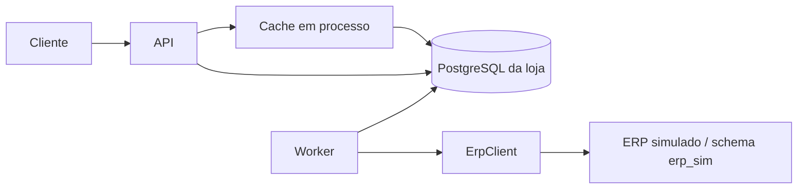

# CaseCellShop — design

**Spec:** [`spec.md`](spec.md) · **Decisões:** [`STATE.md`](../../project/STATE.md)

Como construir: componentes, dados, consultas e parâmetros. O motivo de cada escolha e as alternativas descartadas estão nas ADRs.

## Visão geral



O compose roda o PostgreSQL, um serviço de migração, a API e um worker. O worker faz o envio ao ERP, a reconciliação e a sincronização, e o ERP simulado roda no processo dele.

## Dados

- `products`: SKU, nome, preço em centavos e `synced_at`.
- `inventory`: `on_hand`, `reserved`, `sold_total` e `synced_at`, com `reserved >= 0`, `on_hand >= 0` e quantidade positiva garantidos pelo banco.
- `orders` e `order_items`: status (`pending`, `invoiced` ou `failed`), motivo, preço de cada item, `accepted_at`, `outcome_at` e a marca do SLI de 60 s.
- `idempotency_keys`: a chave (índice único), o hash do payload, o pedido e a data.
- `outbox`: status (`pending`, `dead`, `done` ou `cancelled`), tentativas, `lease_until`, `claim_token`, `first_sent_at`, `last_call_at`, `next_attempt_at`, `reconciled_at`, `traceparent` e `correlationId`.
- `sync_state`: `last_completed_at`.
- Schema `erp_sim`: produtos, preço, estoque e faturas do ERP simulado, acessado só pelo módulo do fake. Tem tipos gerados próprios, que só o módulo do fake e os testes importam.

Todo prazo gravado usa o relógio do banco; o relógio injetável controla só os timers do processo.

## Acesso ao banco (AD-017)

- **Fonte única e tipos gerados (`FND-09`):** as migrações definem as tabelas (`FND-11`). Depois de aplicá-las, o kysely-codegen gera um arquivo de tipos por schema (o da loja e o `erp_sim`), versionado e nunca editado à mão, sem as tabelas de controle do migrador (`kysely_migration` e `kysely_migration_lock`) e sem enum de runtime. O CI gera de novo numa pasta temporária, compara com os arquivos versionados e falha se algum divergir do banco (o `--verify` do gerador faria a mesma comparação, mas lança antes de fechar a própria conexão). Como ninguém edita esses arquivos, o lint desliga neles só as duas regras que o código gerado viola (`consistent-type-definitions` e `no-empty-object-type`).
- **Consultas pelo Kysely,** sobre o mesmo pool do `pg`. Os trechos de SQL deste design são o SQL emitido; o código os escreve pelo builder, com `onConflict(…).doNothing()`, `forUpdate().skipLocked()` e `returning(…)`. Todo valor vai como parâmetro, nunca no texto. Zero linhas afetadas é `numUpdatedRows === 0n` no resultado. A reserva, por exemplo:

  ```ts
  const result = await trx
    .updateTable('inventory')
    .set({ reserved: (eb) => eb('reserved', '+', q) })
    .where('sku', '=', sku)
    .where((eb) => eb(eb('on_hand', '-', eb.ref('reserved')), '>=', q))
    .executeTakeFirst();
  if (result.numUpdatedRows === 0n) { /* desfaz e responde 409 */ }
  ```

- **Formas proibidas (`AI-19`):** `set`, `values` e `doUpdateSet` com callback no lugar do objeto; coluna citada no texto fixo de um `` sql`…` ``, que fica só com funções e literais (`now()`, `make_interval(...)`); comando inteiro em `` sql`…` ``; `sql.raw`, `sql.lit`, `sql.ref`, `sql.id`, `sql.table` e `db.dynamic`; a execução de SQL montado fora do builder (`CompiledQuery.raw`, `executeQuery` com consulta crua, `getExecutor()`); e `.query()` do `pg`, `db.transaction()` e `startTransaction()` fora de `src/db/`. Uma conferência no CI reprova cada uma.
- **Transação (`FND-10`):** o código abre transação só pelo invólucro de `src/db/`. Antes do `COMMIT`, ele roda uma consulta de guarda pelo Kysely: se um erro capturado já abortou a transação, a guarda recebe `25P02`, o invólucro desfaz e rejeita, em vez de o PostgreSQL trocar o `COMMIT` por um `ROLLBACK` sem erro. Um adaptador do pool, passado ao dialeto do Kysely, põe o ouvinte de `error` em toda conexão retirada, dentro ou fora de transação, como o `src/db/client.ts` faz hoje, e descarta a conexão cujo `ROLLBACK` falhou. A guarda que recebe `25P02` vira `500` (defeito do código).
- **Erros:** o SQLSTATE chega em `err.code`, direto do `pg`, sem embrulho do Kysely; o mapeamento do contrato lê dali.
- **O banco continua guardando a regra:** os CHECKs `reserved >= 0` e `on_hand >= 0` ficam como defesa em profundidade, e os prazos usam o `now()` do banco, num fragmento `` sql`now()` ``.

## Checkout (AD-002, AD-006)

**Transação, nesta ordem:**

1. **Chave de idempotência,** com os itens já ordenados por SKU. `INSERT … ON CONFLICT (key) DO NOTHING`, seguido de um `SELECT` quando a chave já existe: um `INSERT` simples que viola o índice único abortaria a transação no PostgreSQL. Uma requisição concorrente com a mesma chave espera no índice até a primeira terminar. Antes da chave vai só a linha do pedido, com o `id` gerado pelo banco, porque a chave aponta para ele (`idempotency_keys.order_id`, FK `NOT NULL`); numa repetição, essa linha some no `ROLLBACK`. Nada é reservado antes da chave (AD-020).
   - O hash é o SHA-256 (`node:crypto`) do payload validado e normalizado, com os itens em ordem de SKU e serializado com as chaves em ordem: o mesmo pedido escrito de outro jeito não vira `422`.
   - Mesma chave e mesmo corpo: `202` com o mesmo `orderId`, a mesma `Location` e o status atual. Outro corpo: `422`. Sem a chave: `400`. Espera além do `lock_timeout` no passo da chave: `409`.
   - Um SKU repetido no mesmo pedido recebe `400`.
2. **Pedido,** com o preço lido do banco e gravado em cada item. SKU inexistente: `422`. Preço diferente do `expectedUnitPrice`: `409` (`price-changed`), com o preço atual e sem reservar.
3. **Mensagem de saída,** com `traceparent` e `correlationId`.
4. **Reserva, por último,** com um `UPDATE` por SKU, em ordem de SKU:

   ```sql
   UPDATE inventory SET reserved = reserved + :q
   WHERE sku = :sku AND on_hand - reserved >= :q
   ```

   O código escreve este `UPDATE` pelo Kysely (ver "Acesso ao banco"). Zero linhas afetadas: a transação é desfeita e a resposta é `409`. No `READ COMMITTED`, o segundo `UPDATE` concorrente espera o lock da linha e reavalia o `WHERE`.

Qualquer falha desfaz a transação inteira, inclusive a chave, e o cliente pode repetir com a mesma chave. A chave vale por pelo menos 24 h; depois da limpeza, a mesma chave cria outro pedido.

**Ordem de lock.** Chave, pedido e mensagem são linhas novas e só disputam o índice da chave. Entre linhas que já existem, toda transação trava na mesma ordem: mensagem da outbox, pedido, estoque por SKU, com um `UPDATE` por linha. Vale para a reserva, a conclusão, o cancelamento e a sincronização.

**Estados do pedido.** `pending` → `invoiced` ou `failed`, sempre por compare-and-set (`WHERE status = 'pending'`); o estoque só muda se a transição afetou uma linha.

**Saída da reserva:**

- **faturado:** na transação que marca `invoiced`, `on_hand` e `reserved` baixam e `sold_total` sobe. A baixa usa `GREATEST(on_hand - :q, 0)` só para respeitar `on_hand >= 0`;
- **rejeição permanente:** `reserved` baixa na transação que marca `failed`;
- **pedido na DLQ:** a reserva fica, porque o pedido ainda pode ser faturado.

<a id="contrato-ad-007"></a>

## Contrato (AD-010)

- **Validação:** o contrato em `src/contract/` (zod) valida toda requisição (parâmetros, query, cabeçalhos e corpo) num middleware que responde `400` em problem+json; o `415` e o `413` vêm do parser de JSON. Nos testes, um helper valida o corpo e os cabeçalhos de toda resposta pelo schema da rota. `Location`, `Retry-After`, `X-Request-Id` e `Cache-Control` têm asserção própria.
- **Geração:** `npm run openapi` gera o `openapi.yaml` (OpenAPI 3.1) a partir do registro de rotas; o CI gera de novo, compara com o commitado e passa o lint (`FND-07`).
- **Limites de entrada:** quantidade de 1 a 10 por item, de 1 a 20 itens por pedido, `Idempotency-Key` com 1 a 128 caracteres ASCII visíveis (o formato do `X-Request-Id`), SKU com 1 a 64 caracteres de `A-Z`, `a-z`, `0-9`, `.`, `_` e `-`, corpo de até 16 KiB, e objetos estritos (`.strict()`, que vira `additionalProperties: false` no OpenAPI).
- **`X-Request-Id`:** aceito se for válido, gerado se não. É o `correlationId` dos logs e volta em toda resposta, inclusive no `202`, e no problem+json. Um `traceparent` de entrada continua o trace.
- **Fluxo assíncrono:** o `202` traz `{ orderId, status, total }`, com o `total` em centavos, e os cabeçalhos `Location: /orders/{orderId}/status` e `Retry-After: 4`, inclusive na repetição com a mesma chave; o `503` traz `Retry-After: 5`, como o do `/health`.
- **`orderId`:** UUID v4 gerado pelo banco (`gen_random_uuid()`), sem ordem previsível; um identificador fora do formato UUID recebe `400`.
- **Status:** `GET /orders/{orderId}/status` responde `200` com `{ orderId, status }`, e com `reason` só no `failed`.
- **Pedido:** `pending`, `invoiced` ou `failed` com o motivo (rejeição do ERP, falta de estoque no ERP ou cancelamento: `erp_rejected`, `erp_out_of_stock` ou `cancelled`). O banco garante que só um pedido `failed` tem motivo, que todo `failed` tem um, e que o motivo é um dos três. Um pedido na DLQ continua `pending`.
- **Preço:** em centavos, como inteiros. O checkout usa o preço do banco, nunca o da requisição, envia-o ao ERP (H3) e devolve o total no `202`. O `expectedUnitPrice`, o preço que o cliente viu, é obrigatório em cada item (AD-018): igual ao do banco, o pedido segue; diferente, `409` com o preço atual, e o cliente confirma de novo.
- **Erros por rota:**
  - `POST /checkout`: `400` (entrada inválida, sem chave, SKU repetido); `409` (sem estoque, preço alterado, mesma chave em andamento); `413` (corpo acima do limite); `415` (conteúdo diferente de JSON); `422` (chave com outro corpo, SKU inexistente); `503`;
  - `GET /orders/{orderId}/status`: `400` (identificador inválido), `404` (pedido inexistente), `503`;
  - `GET /products`: `400` (parâmetro inválido), `503` (catálogo não sincronizado, ou sem entrada e com a origem fora);
  - todas: `default` em problem+json (`500`).
- **Falhas do banco, pelo passo da transação,** com o SQLSTATE lido de `err.code`: `lock_timeout` (`55P03`) no `INSERT` da chave → `409`; qualquer outra (`lock_timeout` em outro passo, `statement_timeout` `57014`, deadlock `40P01`, pool esgotado, falha de conexão) → `503` com `Retry-After`. A transação abortada (`25P02` na guarda do `COMMIT`, `FND-10`) é defeito do código: `500`, com o evento de log `error` `db.transaction_aborted`.
- **Erros:** `application/problem+json` (RFC 9457), com `correlationId` e um `type` por causa, que separa os três `409` e os dois `422`. Um middleware único produz todos, sem stack trace.
  - **Causas (`/problems/<causa>`):** `400` `invalid-request` (validação do contrato, inclusive a falta do `expectedUnitPrice`), `idempotency-key-required` e `duplicate-sku`; `409` `out-of-stock`, `price-changed` e `idempotency-key-in-progress`; `413` `payload-too-large`; `415` `unsupported-media-type`; `422` `idempotency-key-reused` e `unknown-sku`; `404` `not-found`; `503` `service-unavailable`.
  - **`price-changed`:** traz o membro de extensão `currentPrices: [{ sku, unitPrice }]`, com o preço atual de cada item que mudou.
  - A falta da `Idempotency-Key` e o SKU repetido têm causa própria; por isso o handler os confere, além do schema, que declara a chave obrigatória.
- **Listas:** `{ "items": [...], "hasNext": true }`, com `?page=` a partir de 1 e tamanho fixo. Uma página além do fim volta vazia, com `hasNext: false`.

## Vitrine e cache (AD-005)

- **Uma entrada com o catálogo inteiro,** atrás de uma porta `Cache`; as páginas são fatiadas dela. Todas as páginas de um TTL vêm do mesmo instantâneo, e há uma única chave a proteger contra stampede.
- **TTL curto, com jitter.**
- **Single-flight:** uma consulta à origem, mesmo com N requisições simultâneas; uma promessa rejeitada é descartada. Com N réplicas da API, uma expiração gera até N consultas.
- ***Stale-if-error*:** com a origem em erro, a entrada expirada é servida até um teto de idade; depois de uma falha, a entrada antiga é servida direto por alguns segundos antes de tentar a origem de novo; sem entrada, `503` com `Retry-After`.
- **Invalidação só por expiração.** O checkout decide pelo banco, nunca pelo cache.
- **Disponibilidade em faixas:** "disponível", "últimas unidades" e "esgotado". A faixa muda menos que o número exato, então a defasagem do TTL aparece menos, e o estoque exato não é exposto.
- **Antes da primeira sincronização completa,** `503`.
- **`Cache-Control: no-store`** em toda resposta: sem o cabeçalho, um cache intermediário pode aplicar frescor heurístico (RFC 9111 §4.2.2).

## Worker: envio (AD-003)

- **Limite:** um semáforo no processo, em ordem de chegada, para todas as chamadas ao ERP (envio, sincronização e reconciliação). A permissão devolvida vai direto ao primeiro da fila, para quem chega depois não passar à frente.
- **Reivindicação:**
  - o worker adquire primeiro as permissões e só reivindica tantas mensagens quantas permissões tem; cada tentativa segura a sua até a conclusão, para a consulta e a criação não esperarem na fila no meio da tentativa e o lease não correr enquanto a mensagem espera a vez;
  - numa transação curta, com `FOR UPDATE SKIP LOCKED`, grava e faz commit, antes de qualquer chamada: lease, token novo, mais uma tentativa (contada aqui, para uma mensagem que derruba o processo também chegar à DLQ) e `first_sent_at`, se vazio (nunca apagado);
  - uma mensagem só é reivindicada depois do atraso mínimo, contado de `last_call_at`. Vale para retry, lease vencido, reprocessamento e reconciliação;
  - uma mensagem de lease vencido é reivindicada sozinha, e o erro de uma mensagem não interrompe as outras;
  - uma mensagem cujo pedido já não está `pending` é encerrada sem chamar o ERP;
  - uma mensagem que já gastou o limite de tentativas vai para `dead` na reivindicação, sem chamar o ERP: é o caminho da mensagem que derruba o processo, que nunca chega a gravar desfecho.
- **Chamada:**
  - fora da transação, com o preço aceito no checkout (H3);
  - antes de cada chamada, grava `last_call_at` e confere o lease num `UPDATE` só, pelo relógio do banco (`WHERE claim_token = :t AND lease_until > now() + timeout + folga`): sem linha afetada, desiste, e a mensagem volta quando o lease vencer;
  - com `first_sent_at` já preenchido, consulta pela referência antes de criar;
  - o token protege o banco da loja, não o ERP; do lado do ERP, a proteção contra duas criações simultâneas é a H1b.
- **Conclusão:** concluir, adiar, marcar como falho ou mandar para a DLQ só tem efeito com `WHERE claim_token = :t`, para um worker atrasado não sobrescrever o resultado de outro; a transição do pedido segue o compare-and-set; uma conclusão sem linha afetada é contada numa métrica; se gravar o desfecho falhar, o worker repete enquanto o lease vale, até 5 vezes por tentativa, para um erro rápido e persistente não virar um laço contra o banco; esgotadas as repetições, desiste, e a mensagem volta pela reivindicação quando o lease vencer.
- **Desfechos:**
  - transitório ou ambíguo: nova tentativa depois do atraso mínimo mais *full jitter* sobre um exponencial com teto; o jitter espalha os retries depois de uma falha que atingiu muitos pedidos de uma vez;
  - permanente: pedido falho e reserva liberada;
  - limite de tentativas: `dead` (a DLQ), com o pedido `pending`.
- **Encerramento:** no `SIGTERM`, o worker para de reivindicar e espera a chamada em andamento; se o prazo estourar, o lease vence e o token protege o estado. O contêiner roda `node` direto, sem `npm`, para o sinal chegar ao processo.
- **Interface (`src/worker.ts`):** `createWorker({ pool, erp, logger, telemetry, clock, random?, config? })` devolve `start`, `stop` e `pollOnce`.
  - `pollOnce()` faz uma rodada: adquire as permissões livres do semáforo, reivindica até esse número de mensagens, roda as tentativas em paralelo e resolve, depois de todas terminarem, com o número de mensagens reivindicadas. Uma tentativa que lança um erro inesperado conta como ambígua e não interrompe as outras;
  - `start()` não espera a rodada inteira: mantém as tentativas em andamento e reivindica de novo assim que uma permissão volta, para uma chamada lenta não segurar a vazão das outras; quando a reivindicação volta vazia, espera o intervalo de polling pelo relógio injetável. O `stop()` para de reivindicar e espera as tentativas em andamento; um `start()` depois do `stop()` volta a reivindicar, e um `start()` chamado enquanto o `stop()` espera aguarda o `stop()` terminar e então volta a reivindicar (um estado só: parado, rodando ou parando);
  - `random` (padrão `Math.random`) sorteia o jitter, para o teste fixá-lo; `config` sobrepõe os parâmetros da tabela (lease, atraso mínimo, timeout, folga, tentativas, base e teto da espera, polling, limite de chamadas);
  - `erp` é a porta `ErpClient`; o `src/main/worker.ts` monta o ERP simulado sobre o pool próprio dele e a camada anticorrupção por cima.
- **Nos testes:** os prazos gravados correm no relógio do banco, então o teste semeia `lease_until`, `last_call_at` e `next_attempt_at` em vez de esperar; o timeout do ERP e os atrasos do simulado correm no relógio manual. A morte do worker é uma rodada abandonada no meio de uma chamada com o comportamento `hang`, seguida do lease vencido semeado.

## Worker: reconciliação e runbook (AD-003)

- **Reconciliação, periódica:** consulta pela referência as mensagens em `dead` cujo atraso mínimo passou, em lotes ordenados por `reconciled_at`. Se o ERP tem o pedido, conclui como faturado e encerra a mensagem com `WHERE status = 'dead'`. Se não tem, ou se a consulta falhar, a mensagem fica para o runbook.
- **Reprocessar em lote:** um SQL devolve à fila as mensagens em `dead` (por exemplo, as do período de uma queda), zera as tentativas e preserva `first_sent_at`. É seguro, porque cada uma é consultada no ERP antes de qualquer criação, e só depois do atraso mínimo.
- **Cancelar:** depois de o operador confirmar no ERP que o pedido não existe, um SQL, na ordem de lock, encerra a mensagem (`WHERE status = 'dead'`; zero linhas, nada muda), marca o pedido como `failed` e libera a reserva.

| Aqui | No SQS |
| --- | --- |
| lease | visibility timeout |
| tentativas | `maxReceiveCount` |
| `dead` | DLQ |
| SQL de reprocessar em lote | redrive |

## Sincronização (AD-009)

- **Quando:** no worker, uma vez na subida (a carga inicial) e depois uma rodada por intervalo, uma de cada vez: a próxima começa um intervalo depois do início da anterior, ou logo ao fim dela. Ao terminar uma rodada completa, grava `last_completed_at`.
- **Antes de ler o ERP:** guarda `t0`, pelo relógio do banco, e o `sold_total` de cada SKU.
- **Leitura:** produtos, preço e estoque pelo `ErpClient`, página a página.
- **Estoque:** um `UPDATE` por SKU, em ordem de SKU, cada um na sua transação curta:

  ```sql
  UPDATE inventory
  SET on_hand = GREATEST(:erp_on_hand - (sold_total - :sold_total_t0), 0),
      synced_at = :t0
  WHERE sku = :sku AND synced_at < :t0
  ```

  Toda baixa local depois de `t0` é descontada do valor lido: se o ERP já a tinha visto, ela sai duas vezes (erro para menos); se não, o desconto é exato. O `SET` usa o `sold_total` da versão atual da linha. Uma leitura mais antiga nunca sobrescreve uma mais nova, e `reserved` nunca é tocado.
- **Preço e catálogo:** mesma regra, com o `synced_at` de `products`; um SKU novo entra por `INSERT … ON CONFLICT`.
- **SKU ausente:** depois de uma rodada completa, cada SKU que não veio fica com `on_hand = 0`, um a um e em ordem de SKU, pela mesma condição de `synced_at`. Uma rodada incompleta não mexe em nenhum ausente.
- **ERP fora:** a loja segue com o último estoque conhecido; a idade da sincronização dispara alerta. O checkout continua, e os pedidos esperam na fila com a reserva feita.

## ERP simulado e camada anticorrupção (AD-004)

- **ERP simulado:**
  - módulo em processo, atrás da porta `ErpClient`, com estado no schema `erp_sim`, migrações, dados iniciais e pool próprios; o atraso do modo lento acontece fora de transação, para um ERP lento não ocupar as conexões da loja;
  - responde por um transporte simulado, com status HTTP e erros de rede tipados, para a camada anticorrupção classificar o fake do mesmo jeito que classificaria o ERP real;
  - comportamentos: normal; lento; indisponível; rejeição; "fatura sem responder"; "fatura depois do timeout", com atraso abaixo e acima do limite da H4; "erro rápido e fatura depois", que devolve `502` na hora e grava a fatura dentro do limite da H4;
  - implementa H1a (consulta pela referência), H1b (fatura por `INSERT … ON CONFLICT` na referência), H2 (recusa sem estoque) e H3 (fatura pelo preço enviado), e tem um modo sem a H1b.
- **Camada anticorrupção:**
  - adaptador único, com contrato e testes próprios, que traduz o modelo do ERP para o da loja;
  - timeout por `AbortController` disparado pelo relógio injetável;
  - sem retry interno: o retry fica no worker, porque retry em duas camadas multiplica a carga sobre o ERP.
- **Classificação, por operação:**
  - **criação:** sucesso, inclusive o pedido existente devolvido pela H1b; permanente para `422` e falta de estoque (H2); transitório quando a requisição não chegou (conexão recusada, DNS) ou o ERP recusou sem processar (`429`, `503`); ambíguo quando pode ter chegado sem resposta conclusiva (timeout, conexão encerrada depois do envio, `500`, `502`, `504`);
  - **consulta pela referência:** "existe" ou "não existe", este só com o sinal explícito do ERP (`404` com o corpo de pedido inexistente); qualquer outra falha é transitória e nunca leva a uma criação;
  - **catálogo:** sucesso ou transitório;
  - **qualquer operação:** `400`, `401`, `403` e um `404` sem o corpo esperado são erros de configuração ou de contrato: transitórios e com alerta, para que um erro do adaptador ou uma credencial expirada não falhem todos os pedidos de uma vez. Qualquer outro status é ambíguo.
- **Porta `ErpClient` (`src/erp/erp-client.ts`):** cada operação devolve um resultado de lista fechada, nunca uma exceção de negócio:
  - `createOrder(request)`: `ok` (com o pedido do ERP), `permanent` (`reason`: `rejected` ou `out_of_stock`, que viram os motivos `erp_rejected` e `erp_out_of_stock` do pedido), `transient`, `ambiguous` ou `config_error`;
  - `findOrderByReference(reference)`: `found` (com o pedido), `not_found`, `transient` ou `config_error`;
  - `listCatalog(page)`: `ok` (com a página), `transient` ou `config_error`.

  Para o worker, `config_error` é transitório, com o log `erp.config_error` e o counter de erros de configuração.
- **Transporte (`ErpTransport`):** `send(request, signal)` resolve com `{ status, body }` ou rejeita com um `ErpNetworkError` (`code`: `ECONNREFUSED` ou `ENOTFOUND`, a requisição não chegou; `ECONNRESET`, a conexão caiu depois do envio). Respostas do ERP simulado:
  - criação: `201` (fatura nova) ou `200` (a existente, pela H1b), com `{ erpOrderId, reference }`; recusa `422` com `{ code, sku? }`, em que `code` é `out_of_stock` (H2), `unknown_product` ou `rejected`;
  - consulta: `200` com o pedido, ou `404` com `{ code: 'order_not_found' }`;
  - catálogo: `200` com `{ items, hasNext }`.

  Os itens do catálogo vêm com os nomes da porta (`sku`, `name`, `priceCents`, `onHand`). Na camada anticorrupção, `422` com `out_of_stock` é `permanent` por falta de estoque, e qualquer outro `422` é `permanent` por rejeição. Na criação e no catálogo, todo `404` é `config_error`, com ou sem corpo: o corpo `order_not_found` só tem sentido na consulta. Uma criação devolvida pela H1b não baixa o estoque de novo.
- **Camada anticorrupção (`src/erp/acl.ts`):** `createErpClient({ transport, clock, timeoutMs })` devolve a porta. O timeout aborta o sinal da chamada pelo `clock.sleep`, e a chamada abortada é ambígua na criação e transitória na consulta e no catálogo.
- **Roteiro do ERP simulado (`src/erp/sim/index.ts`):** `createSimulatedErp({ pool, clock, withoutH1b? })` devolve `{ transport, script }`. O `script.enqueue(behavior, match?)` põe na fila um comportamento para a próxima chamada que casar com `match` (`op`: `createOrder`, `findOrder` ou `listCatalog`; `reference`, na criação e na consulta), e cada comportamento vale para uma chamada só. Sem comportamento na fila, vale o padrão (`script.setDefault`, inicialmente `normal`); o `src/main/worker.ts` o lê de `ERP_SIM_MODE` (`normal`, `slow` ou `unavailable`). Os atrasos correm no relógio injetável, fora de transação. Comportamentos:
  - `normal`;
  - `slow` (`delayMs`): espera e depois processa e responde como no `normal`; abortada durante a espera, não processa;
  - `unavailable`: rejeita com `ECONNREFUSED`, sem processar;
  - `reject`: `422` com `rejected`, sem processar;
  - `status` (`status`, `body?`): responde esse status, sem processar; cobre `400`, `401`, `403`, o `404` sem o corpo esperado, `429`, `500`, `503` e `504`;
  - `invoice_no_response`: fatura e não responde até o sinal abortar;
  - `invoice_after` (`delayMs`): não responde, e a fatura é gravada `delayMs` depois do início da chamada, mesmo com a chamada já abortada; com atraso abaixo e acima dos 40 s da H4;
  - `fast_502_then_invoice` (`delayMs`): responde `502` na hora e grava a fatura `delayMs` depois;
  - `hang`: nunca responde nem fatura.

  A falta de estoque (H2) e o SKU desconhecido vêm do estado do `erp_sim`, não do roteiro. O `script.drain()` espera terminar toda gravação de fatura já iniciada, a imediata do `invoice_no_response` e as adiadas cujo prazo o relógio já alcançou, para o teste contar as faturas sem `sleep`.
- **Modo sem a H1b:** uma migração nova do `erp_sim` troca a unicidade de `invoices.reference` por uma coluna `dedup_key`, única e anulável, com índice simples em `reference`. Com a H1b, a criação grava `dedup_key = reference` e usa `ON CONFLICT (dedup_key) DO NOTHING`; sem ela, grava `NULL`, e cada criação vira uma fatura nova. A consulta pela referência devolve a fatura mais antiga.

## Observabilidade (AD-008)

- **Logs:** JSON pelo pino. Obrigatórios: `time`, `level`, `service`, `msg`, `event`, `correlationId`, `trace_id`, `span_id`. Quando existirem: `route`, `method`, `status`, `duration_ms`, `cache`, `orderId`, `sku`, `attempt`, `outcome`, `err.code`. O `AsyncLocalStorage` leva o contexto.
  - `info`: checkout aceito, pedido faturado, rodada de sincronização;
  - `warn`: checkout recusado, retry, origem do cache em erro, preço alterado, erro de configuração no ERP;
  - `error`: mensagem na DLQ, falha da sincronização, transação abortada antes do `COMMIT` (`db.transaction_aborted`, `FND-10`).
  - **Checkout (M2):** `info` `checkout.accepted` e `warn` `checkout.rejected` (com a causa) e `checkout.price_changed`, todos com o `orderId` quando ele existe; o log `http_request` do checkout e do status também leva o `orderId`.
  - **Worker (M3):** cada tentativa roda no `logContext` com o `correlationId` gravado na outbox e dentro do span dela, e todo log da tentativa leva `orderId` e `attempt`. Eventos: `info` `order.invoiced` e `outbox.closed` (pedido que já não estava `pending`); `warn` `order.failed` (com o motivo), `outbox.retry` (com o `outcome` que o causou, só quando a mensagem de fato volta à fila), `outbox.lease_short`, `outbox.conclusion_no_row`, `outbox.conclusion_failed` (falha ao gravar o desfecho, antes de repetir) e `erp.config_error` (com o status); `error` `outbox.dead`, `outbox.attempt_error` (erro inesperado na tentativa), `worker.poll_error` (falha da reivindicação no laço do `start()`) e `db.transaction_aborted` (no lugar do `outbox.conclusion_failed`, quando a falha é a transação abortada). O span da tentativa se chama `outbox.attempt`, com os atributos `orderId` e `attempt`. Os eventos que a reivindicação decide sem chamar o ERP (`outbox.closed` e o `outbox.dead` do limite já gasto) rodam num span próprio, `outbox.settle`, filho do mesmo `traceparent`, com `orderId`, `attempt` e `outcome`, para quem conta tentativas no backend de traces não contar encerramentos. Quando a conclusão fecha a mensagem mas o pedido já tinha outro desfecho (mudado fora do fluxo), sai o `outbox.closed` e conta `closed`, para toda mensagem encerrada aparecer no log e no counter.
- **Pacotes** (AD-011): `@opentelemetry/api` 1.10.0, que o SDK 3 exige; SDK 3.0.0 com `sdk-trace` (que substitui o `sdk-trace-base` e o `sdk-trace-node`), `context-async-hooks` e o propagador W3C do `core`, registrados na inicialização, mais `sdk-metrics` e `resources`; exporters 0.300.0 (`exporter-prometheus`, `exporter-trace-otlp-http`). No SDK 3, o provider é o `TracerProvider` do `sdk-trace`, e os processadores recebem `{ exporter }`; nos testes, `forceFlush()` vem antes de ler o `InMemorySpanExporter`.
- **Traces:** spans manuais no middleware HTTP, no cache, nos repositórios, na outbox, no worker, na sincronização e no `ErpClient`. Cada tentativa é um span filho do checkout, retomado pelo `traceparent` da outbox, com `orderId` e número da tentativa. O exportador vem de `OTEL_TRACES_EXPORTER`: nenhum por padrão, para o healthcheck do compose não encher o log a cada 2 s; `console` para ver os traces em desenvolvimento; `otlp` (OTLP/HTTP) para um backend de traces em produção (no Datadog, pelo Agent). Os atributos de recurso `service.name`, `deployment.environment.name` e `service.version` viram `service`, `env` e `version` nos traces e nos logs, com os mesmos valores, porque o Datadog só liga log e trace com a marcação unificada de serviço. O log leva no topo do JSON o `trace_id` (32 caracteres hexadecimais), o `span_id` (16) e o `trace_flags`, os nomes que o OpenTelemetry recomenda.
- **Métricas,** instrumentadas com a API de métricas do OpenTelemetry e expostas em `/metrics` (formato Prometheus) na API e no worker. Counter para eventos, gauge para estado, histogram para durações e idades, com buckets em segundos que incluem os limiares dos SLOs. Labels de uma lista fechada (rota como template, método, classe de status, resultado), nunca `orderId` nem `sku`:
  - **HTTP:** duração por rota (histogram), base dos SLOs de latência;
  - **cache:** `hit`, `miss`, `stale` e consultas à origem (counters); cargas em andamento (gauge); latência da vitrine por resultado, idade da entrada servida e idade do dado desde a leitura do ERP (histograms);
  - **checkout:** desfecho por resultado (counter, desde o M2), com o label `outcome` em `accepted`, `out_of_stock`, `price_changed`, `replay`, `invalid` ou `unavailable`;
  - **fila:** pedidos sem desfecho em 60 s (counter) e aceite ao faturamento (histogram); idade da mensagem mais antiga, pendentes e DLQ (gauges); conclusões sem linha afetada (counter);
  - **estoque:** unidades reservadas e SKUs com `reserved > on_hand` (gauges);
  - **ERP:** duração e desfecho (histogram e counter), chamadas em andamento (gauge), rejeições por falta de estoque e erros de configuração (counters);
  - **sincronização:** idade da última rodada completa (gauge), correções por campo e SKUs ausentes zerados (counters).
- **Nomes das métricas do worker (M3),** no `/metrics` dele:
  - `outbox_attempt_outcome_total` (counter, label `outcome`: `invoiced`, `failed`, `retry`, `dead`, `closed` ou `lease_short`), contado quando o desfecho é gravado: `closed` e o `dead` do limite já gasto na reivindicação, `lease_short` quando a tentativa desiste; a conclusão sem linha afetada não conta aqui, só no counter dela;
  - `outbox_conclusion_no_row_total` (counter, sem label);
  - `order_accept_to_invoice_seconds` (histogram, sem label, com fronteira em 60 s), com o `outcome_at - accepted_at` que o `RETURNING` do `UPDATE` do pedido devolve na própria transação da conclusão, só quando o pedido de fato mudou; o `invoiced` e o `failed` do `outbox_attempt_outcome_total`, e os logs `order.invoiced` e `order.failed`, também só saem nesse caso;
  - `erp_request_duration_seconds` (histogram) e `erp_request_total` (counter), com os labels `operation` (`create_order`, `find_order` ou `list_catalog`) e `outcome` (`ok`, `found`, `not_found`, `permanent`, `transient`, `ambiguous` ou `config_error`), com fronteiras até 30 s, a última em 30;
  - `erp_requests_in_flight` (gauge, sem label);
  - `erp_config_error_total` (counter, label `operation`) e `erp_out_of_stock_rejection_total` (counter, sem label).
- **Gauges e counters lidos do banco** saem da API, que não é o processo monitorado; os alertas de fila e de sincronização também disparam sem dados. Um counter derivado do banco só sobe quando um `UPDATE … RETURNING` marca a linha.
- **Alertas e dashboard:** em PromQL, com os nomes de `/metrics`; um teste confere cada nome usado. No Datadog, o Agent coleta o mesmo endpoint pela integração OpenMetrics, que acrescenta um namespace.

## Fundação (M1)

- **Pontos de injeção,** que os testes usam sem ler o resto de `src/`:
  - `src/app.ts`: `createApp({ pool, logger, telemetry })` devolve o app do Express, sem abrir porta;
  - `src/telemetry.ts`: `createTelemetry({ spanExporter? })` devolve, além do que a API e o worker usam, `forceFlush()` e `shutdown()`; os testes passam o `InMemorySpanExporter` do `sdk-trace`;
  - `src/worker.ts`: `createWorker({ pool, erpPool, logger, telemetry, clock })`, com `start()` e `stop()`; no M3, o `erpPool` dá lugar à porta `erp` (ver "Worker: envio");
  - `src/erp/erp-client.ts`: a porta `ErpClient`, com `listCatalog(page)`, que devolve `{ items: [{ sku, name, priceCents, onHand }], hasNext }`; `createOrder({ reference, items: [{ sku, quantity, unitPriceCents }] })`, que devolve `{ erpOrderId, reference }`; e `findOrderByReference(reference)`, que devolve o mesmo objeto ou `null`;
  - `src/erp/sim/index.ts`: `createSimulatedErpClient({ pool, clock })` monta a porta: a camada anticorrupção sobre o transporte simulado, como na AD-004. No M1, só há o modo normal; a separação entre as duas entra no M3, com os modos de falha. O estado fica no schema `erp_sim`, com as tabelas `erp_sim.products (sku, name, price_cents, on_hand)` e `erp_sim.invoices (id, reference único, items, total_cents, created_at)`; os testes criam produtos e contam faturas por SQL nelas;
  - `src/clock.ts`: a porta `Clock`, com `now()` em milissegundos e `sleep(ms)`; os testes usam um relógio manual;
  - `src/db/migrate.ts`: `migrate(pool)` aplica as migrações dos dois schemas (a partir do M2, `migrate(pool, folders = MIGRATION_FOLDERS)`, com `folders` como lista de `{ dir, schema }`, para os testes do `FND-11` usarem pastas próprias), e `seed(pool)` grava os dados iniciais do `erp_sim`;
  - `src/db/database.ts` (M2, AD-017): `createDb(pool)` e `createErpDb(pool)` devolvem o `Kysely` tipado de cada schema, o da loja e o `erp_sim`, os dois sobre `createPoolAdapter(pool)`, o adaptador do pool passado ao `PostgresDialect` (ouvinte de `error` em toda conexão retirada; descarte da conexão cujo `ROLLBACK` falhou); `runInTransaction(db, fn)` é o único invólucro de transação, com a guarda antes do `COMMIT`, e rejeita com `TransactionAbortedError` quando a guarda recebe `25P02` (`FND-10`);
  - `src/db/types/store.ts` e `src/db/types/erp-sim.ts` (M2): os tipos gerados de cada schema, cada um com a interface `DB` que o kysely-codegen emite;
  - `scripts/check-db-types.ts` (M2): `checkDbTypes({ databaseUrl, folders?, outDir?, write? })` aplica as migrações de `folders` no banco de `databaseUrl`, roda o kysely-codegen uma vez por schema, com todas as opções por flag e a pasta de trabalho numa pasta temporária vazia (onde ele não acha configuração), e devolve as divergências, uma frase por arquivo; com `write`, grava os arquivos em vez de conferir. Rodado direto, sobe o próprio PostgreSQL pelo Testcontainers; `--write` gera os tipos de novo depois de uma migração nova;
  - `scripts/check-kysely-usage.ts` (M2): `findKyselyViolations(files, columns)` recebe os arquivos (`{ path, content }`) e as colunas dos tipos gerados e devolve as violações do `AI-19`, uma frase por ocorrência, com arquivo e linha; rodado direto, confere `src/`;
  - `scripts/check-instructions.ts`: `checkInstructions(rootDir)` devolve as violações dos limites do que carrega em toda sessão (`FND-06`), uma frase por arquivo; o script falha se houver alguma, e importar o módulo não roda a conferência.
  - `scripts/generate-openapi.ts`: com `--check`, falha se o arquivo divergir do contrato; `--file <caminho>` troca o `openapi.yaml` da raiz por outro.
- **Spans do M1:** o da requisição é `SERVER`, com o nome `<método> <rota>` (como `GET /health`) e o atributo `http.route`; o de repositório é `CLIENT`, com o nome `<repositório>.<operação>` (como `health.ping`) e o atributo `db.system.name` igual a `postgresql`.
- **Migrações:** até a primeira fatia do M2, node-pg-migrate com arquivos `.sql`; a partir dela, o `Migrator` do Kysely (AD-017, `FND-11`):
  - arquivos `.ts` em `migrations/store/` e `migrations/erp_sim/`, com nome `AAAAMMDDHHMMSS_nome.ts`, que exportam `up` e `down` sobre `Kysely<any>`; a estrutura sai do construtor de esquema, e o `` sql`…` `` fica para a condição de um CHECK e o `now()` de um valor padrão;
  - o `migrate(pool, folders)` roda um `Migrator` por pasta, na ordem loja e depois `erp_sim`, com o `FileMigrationProvider` (pasta em caminho absoluto) e a tabela de controle no schema da pasta (`migrationTableSchema`: `public` e `erp_sim`); e um `error` no resultado do `migrateToLatest()` é lançado;
  - dois ganchos do provider fecham o que ele pularia ou aceitaria em silêncio: o `onFileIgnored` lança para todo arquivo ignorado, fora o `.gitkeep`; e o `import` lança quando o caminho não termina em `.ts` e quando o módulo não exporta `down`, antes de devolvê-lo;
  - o `Migrator` espera pelo *advisory lock*, reprova migração fora de ordem e aplica as pendentes de cada schema numa transação só;
  - uma migração que altera uma tabela em uso (um `ALTER TABLE` sobre `orders`, por exemplo) começa o `up` com `SET LOCAL lock_timeout`: sem limite no pool de migração, ela esperaria o `ACCESS EXCLUSIVE` sem fim e travaria as consultas que chegassem depois. Como as pendentes do schema rodam numa transação só, esse limite vale também para as migrações seguintes do lote, e o lock da tabela fica até o `COMMIT` do lote inteiro. A espera pelo *advisory lock* do migrador não depende dele: o Kysely 0.29.7 a limita a 1 h no próprio `acquireMigrationLock`, antes de abrir a transação;
  - o `migrate` monta o Kysely sobre o `createPoolAdapter` (`FND-10`); o serviço `migrate` do compose usa o `createMigrationPool` de `src/db/pool.ts`, um pool só dele, sem `statement_timeout` nem `lock_timeout` (o padrão do `pg` é não ter limite), porque o pool das requisições corta comandos acima de 5 s, o que alcança a espera pelo *advisory lock* e uma migração longa, e esperas de lock acima de 2 s, o que alcança os locks pedidos dentro de uma migração;
  - `migrations` entra no `include` do `tsconfig.json`, e um `overrides` do `.oxlintrc.json` para `**/migrations/**/*.ts` desliga só o `typescript/no-explicit-any`; as migrações de teste ficam em `test/fixtures/migrations/`, dentro do repositório, para o `import 'kysely'` delas resolver;
  - uma migração só importa de `kysely`, sem import de `src/` nem relativo, para uma constante da aplicação não mudar o esquema de uma migração antiga;
  - como o migrador não confere o conteúdo do que já rodou, o CI falha se um PR alterar ou apagar uma migração que já está na `main` (`AI-01`);
  - depois das migrações, o kysely-codegen gera os tipos do banco, e o CI confere que eles estão em dia (`FND-09`).

  A migração do `erp_sim`, reescrita em TypeScript com o mesmo esquema da `.sql`, fica assim:

  ```ts
  import { type Kysely, sql } from 'kysely';

  export async function up(db: Kysely<any>): Promise<void> {
    await db.schema.createSchema('erp_sim').ifNotExists().execute();
    const schema = db.schema.withSchema('erp_sim');
    await schema
      .createTable('products')
      .addColumn('sku', 'text', (col) => col.primaryKey())
      .addColumn('name', 'text', (col) => col.notNull())
      .addColumn('price_cents', 'integer', (col) => col.notNull().check(sql`price_cents >= 0`))
      .addColumn('on_hand', 'integer', (col) => col.notNull().check(sql`on_hand >= 0`))
      .execute();
    // A referência única é a H1b: criar duas vezes devolve a mesma fatura.
    await schema
      .createTable('invoices')
      .addColumn('id', 'bigint', (col) => col.generatedAlwaysAsIdentity().primaryKey())
      .addColumn('reference', 'text', (col) => col.notNull().unique())
      .addColumn('items', 'jsonb', (col) => col.notNull())
      .addColumn('total_cents', 'bigint', (col) => col.notNull().check(sql`total_cents >= 0`))
      .addColumn('created_at', 'timestamptz', (col) => col.notNull().defaultTo(sql`now()`))
      .execute();
  }

  export async function down(db: Kysely<any>): Promise<void> {
    const schema = db.schema.withSchema('erp_sim');
    await schema.dropTable('invoices').execute();
    await schema.dropTable('products').execute();
  }
  ```

- **Dados iniciais:** `seed(pool)` grava o catálogo de exemplo do `erp_sim` com `ON CONFLICT DO NOTHING`, e só o serviço `migrate` do compose o roda, depois das migrações. Os testes não o rodam: cada um cria os dados que usa.
- **`/health`:** `200` se o banco responde a um `SELECT 1` feito pelo repositório; senão, `503` em problem+json. Fica no contrato; o `/metrics` fica fora dele.
- **`X-Request-Id`:** aceito com 1 a 128 caracteres ASCII visíveis; fora disso, um UUID novo.
- **`type` dos erros:** `/problems/<causa>`, como `/problems/invalid-request`.
- **Healthcheck do PostgreSQL por TCP:** `pg_isready --host 127.0.0.1`, como recomendam os mantenedores da imagem oficial. Na primeira subida, a imagem oficial roda um servidor temporário que só escuta no socket Unix (`listen_addresses=''`); um `pg_isready` sem `-h` testa o socket e marca o banco saudável antes de a porta TCP abrir, e o `migrate` recebe `ECONNREFUSED`.
- **Compose:** `postgres`, `migrate`, `api`, `worker` e `jaeger` (interface em `${JAEGER_UI_PORT:-16686}`; o OTLP/HTTP, na 4318, fica só na rede do compose, sem autenticação exposta; a API e o worker usam `OTEL_TRACES_EXPORTER=otlp`, `OTEL_EXPORTER_OTLP_ENDPOINT` e `OTEL_SERVICE_NAME`), com as credenciais locais como padrão no `compose.yaml`, sem `.env`, que os agentes não leem. O `.dockerignore` deixa de fora `test/` e `**/*.test.ts`. A API publica a porta `${API_PORT:-3000}`. O teste do `FND-01` sobe esse arquivo pelo `DockerComposeEnvironment` do Testcontainers, com nome de projeto próprio e a `API_PORT` e a `JAEGER_UI_PORT` livres, sem conflitar com o compose de desenvolvimento.
- **Lint do OpenAPI:** Redocly com `recommended-strict`, em que aviso também reprova. O contrato declara `servers: [{ url: '/' }]` e `security: []` nas rotas públicas. Uma regra que não se aplica a uma rota é desligada só para ela, no `redocly.yaml`, com o motivo num comentário.
- **Limite das instruções (`FND-06`):** linhas contadas como no `wc -l`: até 200 no `AGENTS.md` e no `CLAUDE.md` (recomendação do Claude Code), a mesma régua em cada agente (escolha do projeto) e até 500 em cada `SKILL.md` (recomendação do Claude Code). As specs não têm teto (AD-012).

## Parâmetros

Ficam em configuração. Os que dependem de carga saem das premissas do [`PROJECT.md`](../../project/PROJECT.md).

| Parâmetro | Valor | De onde sai |
| --- | --- | --- |
| SLO da vitrine | 99,9% sem `5xx` em 30 dias; 99% em até 200 ms | Leitura do cache em memória |
| SLO do checkout | 99,9% sem `5xx` em 30 dias; 99% em até 500 ms | Transação curta, sem o ERP; `4xx` não consome o orçamento |
| SLO do aceite ao faturamento | 99% com desfecho em até 60 s | Polling, mais a chamada ao ERP, mais folga para um retry. SLI: pedidos com desfecho em até 60 s sobre os aceitos; os atrasados (`outcome_at` vazio ou depois de `accepted_at + 60 s`) são marcados uma vez pela verificação periódica da API |
| TTL do cache | 5 s ± 10% | Defasagem aceitável; o checkout decide pelo banco |
| Teto do *stale-if-error* | 60 s | Cobre falha curta da origem sem servir dado antigo demais |
| Pausa depois de falha da origem | 5 s | A requisição não espera o timeout da origem |
| Tamanho da página | 50 itens | Fatiadas da entrada única |
| "Últimas unidades" | até 5 livres | Escassez sem expor o número |
| Intervalo da sincronização | 60 s | Defasagem de até 65,5 s mais a rodada; uma leitura do catálogo por minuto no ERP |
| Timeout do ERP | 10 s | Acima do p99,9 da premissa (8 s) |
| Atraso mínimo | 45 s desde o início da última chamada | H4 (40 s) mais 5 s para a ida da requisição |
| Lease | 30 s | Consulta e criação (2 × 10 s), com a permissão do semáforo já em mãos, mais folga; desiste se restar menos que timeout + 2 s |
| Encerramento | 25 s no processo; `stop_grace_period: 30s` | O Docker manda `SIGKILL` 10 s depois do `SIGTERM` por padrão, então o compose precisa de prazo maior que o do processo |
| Chamadas simultâneas ao ERP | 30 | Pico de ~7 pedidos/s × ~3 s ≈ 21 em voo; vazão de ~10/s, com folga para retries, consultas e sincronização |
| Polling da outbox vazia | 500 ms | Início rápido sem carga relevante |
| `Retry-After` do `202` | 4 s | Polling (0,5 s) mais a mediana do ERP (~3 s) |
| `Retry-After` do `503` | 5 s | O mesmo do `/health`: tempo para um lock ou o banco se recuperar |
| Limites do checkout | 1 a 10 por item; 1 a 20 itens; chave até 128 caracteres; corpo até 16 KiB | Um pedido de varejo de capinhas; o limite barra o corpo enorme antes da transação |
| Tentativas e espera | 12; atraso mínimo + *full jitter* sobre exponencial de base 5 s e teto de 5 min | ~23 min em média e até ~39 min antes da DLQ |
| Reconciliação | 5 min, até 100 mensagens por rodada | Um pedido na DLQ não exige reação em segundos; o alerta de DLQ já avisa; o grosso sai pelo reprocessamento em lote |
| Chave de idempotência | pelo menos 24 h | Retries do cliente e reenvio no dia seguinte |
| Pools, por processo | API 10; worker 10; ERP simulado 10; migração 2, sem `statement_timeout` nem `lock_timeout`, com espera por conexão de 1 s | A chamada ao ERP não segura conexão: a reivindicação e a conclusão são transações de milissegundos; total de 30, e 32 enquanto o `migrate` roda, abaixo do `max_connections` padrão de 100 |
| `statement_timeout` / `lock_timeout` / espera por conexão | 5 s / 2 s / 1 s | Nenhuma requisição espera indefinidamente |
