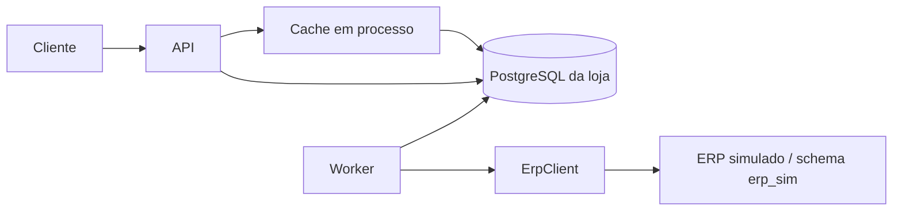

# CaseCellShop — design

**Spec:** [`spec.md`](spec.md) · **Decisões:** [`STATE.md`](../../project/STATE.md)

Como construir: componentes, dados, consultas e parâmetros. O motivo de cada escolha e as alternativas descartadas estão nas ADRs.

## Visão geral



O compose roda o PostgreSQL, um serviço de migração, a API e um worker. O worker faz o envio ao ERP, a reconciliação e a sincronização, e o ERP simulado roda no processo dele.

## Dados

- `products`: SKU, nome, preço em centavos e `synced_at`.
- `inventory`: `on_hand`, `reserved`, `sold_total` e `synced_at`, com `reserved >= 0`, `on_hand >= 0` e quantidade positiva garantidos pelo banco.
- `orders` e `order_items`: status (`pending`, `invoiced` ou `failed`), motivo, preço de cada item, `accepted_at`, `outcome_at` e a marca do SLI de 60 s.
- `idempotency_keys`: a chave (índice único), o hash do payload, o pedido e a data.
- `outbox`: status (`pending`, `dead`, `done` ou `cancelled`), tentativas, `lease_until`, `claim_token`, `first_sent_at`, `last_call_at`, `next_attempt_at`, `reconciled_at`, `traceparent` e `correlationId`.
- `sync_state`: `last_completed_at`.
- Schema `erp_sim`: produtos, preço, estoque e faturas do ERP simulado, acessado só pelo módulo do fake.

Todo prazo gravado usa o relógio do banco; o relógio injetável controla só os timers do processo.

## Checkout (AD-002, AD-006)

**Transação, nesta ordem:**

1. **Chave de idempotência,** com os itens já ordenados por SKU. `INSERT … ON CONFLICT (key) DO NOTHING`, seguido de um `SELECT` quando a chave já existe: um `INSERT` simples que viola o índice único abortaria a transação no PostgreSQL. Uma requisição concorrente com a mesma chave espera no índice até a primeira terminar.
   - O hash é do payload validado e normalizado, serializado com as chaves em ordem: o mesmo pedido escrito de outro jeito não vira `422`.
   - Mesma chave e mesmo corpo: `202` com o mesmo `orderId`, a mesma `Location` e o status atual. Outro corpo: `422`. Sem a chave: `400`. Espera além do `lock_timeout` no passo da chave: `409`.
   - Um SKU repetido no mesmo pedido recebe `400`.
2. **Pedido,** com o preço lido do banco e gravado em cada item. SKU inexistente: `422`. Preço diferente do `expectedUnitPrice` informado: `409` (`price-changed`), com o preço atual e sem reservar.
3. **Mensagem de saída,** com `traceparent` e `correlationId`.
4. **Reserva, por último,** com um `UPDATE` por SKU, em ordem de SKU:

   ```sql
   UPDATE inventory SET reserved = reserved + :q
   WHERE sku = :sku AND on_hand - reserved >= :q
   ```

   Zero linhas afetadas: a transação é desfeita e a resposta é `409`. No `READ COMMITTED`, o segundo `UPDATE` concorrente espera o lock da linha e reavalia o `WHERE`.

Qualquer falha desfaz a transação inteira, inclusive a chave, e o cliente pode repetir com a mesma chave. A chave vale por pelo menos 24 h; depois da limpeza, a mesma chave cria outro pedido.

**Ordem de lock.** Chave, pedido e mensagem são linhas novas e só disputam o índice da chave. Entre linhas que já existem, toda transação trava na mesma ordem: mensagem da outbox, pedido, estoque por SKU, com um `UPDATE` por linha. Vale para a reserva, a conclusão, o cancelamento e a sincronização.

**Estados do pedido.** `pending` → `invoiced` ou `failed`, sempre por compare-and-set (`WHERE status = 'pending'`); o estoque só muda se a transição afetou uma linha.

**Saída da reserva:**

- **faturado:** na transação que marca `invoiced`, `on_hand` e `reserved` baixam e `sold_total` sobe. A baixa usa `GREATEST(on_hand - :q, 0)` só para respeitar `on_hand >= 0`;
- **rejeição permanente:** `reserved` baixa na transação que marca `failed`;
- **pedido na DLQ:** a reserva fica, porque o pedido ainda pode ser faturado.

<a id="contrato-ad-007"></a>

## Contrato (AD-010)

- **Validação:** o contrato em `src/contract/` (zod) valida toda requisição (parâmetros, query, cabeçalhos e corpo) num middleware que responde `400` em problem+json; o `415` e o `413` vêm do parser de JSON. Nos testes, um helper valida o corpo e os cabeçalhos de toda resposta pelo schema da rota. `Location`, `Retry-After`, `X-Request-Id` e `Cache-Control` têm asserção própria.
- **Geração:** `npm run openapi` gera o `openapi.yaml` (OpenAPI 3.1) a partir do registro de rotas; o CI gera de novo, compara com o commitado e passa o lint (`FND-07`).
- **Limites de entrada:** quantidade de 1 a um máximo, número de itens, tamanho da chave e do corpo, objetos estritos (`.strict()`, que vira `additionalProperties: false` no OpenAPI).
- **`X-Request-Id`:** aceito se for válido, gerado se não. É o `correlationId` dos logs e volta em toda resposta, inclusive no `202`, e no problem+json. Um `traceparent` de entrada continua o trace.
- **Fluxo assíncrono:** o `202` traz `Location` e `Retry-After`; o `503` também traz `Retry-After`.
- **Pedido:** `pending`, `invoiced` ou `failed` com o motivo (rejeição do ERP, falta de estoque no ERP ou cancelamento). Um pedido na DLQ continua `pending`.
- **Preço:** em centavos, como inteiros. O checkout usa o preço do banco, nunca o da requisição, envia-o ao ERP (H3) e devolve o total no `202`. Sem `expectedUnitPrice`, vale o preço do banco.
- **Erros por rota:**
  - `POST /checkout`: `400` (entrada inválida, sem chave, SKU repetido); `409` (sem estoque, preço alterado, mesma chave em andamento); `413` (corpo acima do limite); `415` (conteúdo diferente de JSON); `422` (chave com outro corpo, SKU inexistente); `503`;
  - `GET /orders/{orderId}/status`: `400` (identificador inválido), `404` (pedido inexistente), `503`;
  - `GET /products`: `400` (parâmetro inválido), `503` (catálogo não sincronizado, ou sem entrada e com a origem fora);
  - todas: `default` em problem+json (`500`).
- **Falhas do banco, pelo passo da transação:** `lock_timeout` (`55P03`) no `INSERT` da chave → `409`; qualquer outra (`lock_timeout` em outro passo, `statement_timeout` `57014`, deadlock `40P01`, pool esgotado, falha de conexão) → `503` com `Retry-After`.
- **Erros:** `application/problem+json` (RFC 9457), com `correlationId` e um `type` por causa, que separa os três `409` e os dois `422`. Um middleware único produz todos, sem stack trace.
- **Listas:** `{ "items": [...], "hasNext": true }`, com `?page=` a partir de 1 e tamanho fixo. Uma página além do fim volta vazia, com `hasNext: false`.

## Vitrine e cache (AD-005)

- **Uma entrada com o catálogo inteiro,** atrás de uma porta `Cache`; as páginas são fatiadas dela. Todas as páginas de um TTL vêm do mesmo instantâneo, e há uma única chave a proteger contra stampede.
- **TTL curto, com jitter.**
- **Single-flight:** uma consulta à origem, mesmo com N requisições simultâneas; uma promessa rejeitada é descartada. Com N réplicas da API, uma expiração gera até N consultas.
- ***Stale-if-error*:** com a origem em erro, a entrada expirada é servida até um teto de idade; depois de uma falha, a entrada antiga é servida direto por alguns segundos antes de tentar a origem de novo; sem entrada, `503` com `Retry-After`.
- **Invalidação só por expiração.** O checkout decide pelo banco, nunca pelo cache.
- **Disponibilidade em faixas:** "disponível", "últimas unidades" e "esgotado". A faixa muda menos que o número exato, então a defasagem do TTL aparece menos, e o estoque exato não é exposto.
- **Antes da primeira sincronização completa,** `503`.
- **`Cache-Control: no-store`** em toda resposta: sem o cabeçalho, um cache intermediário pode aplicar frescor heurístico (RFC 9111 §4.2.2).

## Worker: envio (AD-003)

- **Limite:** um semáforo no processo, em ordem de chegada, para todas as chamadas ao ERP (envio, sincronização e reconciliação).
- **Reivindicação:**
  - o worker adquire primeiro as permissões e só reivindica tantas mensagens quantas permissões tem; cada tentativa segura a sua até a conclusão, para a consulta e a criação não esperarem na fila no meio da tentativa e o lease não correr enquanto a mensagem espera a vez;
  - numa transação curta, com `FOR UPDATE SKIP LOCKED`, grava e faz commit, antes de qualquer chamada: lease, token novo, mais uma tentativa (contada aqui, para uma mensagem que derruba o processo também chegar à DLQ) e `first_sent_at`, se vazio (nunca apagado);
  - uma mensagem só é reivindicada depois do atraso mínimo, contado de `last_call_at`. Vale para retry, lease vencido, reprocessamento e reconciliação;
  - uma mensagem de lease vencido é reivindicada sozinha, e o erro de uma mensagem não interrompe as outras;
  - uma mensagem cujo pedido já não está `pending` é encerrada sem chamar o ERP.
- **Chamada:**
  - fora da transação, com o preço aceito no checkout (H3);
  - antes de cada chamada, grava `last_call_at` e confere o lease: se restar menos que o timeout mais uma folga, desiste;
  - com `first_sent_at` já preenchido, consulta pela referência antes de criar;
  - o token protege o banco da loja, não o ERP; do lado do ERP, a proteção contra duas criações simultâneas é a H1b.
- **Conclusão:** concluir, adiar, marcar como falho ou mandar para a DLQ só tem efeito com `WHERE claim_token = :t`, para um worker atrasado não sobrescrever o resultado de outro; a transição do pedido segue o compare-and-set; uma conclusão sem linha afetada é contada numa métrica; se gravar o desfecho falhar, o worker repete enquanto o lease vale.
- **Desfechos:**
  - transitório ou ambíguo: nova tentativa depois do atraso mínimo mais *full jitter* sobre um exponencial com teto; o jitter espalha os retries depois de uma falha que atingiu muitos pedidos de uma vez;
  - permanente: pedido falho e reserva liberada;
  - limite de tentativas: `dead` (a DLQ), com o pedido `pending`.
- **Encerramento:** no `SIGTERM`, o worker para de reivindicar e espera a chamada em andamento; se o prazo estourar, o lease vence e o token protege o estado. O contêiner roda `node` direto, sem `npm`, para o sinal chegar ao processo.

## Worker: reconciliação e runbook (AD-003)

- **Reconciliação, periódica:** consulta pela referência as mensagens em `dead` cujo atraso mínimo passou, em lotes ordenados por `reconciled_at`. Se o ERP tem o pedido, conclui como faturado e encerra a mensagem com `WHERE status = 'dead'`. Se não tem, ou se a consulta falhar, a mensagem fica para o runbook.
- **Reprocessar em lote:** um SQL devolve à fila as mensagens em `dead` (por exemplo, as do período de uma queda), zera as tentativas e preserva `first_sent_at`. É seguro, porque cada uma é consultada no ERP antes de qualquer criação, e só depois do atraso mínimo.
- **Cancelar:** depois de o operador confirmar no ERP que o pedido não existe, um SQL, na ordem de lock, encerra a mensagem (`WHERE status = 'dead'`; zero linhas, nada muda), marca o pedido como `failed` e libera a reserva.

| Aqui | No SQS |
| --- | --- |
| lease | visibility timeout |
| tentativas | `maxReceiveCount` |
| `dead` | DLQ |
| SQL de reprocessar em lote | redrive |

## Sincronização (AD-009)

- **Quando:** no worker, uma vez na subida (a carga inicial) e depois uma rodada por intervalo, uma de cada vez: a próxima começa um intervalo depois do início da anterior, ou logo ao fim dela. Ao terminar uma rodada completa, grava `last_completed_at`.
- **Antes de ler o ERP:** guarda `t0`, pelo relógio do banco, e o `sold_total` de cada SKU.
- **Leitura:** produtos, preço e estoque pelo `ErpClient`, página a página.
- **Estoque:** um `UPDATE` por SKU, em ordem de SKU, cada um na sua transação curta:

  ```sql
  UPDATE inventory
  SET on_hand = GREATEST(:erp_on_hand - (sold_total - :sold_total_t0), 0),
      synced_at = :t0
  WHERE sku = :sku AND synced_at < :t0
  ```

  Toda baixa local depois de `t0` é descontada do valor lido: se o ERP já a tinha visto, ela sai duas vezes (erro para menos); se não, o desconto é exato. O `SET` usa o `sold_total` da versão atual da linha. Uma leitura mais antiga nunca sobrescreve uma mais nova, e `reserved` nunca é tocado.
- **Preço e catálogo:** mesma regra, com o `synced_at` de `products`; um SKU novo entra por `INSERT … ON CONFLICT`.
- **SKU ausente:** depois de uma rodada completa, cada SKU que não veio fica com `on_hand = 0`, um a um e em ordem de SKU, pela mesma condição de `synced_at`. Uma rodada incompleta não mexe em nenhum ausente.
- **ERP fora:** a loja segue com o último estoque conhecido; a idade da sincronização dispara alerta. O checkout continua, e os pedidos esperam na fila com a reserva feita.

## ERP simulado e camada anticorrupção (AD-004)

- **ERP simulado:**
  - módulo em processo, atrás da porta `ErpClient`, com estado no schema `erp_sim`, migrações, dados iniciais e pool próprios; o atraso do modo lento acontece fora de transação, para um ERP lento não ocupar as conexões da loja;
  - responde por um transporte simulado, com status HTTP e erros de rede tipados, para a camada anticorrupção classificar o fake do mesmo jeito que classificaria o ERP real;
  - comportamentos: normal; lento; indisponível; rejeição; "fatura sem responder"; "fatura depois do timeout", com atraso abaixo e acima do limite da H4; "erro rápido e fatura depois", que devolve `502` na hora e grava a fatura dentro do limite da H4;
  - implementa H1a (consulta pela referência), H1b (fatura por `INSERT … ON CONFLICT` na referência), H2 (recusa sem estoque) e H3 (fatura pelo preço enviado), e tem um modo sem a H1b.
- **Camada anticorrupção:**
  - adaptador único, com contrato e testes próprios, que traduz o modelo do ERP para o da loja;
  - timeout por `AbortController` disparado pelo relógio injetável;
  - sem retry interno: o retry fica no worker, porque retry em duas camadas multiplica a carga sobre o ERP.
- **Classificação, por operação:**
  - **criação:** sucesso, inclusive o pedido existente devolvido pela H1b; permanente para `422` e falta de estoque (H2); transitório quando a requisição não chegou (conexão recusada, DNS) ou o ERP recusou sem processar (`429`, `503`); ambíguo quando pode ter chegado sem resposta conclusiva (timeout, conexão encerrada depois do envio, `500`, `502`, `504`);
  - **consulta pela referência:** "existe" ou "não existe", este só com o sinal explícito do ERP (`404` com o corpo de pedido inexistente); qualquer outra falha é transitória e nunca leva a uma criação;
  - **catálogo:** sucesso ou transitório;
  - **qualquer operação:** `400`, `401`, `403` e um `404` sem o corpo esperado são erros de configuração ou de contrato: transitórios e com alerta, para que um erro do adaptador ou uma credencial expirada não falhem todos os pedidos de uma vez. Qualquer outro status é ambíguo.

## Observabilidade (AD-008)

- **Logs:** JSON pelo pino. Obrigatórios: `time`, `level`, `service`, `msg`, `event`, `correlationId`, `trace_id`, `span_id`. Quando existirem: `route`, `method`, `status`, `duration_ms`, `cache`, `orderId`, `sku`, `attempt`, `outcome`, `err.code`. O `AsyncLocalStorage` leva o contexto.
  - `info`: checkout aceito, pedido faturado, rodada de sincronização;
  - `warn`: checkout recusado, retry, origem do cache em erro, preço alterado, erro de configuração no ERP;
  - `error`: mensagem na DLQ, falha da sincronização.
- **Pacotes** (AD-011): `@opentelemetry/api` 1.10.0, que o SDK 3 exige; SDK 3.0.0 com `sdk-trace` (que substitui o `sdk-trace-base` e o `sdk-trace-node`), `context-async-hooks` e o propagador W3C do `core`, registrados na inicialização, mais `sdk-metrics` e `resources`; exporters 0.300.0 (`exporter-prometheus`, `exporter-trace-otlp-http`).
- **Traces:** spans manuais no middleware HTTP, no cache, nos repositórios, na outbox, no worker, na sincronização e no `ErpClient`. Cada tentativa é um span filho do checkout, retomado pelo `traceparent` da outbox, com `orderId` e número da tentativa. Console em desenvolvimento; OTLP/HTTP para um backend de traces em produção (no Datadog, pelo Agent). Os atributos de recurso `service.name`, `deployment.environment.name` e `service.version` viram `service`, `env` e `version`.
- **Métricas,** instrumentadas com a API de métricas do OpenTelemetry e expostas em `/metrics` (formato Prometheus) na API e no worker. Counter para eventos, gauge para estado, histogram para durações e idades, com buckets em segundos que incluem os limiares dos SLOs. Labels de uma lista fechada (rota como template, método, classe de status, resultado), nunca `orderId` nem `sku`:
  - **HTTP:** duração por rota (histogram), base dos SLOs de latência;
  - **cache:** `hit`, `miss`, `stale` e consultas à origem (counters); cargas em andamento (gauge); latência da vitrine por resultado, idade da entrada servida e idade do dado desde a leitura do ERP (histograms);
  - **checkout:** desfecho por resultado (aceito, sem estoque, preço alterado, repetição, inválido, indisponível) (counter);
  - **fila:** pedidos sem desfecho em 60 s (counter) e aceite ao faturamento (histogram); idade da mensagem mais antiga, pendentes e DLQ (gauges); conclusões sem linha afetada (counter);
  - **estoque:** unidades reservadas e SKUs com `reserved > on_hand` (gauges);
  - **ERP:** duração e desfecho (histogram e counter), chamadas em andamento (gauge), rejeições por falta de estoque e erros de configuração (counters);
  - **sincronização:** idade da última rodada completa (gauge), correções por campo e SKUs ausentes zerados (counters).
- **Gauges e counters lidos do banco** saem da API, que não é o processo monitorado; os alertas de fila e de sincronização também disparam sem dados. Um counter derivado do banco só sobe quando um `UPDATE … RETURNING` marca a linha.
- **Alertas e dashboard:** em PromQL, com os nomes de `/metrics`; um teste confere cada nome usado. No Datadog, o Agent coleta o mesmo endpoint pela integração OpenMetrics, que acrescenta um namespace.

## Fundação (M1)

- **Pontos de injeção,** que os testes usam sem ler o resto de `src/`:
  - `src/app.ts`: `createApp({ pool, logger, telemetry })` devolve o app do Express, sem abrir porta;
  - `src/telemetry.ts`: `createTelemetry({ spanExporter? })`; os testes passam o `InMemorySpanExporter` do `sdk-trace`;
  - `src/worker.ts`: `createWorker({ pool, erpPool, logger, telemetry, clock })`, com `start()` e `stop()`;
  - `src/erp/erp-client.ts`: a porta `ErpClient` (`listCatalog(page)`, `createOrder(order)`, `findOrderByReference(reference)`); `src/erp/sim/` a implementa;
  - `src/clock.ts`: a porta `Clock`;
  - `src/db/migrate.ts`: `migrate(pool)` aplica as migrações dos dois schemas, e `seed(pool)` grava os dados iniciais do `erp_sim`.
- **Migrações:** node-pg-migrate, com arquivos `.sql` em `migrations/store/` e `migrations/erp_sim/`, nome com data e hora, uma transação por arquivo, *advisory lock* e conferência de ordem; cada schema tem a sua tabela de controle. Como a ferramenta não confere o conteúdo do que já rodou, o CI falha se um PR alterar ou apagar uma migração que já está na `main`.
- **Dados iniciais:** `seed(pool)` grava o catálogo de exemplo do `erp_sim` com `ON CONFLICT DO NOTHING`, e só o serviço `migrate` do compose o roda, depois das migrações. Os testes não o rodam: cada um cria os dados que usa.
- **`/health`:** `200` se o banco responde a um `SELECT 1` feito pelo repositório; senão, `503` em problem+json. Fica no contrato; o `/metrics` fica fora dele.
- **`X-Request-Id`:** aceito com 1 a 128 caracteres ASCII visíveis; fora disso, um UUID novo.
- **`type` dos erros:** `/problems/<causa>`, como `/problems/invalid-request`.
- **Compose:** `postgres`, `migrate`, `api` e `worker`, com as credenciais locais como padrão no `compose.yaml`, sem `.env`, que os agentes não leem. O teste do `FND-01` sobe esse arquivo pelo `DockerComposeEnvironment` do Testcontainers, com nome de projeto próprio e sem publicar portas no host.
- **Lint do OpenAPI:** Redocly com `recommended-strict`, em que aviso também reprova. Uma regra que não se aplica a uma rota é desligada só para ela, no `redocly.yaml`, com o motivo num comentário.
- **Limite das specs (`FND-06`):** palavras contadas como no `wc -w`, pela tabela do `.specs/README.md`; `scripts/check-spec-limits.ts` falha acima dela, ou acima de 200 linhas no `AGENTS.md` ou num agente.

## Parâmetros

Ficam em configuração. Os que dependem de carga saem das premissas do [`PROJECT.md`](../../project/PROJECT.md).

| Parâmetro | Valor | De onde sai |
| --- | --- | --- |
| SLO da vitrine | 99,9% sem `5xx` em 30 dias; 99% em até 200 ms | Leitura do cache em memória |
| SLO do checkout | 99,9% sem `5xx` em 30 dias; 99% em até 500 ms | Transação curta, sem o ERP; `4xx` não consome o orçamento |
| SLO do aceite ao faturamento | 99% com desfecho em até 60 s | Polling, mais a chamada ao ERP, mais folga para um retry. SLI: pedidos com desfecho em até 60 s sobre os aceitos; os atrasados (`outcome_at` vazio ou depois de `accepted_at + 60 s`) são marcados uma vez pela verificação periódica da API |
| TTL do cache | 5 s ± 10% | Defasagem aceitável; o checkout decide pelo banco |
| Teto do *stale-if-error* | 60 s | Cobre falha curta da origem sem servir dado antigo demais |
| Pausa depois de falha da origem | 5 s | A requisição não espera o timeout da origem |
| Tamanho da página | 50 itens | Fatiadas da entrada única |
| "Últimas unidades" | até 5 livres | Escassez sem expor o número |
| Intervalo da sincronização | 60 s | Defasagem de até 65,5 s mais a rodada; uma leitura do catálogo por minuto no ERP |
| Timeout do ERP | 10 s | Acima do p99,9 da premissa (8 s) |
| Atraso mínimo | 45 s desde o início da última chamada | H4 (40 s) mais 5 s para a ida da requisição |
| Lease | 30 s | Consulta e criação (2 × 10 s), com a permissão do semáforo já em mãos, mais folga; desiste se restar menos que timeout + 2 s |
| Encerramento | 25 s no processo; `stop_grace_period: 30s` | O Docker manda `SIGKILL` 10 s depois do `SIGTERM` por padrão, então o compose precisa de prazo maior que o do processo |
| Chamadas simultâneas ao ERP | 30 | Pico de ~7 pedidos/s × ~3 s ≈ 21 em voo; vazão de ~10/s, com folga para retries, consultas e sincronização |
| Polling da outbox vazia | 500 ms | Início rápido sem carga relevante |
| `Retry-After` do `202` | 4 s | Polling (0,5 s) mais a mediana do ERP (~3 s) |
| Tentativas e espera | 12; atraso mínimo + *full jitter* sobre exponencial de base 5 s e teto de 5 min | ~23 min em média e até ~39 min antes da DLQ |
| Reconciliação | 5 min, até 100 mensagens por rodada | Um pedido na DLQ não exige reação em segundos; o alerta de DLQ já avisa; o grosso sai pelo reprocessamento em lote |
| Chave de idempotência | pelo menos 24 h | Retries do cliente e reenvio no dia seguinte |
| Pools, por processo | API 10; worker 10; ERP simulado 10 | A chamada ao ERP não segura conexão: a reivindicação e a conclusão são transações de milissegundos; total de 30, abaixo do `max_connections` padrão de 100 |
| `statement_timeout` / `lock_timeout` / espera por conexão | 5 s / 2 s / 1 s | Nenhuma requisição espera indefinidamente |
