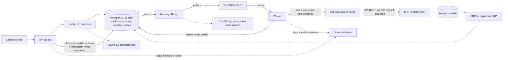

# Arquitetura

O diagnóstico dos três problemas da CaseCellShop, a arquitetura alvo e o porquê de cada bloco. As decisões completas, com as alternativas descartadas, estão no [`STATE.md`](.specs/project/STATE.md); os parâmetros, no [`design.md`](.specs/features/casecellshop/design.md).

**Estado deste documento:** rascunho do M1. A versão final sai no M6, com as seções de concorrência, mensageria, cache e observabilidade acrescentadas nos marcos em que são implementadas.

Cada afirmação traz uma marca:

- **[implementado: arquivo, critério]** já existe no código e tem teste;
- **[M2]** a **[M6]**: planejado neste projeto, no marco indicado do [`ROADMAP.md`](.specs/project/ROADMAP.md);
- **[alvo]**: proposta da arquitetura alvo, fora do escopo do desafio.

## Diagnóstico e arquitetura alvo

**Decisão:** a loja deixa de ler e de escrever no ERP no caminho de cada requisição. O catálogo e a promessa de estoque passam a viver num banco próprio da loja, atualizado por sincronização, e o faturamento passa a ser assíncrono, por uma outbox no mesmo banco.

Os três problemas têm a mesma origem: a loja trata um ERP legado, que não pode ser alterado, como se fosse o banco dela. Lê dele a cada acesso à vitrine, confere o estoque nele e espera por ele para fechar a compra. Com milhões de acessos, o ERP virou o gargalo de leitura, o árbitro da concorrência e a latência do checkout ao mesmo tempo.

### Problema 1: vitrine lenta

**Causa raiz** (`DOC-DIA-01`). O sistema de registro do ERP está no caminho de leitura de alto volume. Cada acesso à vitrine vira uma chamada síncrona à API do ERP, e a carga no ERP cresce com o tráfego da loja, enquanto a capacidade dele não. A lentidão é o sintoma; a causa é o acoplamento de leitura com um sistema que não foi feito para servir vitrine. Como o ERP também fatura, a carga da vitrine disputa recursos com o faturamento.

**Impacto** (`DOC-DIA-02`):

- **cliente:** páginas lentas e erro quando o ERP oscila; quem desiste não volta;
- **negócio:** conversão menor justamente no pico, quando há mais gente comprando, e risco de o ERP degradar o faturamento e o financeiro;
- **operação:** cada pico vira incidente no ERP, sem como separar a carga da vitrine da carga interna.

**Caminhos** (`DOC-DIA-03`):

| | A. Cache na frente da API do ERP | **B. Banco da loja, sincronização e cache em memória** (escolhido) | C. CDC do MySQL do ERP para o banco da loja |
| --- | --- | --- | --- |
| Custo | Baixo | Médio: um banco e um worker | Alto: conector, broker e acesso de replicação |
| Complexidade | Baixa | Média | Alta |
| Latência | Boa no acerto; a falta ainda chama o ERP | Boa sempre: a origem é um banco local | Boa sempre |
| Consistência | Expira e volta ao ERP; um stampede na expiração derruba o ERP | Defasagem limitada: até 65,5 s mais a duração de uma rodada, com o ERP respondendo | Segundos |
| Esforço operacional | Baixo | Médio: rodada de sincronização e alerta de idade | Alto: binlog em formato ROW, privilégio de replicação e um broker para operar |

**Por que B.** O cache sozinho (A) ainda põe o ERP no caminho de cada falta e não resolve o estoque, que precisa de um lugar transacional (problema 2). O CDC (C) dá o melhor frescor, mas depende de acesso de replicação que o acesso de leitura atual pode não incluir, e de infraestrutura que não existe hoje. B tira o ERP do caminho da vitrine com o que a loja já precisa ter: um banco próprio. O CDC fica para a fase de 60 a 90 dias, se a defasagem medida pedir.

**Leitura direta do MySQL do ERP (descartada).** O acesso de leitura ao banco do ERP permitiria tirar a API REST do caminho da vitrine. Seria rápido de fazer, mas as tabelas internas não são contrato: uma nova versão do ERP quebra a loja sem aviso; a carga de leitura continua no banco que fatura, só que por outra porta; e o estoque lido ali não resolve a reserva, que precisa de um lugar transacional da loja. Fica como plano B da consulta pela referência, se a H1a não valer (R6).

O que B entrega:

- produtos, preço e estoque no PostgreSQL da loja **[M2, M4]**;
- uma rodada de sincronização na subida e uma a cada 60 s, no worker **[M4]** (AD-009);
- o catálogo inteiro numa entrada de cache em processo, com TTL de 5 s ± 10%, *single-flight* contra stampede e *stale-if-error* com teto de 60 s **[M4]** (AD-005);
- com o ERP fora, a vitrine segue com o último estoque conhecido, e a idade da sincronização dispara alerta **[M4, M5]**.

### Problema 2: overselling

**Causa raiz** (`DOC-DIA-01`). A disponibilidade é checada num momento e baixada em outro, o *check-then-act*. Dois clientes leem "1 em estoque" ao mesmo tempo, os dois passam pela checagem, e os dois compram. Com o ERP como único lugar do estoque, a baixa só acontece no faturamento, segundos depois, e a janela entre a checagem e a baixa cresce com a latência do ERP.

**Impacto** (`DOC-DIA-02`):

- **cliente:** compra confirmada e depois cancelada; é a pior experiência possível, porque a pessoa já contava com o produto;
- **negócio:** estorno, atendimento, reclamação pública e perda de confiança, concentrados nas promoções, quando o estoque é disputado;
- **operação:** pedidos para cancelar à mão e estoque negativo no ERP para corrigir, sem métrica que mostre o furo antes da reclamação.

**Caminhos** (`DOC-DIA-03`):

| | **A. `UPDATE` condicional atômico no banco da loja** (escolhido) | B. `SELECT … FOR UPDATE` e depois `UPDATE` | C. Contador ou lock distribuído no Redis |
| --- | --- | --- | --- |
| Custo | Baixo | Baixo | Médio: mais um serviço |
| Complexidade | Baixa: uma instrução por SKU | Média: duas idas ao banco e a checagem na aplicação | Alta: o lock precisa de prazo e de *fencing token* |
| Latência | Uma ida ao banco por SKU | Duas idas ao banco por SKU | Uma ida ao Redis, mais o banco para o pedido |
| Consistência | Forte, na mesma transação do pedido | Forte | Fora da transação do pedido; um failover com replicação assíncrona pode perder uma escrita confirmada |
| Esforço operacional | Nenhum além do banco | Nenhum além do banco | Um cluster Redis para operar |

**Por que A.** A reserva é uma instrução só, `UPDATE inventory SET reserved = reserved + :q WHERE sku = :sku AND on_hand - reserved >= :q`, no último passo da transação do checkout. O PostgreSQL trava a linha, e um segundo comprador concorrente espera e reavalia a condição. Zero linhas afetadas significa sem estoque, e a resposta é `409`. B é correto, mas faz duas idas ao banco e põe a regra na aplicação. C tira a reserva da transação do pedido, que é justamente o que precisa ser atômico.

O que A entrega:

- a loja controla a **promessa** de estoque: `on_hand` espelha o ERP, `reserved` é da loja e `sold_total` só cresce **[implementado: `migrations/store/20260102000000_create_store.ts`, `src/checkout/repository.ts`, `CHK-01`; a baixa no faturamento, no M3]** (AD-002);
- uma ordem de lock única entre linhas existentes (mensagem da outbox, pedido, estoque por SKU) evita deadlock **[implementado no checkout: `src/checkout/repository.ts`, `CHK-07`; na conclusão do pedido, no M3]**;
- o teste dispara 50 checkouts simultâneos com estoque 5 e conta que exatamente 5 passam, contra um PostgreSQL real **[implementado: `test/integration/checkout/checkout-concurrency.test.ts`, `CHK-01`]**.

### Problema 3: checkout frágil

**Causa raiz** (`DOC-DIA-01`). O faturamento é síncrono: a resposta ao cliente espera o ERP, cuja mediana é de cerca de 3 s, com p99,9 de 8 s. Quando o ERP demora, o cliente ou o próximo salto dá timeout e tenta de novo, e sem idempotência cada tentativa pode virar um pedido novo. Não há registro durável do pedido antes da chamada, então uma queda no meio deixa o pedido sem rastro, e sem correlação por pedido não há como saber o que aconteceu.

**Impacto** (`DOC-DIA-02`):

- **cliente:** espera longa, erro depois de pagar a espera, cobrança ou pedido em dobro;
- **negócio:** abandono no último passo, que é o mais caro de perder, e faturas duplicadas para estornar;
- **operação:** sem rastreabilidade por pedido, cada caso exige procurar nos logs do ERP; retries em cascata aumentam a carga no ERP justamente quando ele está lento.

**Caminhos** (`DOC-DIA-03`):

| | A. Síncrono, com timeout maior e retry | **B. `202`, outbox no banco da loja e worker** (escolhido) | C. `202` com publicação num broker externo (SQS, RabbitMQ) |
| --- | --- | --- | --- |
| Custo | Nenhum | Baixo: o banco já existe | Médio: um broker gerenciado ou operado |
| Complexidade | Baixa, mas o retry precisa de idempotência no ERP | Média: worker, lease, retry, DLQ e reconciliação | Alta: escrita dupla entre o banco e o broker, ou um relay a mais |
| Latência para o cliente | A do ERP: segundos | A de uma transação curta, sem o ERP | A de uma transação mais a publicação |
| Consistência | Duplica pedido sob retry sem idempotência | O pedido e a mensagem nascem na mesma transação: sem pedido fantasma nem mensagem fantasma | Publicar antes de gravar gera mensagem fantasma; publicar depois gera pedido fantasma |
| Esforço operacional | Baixo, mas cada lentidão do ERP vira incidente | Médio: a DLQ e o runbook | Médio a alto: o broker e a DLQ dele |

**Por que B.** O checkout grava o pedido, a reserva e a mensagem de saída numa transação só e responde `202 Accepted` com `Location` e `Retry-After`. O cliente acompanha em `GET /orders/{orderId}/status`. Um *Message Relay* publica a mensagem no SQS depois do commit, e o worker consome do SQS e chama o ERP fora da transação (AD-021). A resolve a latência só no papel e piora o problema de duplicação. C publicando direto no broker, sem outbox, não é correto, porque o banco e o broker não têm uma transação comum; por isso B usa o SQS atrás da outbox, e não no lugar dela.

O que B entrega:

- `Idempotency-Key` obrigatório, gravado na transação do pedido antes de qualquer reserva: duplo clique e retry do cliente devolvem o pedido original **[implementado: `src/checkout/repository.ts`, `CHK-03`, `CHK-04`]** (AD-006, AD-020);
- retry com atraso mínimo de 45 s e *full jitter*, até 12 tentativas, e depois a DLQ **[M3]** (AD-003);
- antes de criar de novo, o worker consulta o ERP pela referência do pedido, para não faturar duas vezes **[M3]**;
- reconciliação periódica da DLQ e um runbook para reprocessar em lote ou cancelar **[M3]**;
- um semáforo de 30 chamadas simultâneas ao ERP, o que ele aguenta pela premissa de carga **[M3]**.

### Arquitetura de 30 a 90 dias

`DOC-DIA-04`. A ordem segue o risco: primeiro o que tira o ERP do caminho e fecha o furo de estoque, depois o que dá visibilidade, e por último o que escala.

**Dias 0 a 30: tirar o ERP do caminho do cliente.** É o que este projeto implementa.

- **Banco próprio da loja:** PostgreSQL com catálogo, preço, estoque, pedidos, chaves de idempotência e outbox **[M1 a M4]**.
- **Checkout:** reserva atômica, idempotência e `202` **[implementado: `src/checkout/repository.ts`, `CHK-01` a `CHK-12`]**.
- **Fila:** SQS, alimentado pela outbox do banco por um *Message Relay*; localmente, o ElasticMQ no compose **[M3]**.
- **Workers:** um worker para o envio ao ERP e para a sincronização **[M3, M4]**.
- **Sincronização:** preço e estoque a cada 60 s, sem devolver unidade já vendida **[M4]**.
- **Cache:** em processo, na vitrine **[M4]**.
- **Observabilidade básica:** logs estruturados com `correlationId` e `orderId`, métricas em `/metrics` e traces da requisição ao ERP. O contrato com o erro em `problem+json` e o `X-Request-Id` **[implementado: `src/contract/`, `src/http/problem.ts`, `FND-03`, `FND-07`]**; os traces da requisição ao banco, vistos no Jaeger local **[implementado: `src/telemetry.ts`, `FND-05`]**; os demais logs, métricas e traces **[M2 a M5]**.

**Dias 30 a 60: operar com segurança.**

- **Reconciliação com o ERP:** a DLQ conferida periodicamente pela referência, e o runbook de reprocessamento e cancelamento **[M3]**.
- **Observabilidade completa:** SLOs (vitrine e checkout com 99,9% sem `5xx`, e 99% dos pedidos com desfecho em até 60 s), alertas, dashboard e runbook no Datadog ou equivalente **[M5]**.
- **Mais de uma instância da API**, com um cache L2 compartilhado (Redis) atrás do cache em processo, para as instâncias servirem o mesmo dado **[alvo]**.
- **Autenticação na borda** (OAuth2/OIDC) e limite de taxa por cliente; a chave de idempotência passa a valer por cliente **[alvo]**.

**Dias 60 a 90: escalar e reduzir a defasagem.**

- **CDC** a partir de uma réplica do MySQL do ERP no lugar da sincronização por polling, se a defasagem medida pedir e o acesso de replicação for liberado **[alvo]**.
- **EventBridge na saída do relay,** quando surgir um segundo consumidor dos eventos de pedido (aviso ao cliente, analytics), cada um com a sua fila SQS e a sua DLQ **[alvo]**.
- **Várias réplicas do worker**, com a sincronização coordenada e o limite de chamadas ao ERP dividido entre elas **[alvo]**.
- **Migração para a nuvem**, abaixo.

### A nuvem como hipótese de evolução

`DOC-DIA-05`. Hoje tudo roda em datacenter próprio. A nuvem é uma hipótese, não uma premissa: cada componente tem um serviço gerenciado equivalente, e o motivo para trocar é o esforço operacional que ele tira. Os nomes são da AWS como exemplo; Azure e Google Cloud têm equivalentes diretos.

| Componente | Serviço gerenciado | Esforço que tira |
| --- | --- | --- |
| Banco da loja (PostgreSQL) | Amazon RDS ou Aurora PostgreSQL | Backup, failover entre zonas, atualização de versão e réplica de leitura |
| API e worker (contêineres) | ECS no Fargate | Servidores, sistema operacional e escala por carga |
| Fila | Amazon SQS, o mesmo que o ElasticMQ emula no compose; a outbox continua na frente dele, e o EventBridge entra com um segundo consumidor | DLQ, redrive e escala gerenciados, sem perder a transação única do pedido |
| Cache L2 | ElastiCache | Cluster, réplica e failover do Redis |
| Observabilidade | Datadog, ou CloudWatch com Prometheus e Grafana gerenciados | Coleta, retenção e alertas sem operar a pilha |
| Segredos | Secrets Manager | Rotação de credenciais do banco e do ERP |

**O ERP fica no datacenter.** Ele não pode ser alterado e não migra junto. A loja na nuvem passa a falar com ele por uma conexão híbrida: uma VPN site a site, ou um link dedicado (Direct Connect) com a VPN de reserva. Essa conexão vira uma fonte nova de latência e de falha:

- **latência:** cada chamada ao ERP soma o tempo de ida e volta do link. O timeout do ERP (10 s) e o atraso mínimo antes de consultar (45 s) precisam ser revistos com o tempo medido no link;
- **falha:** uma queda do link é, para a loja, uma queda do ERP. O desenho já a absorve: o checkout continua aceitando pedidos, que esperam na outbox com a reserva feita, e a vitrine segue com o último estoque conhecido, com alerta pela idade da sincronização;
- **operação:** o link precisa de monitoramento próprio, para um alerta de "ERP fora" apontar a causa certa.

### Diagrama da arquitetura alvo

`DOC-DIA-06`. As caixas tracejadas são da arquitetura alvo; as outras são implementadas neste projeto.



## Concorrência e idempotência

**Decisão:** o checkout reserva o estoque com um `UPDATE` condicional por SKU, dentro da mesma transação que grava a chave de idempotência, o pedido e a mensagem da outbox. Antes da chave vai só a linha do pedido, que a chave referencia e que some no `ROLLBACK`; nada é reservado antes da chave, e o índice único dela é o que segura a segunda tentativa. O ERP fica fora da transação **[implementado: `src/checkout/repository.ts`]** (AD-002, AD-006, AD-020).

### Por que uma checagem simples de estoque é insuficiente

`DOC-CON-01`. "Ler o estoque e, se houver, gravar a venda" são duas operações, e entre elas outra requisição pode fazer o mesmo. Com uma unidade em estoque, duas transações leem `1`, as duas passam pela checagem, e as duas gravam a venda. Isso acontece com qualquer isolamento que não serialize a leitura: no `READ COMMITTED`, o padrão do PostgreSQL, cada `SELECT` vê o que já foi confirmado, e nada impede a outra transação de confirmar logo depois. A janela cresce com a latência entre a leitura e a gravação, e por isso piora no pico, quando mais gente disputa o mesmo item. Pôr a checagem na aplicação também não resolve com várias réplicas da API, porque cada uma tem a própria memória.

### Alternativas para impedir a venda além do estoque

`DOC-CON-02`. A comparação de custo, complexidade, latência, consistência e esforço está no Problema 2. Aqui fica o que cada uma garante e o que ela custa no checkout:

- **`UPDATE` condicional atômico (escolhido):** `UPDATE inventory SET reserved = reserved + :q WHERE sku = :sku AND on_hand - reserved >= :q`. A checagem e a gravação são uma instrução só. O PostgreSQL trava a linha, e uma segunda transação concorrente espera e reavalia o `WHERE` com o valor novo. Zero linhas afetadas quer dizer sem estoque, e a transação inteira é desfeita **[implementado: `src/checkout/repository.ts`, `CHK-01`]**.
- **Lock pessimista (`SELECT … FOR UPDATE` e depois `UPDATE`):** é correto, mas faz duas idas ao banco por SKU e põe a regra na aplicação, entre a leitura e a gravação, onde um erro de código volta a abrir a janela.
- **Reserva de estoque:** não é alternativa ao lock, e sim o modelo que o checkout usa. A loja guarda a promessa (`reserved`) separada do estoque físico (`on_hand`), e a reserva só baixa no faturamento ou na falha. Assim a sincronização com o ERP nunca apaga uma reserva ainda não faturada **[implementado: a reserva, `CHK-01`; a baixa no faturamento ou na falha, no M3; a sincronização, no M4]** (AD-002, L-001). A reserva com prazo, que expira se o cliente não paga, fica fora do escopo: aqui não há pagamento **[alvo]**.
- **Lock distribuído (Redis ou similar):** resolve a disputa fora do banco, mas o lock precisa de prazo e de *fencing token*, e fica fora da transação do pedido. Um failover com replicação assíncrona pode perder um lock já concedido, e então o banco precisa da condição do mesmo jeito.

Dois pedidos com os mesmos SKUs em ordens diferentes (`{A, B}` e `{B, A}`) podem travar um ao outro. Por isso toda transação reserva os SKUs na mesma ordem, a ordem de SKU **[implementado: `src/checkout/repository.ts`, `CHK-07`]**. O `UPDATE` condicional é a única barreira contra a promessa acima do estoque: o banco aceita `reserved > on_hand`, e o próprio controle negativo do teste mostra isso (`CHK-02`). Os CHECKs `reserved >= 0` e `on_hand >= 0` impedem só valores negativos, como defesa em profundidade **[implementado: `migrations/store/20260102000000_create_store.ts`, `test/integration/checkout/store-schema.test.ts`]**. Uma promessa acima do estoque, que só pode surgir quando a sincronização baixa o `on_hand`, aparece no gauge de SKUs com `reserved > on_hand` **[M5, `OBS-06`]**.

### Idempotência para retry, duplo clique e reprocessamento

`DOC-CON-03`. O cliente manda uma `Idempotency-Key` em cada checkout. Depois da linha do pedido, a transação grava a chave com `INSERT … ON CONFLICT (key) DO NOTHING`, com o hash do pedido normalizado (SHA-256 dos itens em ordem de SKU) **[implementado: `src/checkout/repository.ts`]**:

- **retry depois de um timeout:** a chave já existe, e a resposta é o mesmo `202`, com o mesmo `orderId` e o estado atual do pedido, mesmo que o estoque tenha acabado depois;
- **duplo clique:** as duas requisições chegam juntas, e a segunda espera no índice único até a primeira terminar. Se a primeira confirmar, a segunda devolve o mesmo pedido; se a espera passar do `lock_timeout`, a resposta é `409` (`idempotency-key-in-progress`), e o cliente repete;
- **a mesma chave com outro pedido:** o hash difere, e a resposta é `422`, para um erro do cliente não virar um pedido trocado;
- **o mesmo pedido escrito de outro jeito** (itens em outra ordem): o hash normalizado é o mesmo, e a resposta é o pedido original;
- **reprocessamento no worker:** o faturamento usa o `orderId` como referência no ERP, que deduplica pela referência, e o worker consulta o ERP antes de criar de novo. O mesmo pedido não é faturado duas vezes **[M3]** (AD-003, H1a e H1b).

Qualquer falha desfaz a transação inteira, inclusive a chave, e o cliente pode repetir com a mesma chave. A chave vale por pelo menos 24 h.

### Como o teste prova que não há overselling

`DOC-CON-04`. Contra um PostgreSQL real, sem mock **[implementado: `test/integration/checkout/checkout-concurrency.test.ts`]**:

- **50 checkouts simultâneos para um item com estoque 5,** repetidos em laço: exatamente 5 recebem `202`, 45 recebem `409`, nenhum recebe `5xx`, e o banco termina com `reserved = 5` e `on_hand - reserved >= 0` (`CHK-01`);
- **controle negativo:** uma versão ingênua, que lê e grava em duas instruções com uma janela forçada entre elas, vende além do estoque no mesmo teste. Sem esse controle, um teste verde poderia não provar nada (`CHK-02`);
- **a mesma chave em paralelo para um item com estoque 1** gera um único pedido (`CHK-03`), e **pedidos com os SKUs em ordens opostas, em laço,** terminam sem deadlock (`CHK-07`);
- **um lock segurado pelo teste:** na linha do estoque, a espera vira `503`; na chave, vira `409` (`CHK-08`).

## Mensageria e resiliência

**Decisão:** o pedido e a mensagem de saída nascem na mesma transação, numa tabela de outbox no PostgreSQL da loja (*Transactional Outbox*). Um *Message Relay* publica as mensagens no SQS, e o worker consome do SQS: chama o ERP fora de qualquer transação, consulta o ERP pela referência antes de criar de novo, repete com espera crescente pelo *visibility timeout*, e a mensagem vai para a DLQ do SQS depois do limite de recebimentos. A reconciliação e o runbook tiram os pedidos da DLQ (AD-003, AD-004, AD-021). Localmente, o SQS é o ElasticMQ, um emulador da API do SQS que roda no compose sem conta nem token.

**Rascunho do M3, em duas partes:** a primeira (PR #13) implementou o worker com a fila na própria tabela da outbox (lease, token e status `dead`, AD-003); a segunda troca essa fila pelo SQS (AD-021) e traz a reconciliação e o runbook. As marcas **[M3]** viram **[implementado]** quando a segunda parte entrar; o que muda com o SQS está dito em cada ponto.

### Publicar antes ou depois de gravar o pedido

`DOC-MSG-01`. Nenhum dos dois. Gravar o pedido e publicar numa fila são duas escritas em sistemas diferentes, sem transação comum:

- **publicar antes de gravar:** se a gravação falha, o worker fatura um pedido que a loja não tem (mensagem fantasma);
- **publicar depois de gravar:** se o processo cai entre os dois passos, o pedido fica aceito e nunca é faturado (pedido fantasma).

Por isso a mensagem é uma linha da tabela `outbox`, gravada na mesma transação do pedido, da chave de idempotência e da reserva. Ou as quatro existem, ou nenhuma existe: os testes do checkout contam as mensagens da outbox antes e depois de cada recusa **[implementado: `src/checkout/repository.ts`, `CHK-06`, `CHK-10`; a linha com o `traceparent`, `CHK-12`]**. Depois do commit, o *Message Relay* lê as linhas ainda não publicadas e as publica no SQS; se ele cair entre publicar e marcar a linha, publica de novo, e o consumidor tolera a repetição **[M3]**. É o desenho do guia de padrões de nuvem da AWS para a escrita dupla: a fila externa nunca participa da transação do banco (AD-021).

### Pedido fantasma, mensagem fantasma e fatura duplicada

`DOC-MSG-02`.

- **Pedido fantasma e mensagem fantasma:** não existem, pela transação única acima. Um pedido aceito sempre tem a mensagem, e a mensagem sempre tem o pedido (a chave estrangeira `outbox.order_id`) **[implementado: `migrations/store/20260102000000_create_store.ts`]**.
- **Mensagem perdida no worker:** a mensagem recebida do SQS fica invisível pelo *visibility timeout* e só é apagada depois de gravado o desfecho. Se o worker morre no meio, ela volta a ficar visível e outro worker a retoma, depois do atraso mínimo; na primeira parte, o mesmo papel é do lease e do token gravados na outbox **[M3, `ORD-02`]**.
- **Fatura duplicada,** o risco que sobra numa entrega "pelo menos uma vez":
  - o pedido vai ao ERP com o `orderId` da loja como referência;
  - `first_sent_at` é gravado no banco antes da primeira chamada e nunca apagado. Daí em diante, toda tentativa consulta o ERP pela referência antes de criar (H1a), inclusive depois de um reprocessamento, que zera as tentativas (L-005) **[M3, `ORD-01`, `ORD-07`]**;
  - a consulta só acontece 45 s depois do início da chamada anterior, quando o ERP já concluiu ou abandonou a criação (H4) **[M3, `ORD-03`, `ORD-04`, `ORD-05`]**;
  - se o ERP também recusa a segunda criação com a mesma referência (H1b), a duplicação fica impossível mesmo além da H4 **[M3, `ORD-06`]**.
- **Worker atrasado:** o pedido muda de estado por compare-and-set (`WHERE status = 'pending'`), e o estoque só muda se a transição afetou a linha. Dois workers com a mesma mensagem, depois de um *visibility timeout* vencido, não faturam nem baixam o estoque duas vezes **[M3, `ORD-16`, `ORD-17`]**.

**Limite declarado (R6):** se a H1b e a H4 falharem juntas, um pedido pode terminar com duas faturas no ERP. O teste `ORD-06` demonstra esse caso com o ERP simulado sem a H1b **[M3]**, e o README o declara entre as limitações **[M6]**.

### Retry, DLQ, OpenAPI e testes

`DOC-MSG-03`.

- **Classificação antes do retry:** a camada anticorrupção traduz cada resposta do ERP numa lista fechada, por operação, sem retry interno **[M3, `ORD-09`, `ORD-10`]**:
  - **permanente** (`422`, falta de estoque): o pedido vira `failed` com o motivo, e a reserva é liberada **[M3, `ORD-08`]**;
  - **transitório** (a requisição não chegou, `429`, `503`) e **ambíguo** (timeout, conexão caída depois do envio, `500`, `502`, `504`): nova tentativa;
  - **erro de configuração** (`400`, `401`, `403`, `404` sem o corpo esperado): transitório e com alerta, para uma credencial vencida não falhar todos os pedidos de uma vez.
- **Retry:** atraso mínimo de 45 s desde o início da última chamada, mais *full jitter* sobre um exponencial de base 5 s e teto de 5 min, até 12 tentativas, aplicado mudando a visibilidade da mensagem no SQS (`ChangeMessageVisibility`). O jitter espalha os retries depois de uma falha que atingiu muitos pedidos ao mesmo tempo. Um semáforo de 30 chamadas protege o ERP, e o worker só recebe do SQS tantas mensagens quantas permissões tem **[M3, `ORD-13`, `ORD-20`]**.
- **DLQ:** a DLQ do SQS recebe a mensagem depois de 12 recebimentos (*redrive policy* com `maxReceiveCount`), e o pedido continua `pending` com a reserva, porque ainda pode ser faturado. O recebimento é contado pelo próprio SQS, então uma mensagem que derruba o processo também chega à DLQ, sozinha, sem segurar as outras **[M3, `ORD-12`, `ORD-13`]**.
- **Saída da DLQ:** a reconciliação lê a DLQ a cada 5 min, consulta o ERP e conclui como faturado o que ele já tem. O runbook devolve as mensagens à fila (*redrive*, `StartMessageMoveTask`) ou cancela depois de o operador confirmar no ERP que o pedido não existe; o *redrive* é seguro porque cada mensagem é consultada no ERP antes de qualquer criação **[M3, `ORD-07`, `ORD-14`, `ORD-15`]**.
- **OpenAPI:** o cliente acompanha o pedido em `GET /orders/{orderId}/status` (`pending`, `invoiced` ou `failed` com o motivo), com o schema gerado do mesmo contrato em zod que valida as respostas nos testes **[implementado: `src/contract/orders.ts`, `CHK-11`; o estado depois do worker, M3, `ORD-19`]**.
- **Testes:** contam faturas no ERP simulado, não chamadas, contra o PostgreSQL real e o ElasticMQ real, sem mock do SDK da AWS. As falhas são injetadas por um roteiro do simulado (lento, indisponível, fatura sem responder, fatura depois do timeout abaixo e acima da H4, `502` seguido de fatura, sem a H1b). O tempo do ERP corre num relógio manual; o *visibility timeout* do SQS corre no relógio do emulador, e os testes não o esperam: devolvem a mensagem à fila com `VisibilityTimeout = 0` e semeiam no banco o início da última chamada, sem `sleep` **[M3, `ORD-01` a `ORD-21`]**.
- **Rastreabilidade:** cada tentativa é um span filho do span do checkout, retomado pelo `traceparent` gravado na outbox e levado como atributo da mensagem no SQS, e os logs do worker levam `orderId`, `attempt` e o `correlationId` da requisição original **[M3, `ORD-18`, `OBS-01`]**.

### Outbox, Message Relay e SQS: quem faz o quê

A outbox e a fila têm papéis diferentes, e o desenho é o que o guia de padrões de nuvem da AWS publica para a escrita dupla (AD-021):

| Peça | Papel | Aqui |
| --- | --- | --- |
| *Transactional Outbox* | garante que a mensagem nasce junto com o pedido, na mesma transação | tabela `outbox` no PostgreSQL **[implementado: `src/checkout/repository.ts`, `CHK-12`]** |
| *Message Relay* (*Polling Publisher*) | lê a outbox depois do commit e publica na fila; pode publicar duas vezes, nunca perde | processo que lê com `SKIP LOCKED` e publica em lote **[M3]** |
| Fila (SQS) | distribui o trabalho, esconde a mensagem em processamento, repete e manda para a DLQ | SQS, com o ElasticMQ no compose e nos testes **[M3]** |
| *Idempotent Consumer* | tolera a mensagem repetida | o worker consulta o ERP pela referência antes de criar, e o pedido muda por compare-and-set **[M3, `ORD-01` a `ORD-06`]** |

O SQS não guarda o que o worker decide por pedido, então isso fica no banco, na linha do pedido: o `first_sent_at`, o início da última chamada (para o atraso mínimo da H4) e o resultado da consulta ao ERP. A primeira parte do M3 guardou tudo na própria outbox, que também fazia o papel de fila; a correspondência entre as duas versões:

| Primeira parte (tabela como fila, AD-003) | Segunda parte (SQS, AD-021) |
| --- | --- |
| lease (`lease_until`) | *visibility timeout* |
| token da reivindicação (`claim_token`) | *receipt handle* |
| 12 tentativas contadas na reivindicação | `maxReceiveCount = 12` na *redrive policy* |
| status `dead` | DLQ, com retenção maior que a da fila de origem |
| reprocessamento em lote por SQL | *redrive* (`StartMessageMoveTask`) |

**Na AWS:** o banco vai para o RDS, o relay roda como serviço ou tarefa, e o endereço do SQS passa a ser o real, sem mudar código. Um segundo consumidor dos eventos de pedido (aviso ao cliente, analytics) não lê a fila do faturamento: o relay publica o evento num barramento do EventBridge ou num tópico do SNS, e cada consumidor tem a sua fila SQS e a sua DLQ. O SQS Standard entrega pelo menos uma vez e sem ordem garantida, então cada consumidor é idempotente; a fila FIFO só entraria se a ordem por pedido importasse, e a deduplicação dela cobre só 5 minutos **[alvo]**.

**Por que o ElasticMQ:** é o emulador que as bibliotecas de SQS mais usadas em Node rodam nos próprios testes, cobre o que o desafio avalia (*visibility timeout*, DLQ e *redrive*) e roda sem conta nem token. O LocalStack exige token desde a versão 2026.03.0, e os emuladores que também cobrem SNS e EventBridge são recentes demais; se o EventBridge precisar rodar, a troca é de imagem e de endereço (AD-021).

### Prompts de IA relevantes

`DOC-MSG-04`. O projeto não guarda um diário de prompts: os prompts que decidem cada passo são as instruções versionadas dos agentes, listadas no [`PROMPTS.md`](PROMPTS.md). Os trechos que governam esta área, citados literalmente:

- quem faz o quê, na skill do marco ([`.claude/skills/marco/SKILL.md`](.claude/skills/marco/SKILL.md)):

  ```text
  Tests come only from `test-writer`, production code only from `implementer`, and the review only from `reviewer`.
  ```

- as regras da fila, em [`AGENTS.md`](AGENTS.md), que todo agente lê:

  ```text
  - Never call the ERP inside a database transaction.
  - Lock order between existing rows: outbox message, order, stock by SKU, one `UPDATE` per row.
  - Order transitions by compare-and-set; stock changes only if the transition affected a row.
  - Every outbox transition is conditioned on the claim token.
  - Deadlines stored in the database use the database clock; process timers use the injectable clock.
  ```

- como os testes provam a fila, em [`.claude/rules/tests.md`](.claude/rules/tests.md):

  ```text
  No `sleep`: use the injectable clock and timestamps seeded in the database. ERP failure tests count invoices in the simulated ERP, not calls.
  ```

Respostas da IA recusadas ou corrigidas, e onde foram pegas:

- **Uma garantia falsa no texto de arquitetura:** a sessão principal escreveu que os CHECKs do banco barram a reserva acima do estoque. O `reviewer` reproduziu o contrário com o próprio controle negativo do `CHK-02` e reprovou a revisão (achado A1, `média`) ([PR #12, Revisão 1](https://github.com/roneyrogerio/casecellshop-backend/pull/12#issuecomment-6540136376)).
- **Um design que divergiu de uma decisão aceita:** a ordem da transação passou a gravar o pedido antes da chave, contra o texto da AD-006. O mesmo relatório apontou a divergência (A3), e ela virou a AD-020, em vez de uma edição silenciosa.
- **Um erro engolido pelo código do `implementer`:** o migrador aceitava uma migração que lança um valor falsy como sucesso. O `reviewer` reproduziu com uma migração `throw null` (A1 da [PR #11, Revisão 1](https://github.com/roneyrogerio/casecellshop-backend/pull/11#issuecomment-6537842382)).

Os exemplos do M3 entram aqui quando o PR do marco for revisado.
