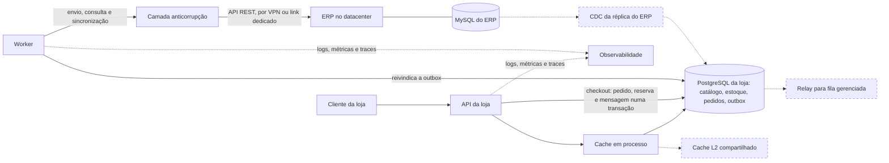

# Arquitetura

O diagnóstico dos três problemas da CaseCellShop, a arquitetura alvo e o porquê de cada bloco. As decisões completas, com as alternativas descartadas, estão no [`STATE.md`](.specs/project/STATE.md); os parâmetros, no [`design.md`](.specs/features/casecellshop/design.md).

**Estado deste documento:** rascunho do M1. A versão final sai no M6, com as seções de concorrência, mensageria, cache e observabilidade acrescentadas nos marcos em que são implementadas.

Cada afirmação traz uma marca:

- **[implementado: arquivo, critério]** já existe no código e tem teste;
- **[M2]** a **[M6]**: planejado neste projeto, no marco indicado do [`ROADMAP.md`](.specs/project/ROADMAP.md);
- **[alvo]**: proposta da arquitetura alvo, fora do escopo do desafio.

## Diagnóstico e arquitetura alvo

**Decisão:** a loja deixa de ler e de escrever no ERP no caminho de cada requisição. O catálogo e a promessa de estoque passam a viver num banco próprio da loja, atualizado por sincronização, e o faturamento passa a ser assíncrono, por uma outbox no mesmo banco.

Os três problemas têm a mesma origem: a loja trata um ERP legado, que não pode ser alterado, como se fosse o banco dela. Lê dele a cada acesso à vitrine, confere o estoque nele e espera por ele para fechar a compra. Com milhões de acessos, o ERP virou o gargalo de leitura, o árbitro da concorrência e a latência do checkout ao mesmo tempo.

### Problema 1: vitrine lenta

**Causa raiz** (`DOC-DIA-01`). O sistema de registro do ERP está no caminho de leitura de alto volume. Cada acesso à vitrine vira uma chamada síncrona à API do ERP, e a carga no ERP cresce com o tráfego da loja, enquanto a capacidade dele não. A lentidão é o sintoma; a causa é o acoplamento de leitura com um sistema que não foi feito para servir vitrine. Como o ERP também fatura, a carga da vitrine disputa recursos com o faturamento.

**Impacto** (`DOC-DIA-02`):

- **cliente:** páginas lentas e erro quando o ERP oscila; quem desiste não volta;
- **negócio:** conversão menor justamente no pico, quando há mais gente comprando, e risco de o ERP degradar o faturamento e o financeiro;
- **operação:** cada pico vira incidente no ERP, sem como separar a carga da vitrine da carga interna.

**Caminhos** (`DOC-DIA-03`):

| | A. Cache na frente da API do ERP | **B. Banco da loja, sincronização e cache em memória** (escolhido) | C. CDC do MySQL do ERP para o banco da loja |
| --- | --- | --- | --- |
| Custo | Baixo | Médio: um banco e um worker | Alto: conector, broker e acesso de replicação |
| Complexidade | Baixa | Média | Alta |
| Latência | Boa no acerto; a falta ainda chama o ERP | Boa sempre: a origem é um banco local | Boa sempre |
| Consistência | Expira e volta ao ERP; um stampede na expiração derruba o ERP | Defasagem limitada: até 65,5 s mais a duração de uma rodada, com o ERP respondendo | Segundos |
| Esforço operacional | Baixo | Médio: rodada de sincronização e alerta de idade | Alto: binlog em formato ROW, privilégio de replicação e um broker para operar |

**Por que B.** O cache sozinho (A) ainda põe o ERP no caminho de cada falta e não resolve o estoque, que precisa de um lugar transacional (problema 2). O CDC (C) dá o melhor frescor, mas depende de acesso de replicação que o acesso de leitura atual pode não incluir, e de infraestrutura que não existe hoje. B tira o ERP do caminho da vitrine com o que a loja já precisa ter: um banco próprio. O CDC fica para a fase de 60 a 90 dias, se a defasagem medida pedir.

**Leitura direta do MySQL do ERP (descartada).** O acesso de leitura ao banco do ERP permitiria tirar a API REST do caminho da vitrine. Seria rápido de fazer, mas as tabelas internas não são contrato: uma nova versão do ERP quebra a loja sem aviso; a carga de leitura continua no banco que fatura, só que por outra porta; e o estoque lido ali não resolve a reserva, que precisa de um lugar transacional da loja. Fica como plano B da consulta pela referência, se a H1a não valer (R6).

O que B entrega:

- produtos, preço e estoque no PostgreSQL da loja **[M2, M4]**;
- uma rodada de sincronização na subida e uma a cada 60 s, no worker **[M4]** (AD-009);
- o catálogo inteiro numa entrada de cache em processo, com TTL de 5 s ± 10%, *single-flight* contra stampede e *stale-if-error* com teto de 60 s **[M4]** (AD-005);
- com o ERP fora, a vitrine segue com o último estoque conhecido, e a idade da sincronização dispara alerta **[M4, M5]**.

### Problema 2: overselling

**Causa raiz** (`DOC-DIA-01`). A disponibilidade é checada num momento e baixada em outro, o *check-then-act*. Dois clientes leem "1 em estoque" ao mesmo tempo, os dois passam pela checagem, e os dois compram. Com o ERP como único lugar do estoque, a baixa só acontece no faturamento, segundos depois, e a janela entre a checagem e a baixa cresce com a latência do ERP.

**Impacto** (`DOC-DIA-02`):

- **cliente:** compra confirmada e depois cancelada; é a pior experiência possível, porque a pessoa já contava com o produto;
- **negócio:** estorno, atendimento, reclamação pública e perda de confiança, concentrados nas promoções, quando o estoque é disputado;
- **operação:** pedidos para cancelar à mão e estoque negativo no ERP para corrigir, sem métrica que mostre o furo antes da reclamação.

**Caminhos** (`DOC-DIA-03`):

| | **A. `UPDATE` condicional atômico no banco da loja** (escolhido) | B. `SELECT … FOR UPDATE` e depois `UPDATE` | C. Contador ou lock distribuído no Redis |
| --- | --- | --- | --- |
| Custo | Baixo | Baixo | Médio: mais um serviço |
| Complexidade | Baixa: uma instrução por SKU | Média: duas idas ao banco e a checagem na aplicação | Alta: o lock precisa de prazo e de *fencing token* |
| Latência | Uma ida ao banco por SKU | Duas idas ao banco por SKU | Uma ida ao Redis, mais o banco para o pedido |
| Consistência | Forte, na mesma transação do pedido | Forte | Fora da transação do pedido; um failover com replicação assíncrona pode perder uma escrita confirmada |
| Esforço operacional | Nenhum além do banco | Nenhum além do banco | Um cluster Redis para operar |

**Por que A.** A reserva é uma instrução só, `UPDATE inventory SET reserved = reserved + :q WHERE sku = :sku AND on_hand - reserved >= :q`, no último passo da transação do checkout. O PostgreSQL trava a linha, e um segundo comprador concorrente espera e reavalia a condição. Zero linhas afetadas significa sem estoque, e a resposta é `409`. B é correto, mas faz duas idas ao banco e põe a regra na aplicação. C tira a reserva da transação do pedido, que é justamente o que precisa ser atômico.

O que A entrega:

- a loja controla a **promessa** de estoque: `on_hand` espelha o ERP, `reserved` é da loja e `sold_total` só cresce **[M2]** (AD-002);
- uma ordem de lock única entre linhas existentes (mensagem da outbox, pedido, estoque por SKU) evita deadlock **[M2]**;
- o teste dispara 50 checkouts simultâneos com estoque 5 e conta que exatamente 5 passam, contra um PostgreSQL real **[M2, `CHK-01`]**.

### Problema 3: checkout frágil

**Causa raiz** (`DOC-DIA-01`). O faturamento é síncrono: a resposta ao cliente espera o ERP, cuja mediana é de cerca de 3 s, com p99,9 de 8 s. Quando o ERP demora, o cliente ou o próximo salto dá timeout e tenta de novo, e sem idempotência cada tentativa pode virar um pedido novo. Não há registro durável do pedido antes da chamada, então uma queda no meio deixa o pedido sem rastro, e sem correlação por pedido não há como saber o que aconteceu.

**Impacto** (`DOC-DIA-02`):

- **cliente:** espera longa, erro depois de pagar a espera, cobrança ou pedido em dobro;
- **negócio:** abandono no último passo, que é o mais caro de perder, e faturas duplicadas para estornar;
- **operação:** sem rastreabilidade por pedido, cada caso exige procurar nos logs do ERP; retries em cascata aumentam a carga no ERP justamente quando ele está lento.

**Caminhos** (`DOC-DIA-03`):

| | A. Síncrono, com timeout maior e retry | **B. `202`, outbox no banco da loja e worker** (escolhido) | C. `202` com publicação num broker externo (SQS, RabbitMQ) |
| --- | --- | --- | --- |
| Custo | Nenhum | Baixo: o banco já existe | Médio: um broker gerenciado ou operado |
| Complexidade | Baixa, mas o retry precisa de idempotência no ERP | Média: worker, lease, retry, DLQ e reconciliação | Alta: escrita dupla entre o banco e o broker, ou um relay a mais |
| Latência para o cliente | A do ERP: segundos | A de uma transação curta, sem o ERP | A de uma transação mais a publicação |
| Consistência | Duplica pedido sob retry sem idempotência | O pedido e a mensagem nascem na mesma transação: sem pedido fantasma nem mensagem fantasma | Publicar antes de gravar gera mensagem fantasma; publicar depois gera pedido fantasma |
| Esforço operacional | Baixo, mas cada lentidão do ERP vira incidente | Médio: a DLQ e o runbook | Médio a alto: o broker e a DLQ dele |

**Por que B.** O checkout grava o pedido, a reserva e a mensagem de saída numa transação só e responde `202 Accepted` com `Location` e `Retry-After`. O cliente acompanha em `GET /orders/{orderId}/status`. O worker reivindica a mensagem com `FOR UPDATE SKIP LOCKED`, lease e token, e chama o ERP fora da transação. A resolve a latência só no papel e piora o problema de duplicação. C exige a mesma outbox para ser correto, porque o banco e o broker não têm uma transação comum; vale quando houver um segundo consumidor dos eventos, e aí um relay publica a outbox no broker.

O que B entrega:

- `Idempotency-Key` obrigatório, gravado como primeiro passo da transação: duplo clique e retry do cliente devolvem o pedido original **[M2]** (AD-006);
- retry com atraso mínimo de 45 s e *full jitter*, até 12 tentativas, e depois a DLQ **[M3]** (AD-003);
- antes de criar de novo, o worker consulta o ERP pela referência do pedido, para não faturar duas vezes **[M3]**;
- reconciliação periódica da DLQ e um runbook para reprocessar em lote ou cancelar **[M3]**;
- um semáforo de 30 chamadas simultâneas ao ERP, o que ele aguenta pela premissa de carga **[M3]**.

### Arquitetura de 30 a 90 dias

`DOC-DIA-04`. A ordem segue o risco: primeiro o que tira o ERP do caminho e fecha o furo de estoque, depois o que dá visibilidade, e por último o que escala.

**Dias 0 a 30: tirar o ERP do caminho do cliente.** É o que este projeto implementa.

- **Banco próprio da loja:** PostgreSQL com catálogo, preço, estoque, pedidos, chaves de idempotência e outbox **[M1 a M4]**.
- **Checkout:** reserva atômica, idempotência e `202` **[M2]**.
- **Fila:** a outbox no próprio banco, sem broker externo **[M3]**.
- **Workers:** um worker para o envio ao ERP e para a sincronização **[M3, M4]**.
- **Sincronização:** preço e estoque a cada 60 s, sem devolver unidade já vendida **[M4]**.
- **Cache:** em processo, na vitrine **[M4]**.
- **Observabilidade básica:** logs estruturados com `correlationId` e `orderId`, métricas em `/metrics` e traces da requisição ao ERP. O contrato com o erro em `problem+json` e o `X-Request-Id` **[implementado: `src/contract/`, `src/http/problem.ts`, `FND-03`, `FND-07`]**; os traces da requisição ao banco, vistos no Jaeger local **[implementado: `src/telemetry.ts`, `FND-05`]**; os demais logs, métricas e traces **[M2 a M5]**.

**Dias 30 a 60: operar com segurança.**

- **Reconciliação com o ERP:** a DLQ conferida periodicamente pela referência, e o runbook de reprocessamento e cancelamento **[M3]**.
- **Observabilidade completa:** SLOs (vitrine e checkout com 99,9% sem `5xx`, e 99% dos pedidos com desfecho em até 60 s), alertas, dashboard e runbook no Datadog ou equivalente **[M5]**.
- **Mais de uma instância da API**, com um cache L2 compartilhado (Redis) atrás do cache em processo, para as instâncias servirem o mesmo dado **[alvo]**.
- **Autenticação na borda** (OAuth2/OIDC) e limite de taxa por cliente; a chave de idempotência passa a valer por cliente **[alvo]**.

**Dias 60 a 90: escalar e reduzir a defasagem.**

- **CDC** a partir de uma réplica do MySQL do ERP no lugar da sincronização por polling, se a defasagem medida pedir e o acesso de replicação for liberado **[alvo]**.
- **Relay da outbox para uma fila gerenciada** (SQS), quando surgir um segundo consumidor dos eventos de pedido ou a vazão passar do que o polling sustenta **[alvo]**.
- **Várias réplicas do worker**, com a sincronização coordenada e o limite de chamadas ao ERP dividido entre elas **[alvo]**.
- **Migração para a nuvem**, abaixo.

### A nuvem como hipótese de evolução

`DOC-DIA-05`. Hoje tudo roda em datacenter próprio. A nuvem é uma hipótese, não uma premissa: cada componente tem um serviço gerenciado equivalente, e o motivo para trocar é o esforço operacional que ele tira. Os nomes são da AWS como exemplo; Azure e Google Cloud têm equivalentes diretos.

| Componente | Serviço gerenciado | Esforço que tira |
| --- | --- | --- |
| Banco da loja (PostgreSQL) | Amazon RDS ou Aurora PostgreSQL | Backup, failover entre zonas, atualização de versão e réplica de leitura |
| API e worker (contêineres) | ECS no Fargate | Servidores, sistema operacional e escala por carga |
| Fila | A outbox continua; um relay publica no SQS quando houver um segundo consumidor | DLQ e redrive gerenciados, sem perder a transação única do pedido |
| Cache L2 | ElastiCache | Cluster, réplica e failover do Redis |
| Observabilidade | Datadog, ou CloudWatch com Prometheus e Grafana gerenciados | Coleta, retenção e alertas sem operar a pilha |
| Segredos | Secrets Manager | Rotação de credenciais do banco e do ERP |

**O ERP fica no datacenter.** Ele não pode ser alterado e não migra junto. A loja na nuvem passa a falar com ele por uma conexão híbrida: uma VPN site a site, ou um link dedicado (Direct Connect) com a VPN de reserva. Essa conexão vira uma fonte nova de latência e de falha:

- **latência:** cada chamada ao ERP soma o tempo de ida e volta do link. O timeout do ERP (10 s) e o atraso mínimo antes de consultar (45 s) precisam ser revistos com o tempo medido no link;
- **falha:** uma queda do link é, para a loja, uma queda do ERP. O desenho já a absorve: o checkout continua aceitando pedidos, que esperam na outbox com a reserva feita, e a vitrine segue com o último estoque conhecido, com alerta pela idade da sincronização;
- **operação:** o link precisa de monitoramento próprio, para um alerta de "ERP fora" apontar a causa certa.

### Diagrama da arquitetura alvo

`DOC-DIA-06`. As caixas tracejadas são da arquitetura alvo; as outras são implementadas neste projeto.

