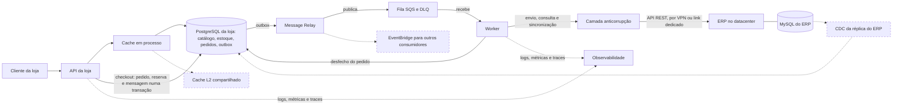

# Arquitetura

O diagnóstico dos três problemas da CaseCellShop, a arquitetura alvo e o porquê de cada bloco. As decisões completas, com as alternativas descartadas, estão no [`STATE.md`](.specs/project/STATE.md); os parâmetros, no [`design.md`](.specs/features/casecellshop/design.md).

## As cinco perguntas

`DOC-IDX-01`. Cada pergunta da Parte 1.A do desafio, a seção que a responde e os critérios que a conferem. O texto de entrega, com as cinco respostas, está no [`RESPOSTAS.md`](RESPOSTAS.md).

| Pergunta | Seção | Critérios |
| --- | --- | --- |
| 1. Diagnóstico, trade-offs e arquitetura alvo | [Diagnóstico e arquitetura alvo](#diagnóstico-e-arquitetura-alvo) | `DOC-DIA-01` a `DOC-DIA-06` |
| 2. Cache, invalidação e vitrine | [Cache e performance da vitrine](#cache-e-performance-da-vitrine) | `DOC-CAC-01` a `DOC-CAC-04` |
| 3. Observabilidade | [Observabilidade](#observabilidade) | `DOC-OBS-01` a `DOC-OBS-04` |
| 4. Concorrência, estoque e idempotência | [Concorrência e idempotência](#concorrência-e-idempotência) | `DOC-CON-01` a `DOC-CON-04` |
| 5. Mensageria, resiliência, contrato e IA | [Mensageria e resiliência](#mensageria-e-resiliência) | `DOC-MSG-01` a `DOC-MSG-04` |

Cada afirmação traz uma marca:

- **[implementado: arquivo, critério]** existe no código e tem teste com o ID do critério no nome;
- **[alvo]**: proposta da arquitetura alvo, fora do escopo do desafio.

## Diagnóstico e arquitetura alvo

**Decisão:** a loja deixa de ler e de escrever no ERP no caminho de cada requisição. O catálogo e a promessa de estoque passam a viver num banco próprio da loja, atualizado por sincronização, e o faturamento passa a ser assíncrono, por uma outbox no mesmo banco.

Os três problemas têm a mesma origem: a loja trata um ERP legado, que não pode ser alterado, como se fosse o banco dela. Lê dele a cada acesso à vitrine, confere o estoque nele e espera por ele para fechar a compra. Com milhões de acessos, o ERP virou o gargalo de leitura, o árbitro da concorrência e a latência do checkout ao mesmo tempo.

### Problema 1: vitrine lenta

**Causa raiz** (`DOC-DIA-01`). O sistema de registro do ERP está no caminho de leitura de alto volume. Cada acesso à vitrine vira uma chamada síncrona à API do ERP, e a carga no ERP cresce com o tráfego da loja, enquanto a capacidade dele não. A lentidão é o sintoma; a causa é o acoplamento de leitura com um sistema que não foi feito para servir vitrine. Como o ERP também fatura, a carga da vitrine disputa recursos com o faturamento.

**Impacto** (`DOC-DIA-02`):

- **cliente:** páginas lentas e erro quando o ERP oscila; quem desiste não volta;
- **negócio:** conversão menor justamente no pico, quando há mais gente comprando, e risco de o ERP degradar o faturamento e o financeiro;
- **operação:** cada pico vira incidente no ERP, sem como separar a carga da vitrine da carga interna.

**Caminhos** (`DOC-DIA-03`):

| | A. Cache na frente da API do ERP | **B. Banco da loja, sincronização e cache em memória** (escolhido) | C. Captura de mudanças (CDC) do MySQL do ERP para o banco da loja |
| --- | --- | --- | --- |
| Custo | Baixo | Médio: um banco e um worker | Alto: conector, broker e acesso de replicação |
| Complexidade | Baixa | Média | Alta |
| Latência | Boa no acerto; a falta ainda chama o ERP | Boa sempre: a origem é um banco local | Boa sempre |
| Consistência | Expira e volta ao ERP; um stampede na expiração derruba o ERP | Defasagem limitada: até 65,5 s mais a duração de uma rodada, com o ERP respondendo | Segundos |
| Esforço operacional | Baixo | Médio: rodada de sincronização e alerta de idade | Alto: binlog em formato ROW, privilégio de replicação e um broker para operar |

**Por que B.** O cache sozinho (A) ainda põe o ERP no caminho de cada falta e não resolve o estoque, que precisa de um lugar transacional (problema 2). O CDC (C) dá o melhor frescor, mas depende de acesso de replicação que o acesso de leitura atual pode não incluir, e de infraestrutura que não existe hoje. B tira o ERP do caminho da vitrine com o que a loja já precisa ter: um banco próprio. O CDC fica para a fase de 60 a 90 dias, se a defasagem medida pedir.

**Leitura direta do MySQL do ERP (descartada).** O acesso de leitura ao banco do ERP permitiria tirar a API REST do caminho da vitrine. Seria rápido de fazer, mas as tabelas internas não são contrato: uma nova versão do ERP quebra a loja sem aviso; a carga de leitura continua no banco que fatura, só que por outra porta; e o estoque lido ali não resolve a reserva, que precisa de um lugar transacional da loja. Fica como plano B da consulta pela referência, se a H1a não valer (R6).

O que B entrega:

- produtos, preço e estoque no PostgreSQL da loja **[implementado: `migrations/store/`, `src/catalog/sync-store.ts`, `CAT-07`]**;
- uma rodada de sincronização na subida e uma a cada 60 s, no worker, que lê o catálogo inteiro e grava só o que mudou **[implementado: `src/catalog/sync.ts`, `CAT-09`, `CAT-14`]** (AD-009, AD-030);
- o catálogo inteiro numa entrada de cache em processo, com tempo de vida (TTL) de 5 s ± 10%, *single-flight* contra stampede e *stale-if-error* com teto de 60 s **[implementado: `src/cache/cache.ts`, `CAT-01` a `CAT-04`]** (AD-005);
- com o ERP fora, a vitrine segue com o último estoque conhecido, e a idade da sincronização dispara alerta **[implementado: `src/catalog/sync-age.ts`, `CAT-15`; o alerta, `OBS-03`]**.

### Problema 2: overselling

**Causa raiz** (`DOC-DIA-01`). A disponibilidade é checada num momento e baixada em outro, o *check-then-act*. Dois clientes leem "1 em estoque" ao mesmo tempo, os dois passam pela checagem, e os dois compram. Com o ERP como único lugar do estoque, a baixa só acontece no faturamento, segundos depois, e a janela entre a checagem e a baixa cresce com a latência do ERP.

**Impacto** (`DOC-DIA-02`):

- **cliente:** compra confirmada e depois cancelada; é a pior experiência possível, porque a pessoa já contava com o produto;
- **negócio:** estorno, atendimento, reclamação pública e perda de confiança, concentrados nas promoções, quando o estoque é disputado;
- **operação:** pedidos para cancelar à mão e estoque negativo no ERP para corrigir, sem métrica que mostre o furo antes da reclamação.

**Caminhos** (`DOC-DIA-03`):

| | **A. `UPDATE` condicional atômico no banco da loja** (escolhido) | B. `SELECT … FOR UPDATE` e depois `UPDATE` | C. Contador ou lock distribuído no Redis |
| --- | --- | --- | --- |
| Custo | Baixo | Baixo | Médio: mais um serviço |
| Complexidade | Baixa: uma instrução por SKU | Média: duas idas ao banco e a checagem na aplicação | Alta: o lock precisa de prazo e de *fencing token* |
| Latência | Uma ida ao banco por SKU | Duas idas ao banco por SKU | Uma ida ao Redis, mais o banco para o pedido |
| Consistência | Forte, na mesma transação do pedido | Forte | Fora da transação do pedido; um failover com replicação assíncrona pode perder uma escrita confirmada |
| Esforço operacional | Nenhum além do banco | Nenhum além do banco | Um cluster Redis para operar |

**Por que A.** A reserva é uma instrução só, `UPDATE inventory SET reserved = reserved + :q WHERE sku = :sku AND on_hand - reserved >= :q`, no último passo da transação do checkout. O PostgreSQL trava a linha, e um segundo comprador concorrente espera e reavalia a condição. Zero linhas afetadas significa sem estoque, e a resposta é `409`. B é correto, mas faz duas idas ao banco e põe a regra na aplicação. C tira a reserva da transação do pedido, que é justamente o que precisa ser atômico.

O que A entrega:

- a loja controla a **promessa** de estoque: `on_hand` espelha o ERP, `reserved` é da loja e `sold_total` só cresce **[implementado: `migrations/store/20260102000000_create_store.ts`, `src/checkout/repository.ts`, `CHK-01`; a baixa no faturamento: `src/billing/conclude.ts`, `ORD-17`]** (AD-002);
- uma ordem de lock única entre linhas existentes (mensagem da outbox, pedido, estoque por SKU) evita deadlock **[implementado no checkout: `src/checkout/repository.ts`, `CHK-07`; na conclusão e no cancelamento do pedido: `src/billing/conclude.ts`, `src/billing/runbook.ts`]**;
- o teste dispara 50 checkouts simultâneos com estoque 5 e conta que exatamente 5 passam, contra um PostgreSQL real **[implementado: `test/integration/checkout/checkout-concurrency.test.ts`, `CHK-01`]**.

### Problema 3: checkout frágil

**Causa raiz** (`DOC-DIA-01`). O faturamento é síncrono: a resposta ao cliente espera o ERP, cuja mediana é de cerca de 3 s, com p99,9 de 8 s. Quando o ERP demora, o cliente ou o próximo salto dá timeout e tenta de novo, e sem idempotência cada tentativa pode virar um pedido novo. Não há registro durável do pedido antes da chamada, então uma queda no meio deixa o pedido sem rastro, e sem correlação por pedido não há como saber o que aconteceu.

**Impacto** (`DOC-DIA-02`):

- **cliente:** espera longa, erro depois de pagar a espera, cobrança ou pedido em dobro;
- **negócio:** abandono no último passo, que é o mais caro de perder, e faturas duplicadas para estornar;
- **operação:** sem rastreabilidade por pedido, cada caso exige procurar nos logs do ERP; retries em cascata aumentam a carga no ERP justamente quando ele está lento.

**Caminhos** (`DOC-DIA-03`):

| | A. Síncrono, com timeout maior e retry | **B. `202`, outbox no banco da loja e worker** (escolhido) | C. `202` com publicação num broker externo (SQS, RabbitMQ) |
| --- | --- | --- | --- |
| Custo | Nenhum | Baixo: o banco já existe | Médio: um broker gerenciado ou operado |
| Complexidade | Baixa, mas o retry precisa de idempotência no ERP | Média: worker, lease, retry, DLQ e reconciliação | Alta: escrita dupla entre o banco e o broker, ou um relay a mais |
| Latência para o cliente | A do ERP: segundos | A de uma transação curta, sem o ERP | A de uma transação mais a publicação |
| Consistência | Duplica pedido sob retry sem idempotência | O pedido e a mensagem nascem na mesma transação: sem pedido fantasma nem mensagem fantasma | Publicar antes de gravar gera mensagem fantasma; publicar depois gera pedido fantasma |
| Esforço operacional | Baixo, mas cada lentidão do ERP vira incidente | Médio: a DLQ e o runbook | Médio a alto: o broker e a DLQ dele |

**Por que B.** O checkout grava o pedido, a reserva e a mensagem de saída numa transação só e responde `202 Accepted` com `Location` e `Retry-After`. O cliente acompanha em `GET /orders/{orderId}/status`. Um *Message Relay* publica a mensagem no SQS depois do commit, e o worker consome do SQS e chama o ERP fora da transação (AD-021). A resolve a latência só no papel e piora o problema de duplicação. C publicando direto no broker, sem outbox, não é correto, porque o banco e o broker não têm uma transação comum; por isso B usa o SQS atrás da outbox, e não no lugar dela.

O que B entrega:

- `Idempotency-Key` obrigatório, gravado na transação do pedido antes de qualquer reserva: duplo clique e retry do cliente devolvem o pedido original **[implementado: `src/checkout/repository.ts`, `CHK-03`, `CHK-04`]** (AD-006, AD-020);
- retry com atraso mínimo de 45 s e *full jitter*, até 12 tentativas, e depois a DLQ **[implementado]** (AD-003);
- antes de criar de novo, o worker consulta o ERP pela referência do pedido, para não faturar duas vezes **[implementado]**;
- reconciliação periódica da DLQ e um runbook para reprocessar em lote ou cancelar **[implementado]**;
- um semáforo de 30 chamadas simultâneas ao ERP, o que ele aguenta pela premissa de carga **[implementado]**.

### Arquitetura de 30 a 90 dias

`DOC-DIA-04`. A ordem segue o risco: primeiro o que tira o ERP do caminho e fecha o furo de estoque, depois o que dá visibilidade, e por último o que escala.

**Dias 0 a 30: tirar o ERP do caminho do cliente.** É o que este projeto implementa.

- **Banco próprio da loja:** PostgreSQL com catálogo, preço, estoque, pedidos, chaves de idempotência e outbox **[implementado: `migrations/store/`, `test/integration/checkout/store-schema.test.ts`, `CHK-01`]**.
- **Checkout:** reserva atômica, idempotência e `202` **[implementado: `src/checkout/repository.ts`, `CHK-01` a `CHK-12`]**.
- **Fila:** SQS, alimentado pela outbox do banco por um *Message Relay*; localmente, o ElasticMQ no compose **[implementado]**.
- **Workers:** um worker para o envio ao ERP e para a sincronização **[implementado: `src/billing/worker.ts`, `ORD-01`; `src/catalog/sync.ts`, `CAT-09`]**.
- **Sincronização:** preço e estoque a cada 60 s, sem devolver unidade já vendida **[implementado: `src/catalog/sync-store.ts`, `CAT-07`]**.
- **Cache:** em processo, na vitrine **[implementado: `src/cache/cache.ts`, `CAT-01` a `CAT-05`]**.
- **Observabilidade básica:** logs estruturados com `correlationId` e `orderId`, métricas em `/metrics` e traces da requisição ao ERP. O contrato com o erro em `problem+json` e o `X-Request-Id` **[implementado: `src/contract/`, `src/http/problem.ts`, `FND-03`, `FND-07`]**; os traces da requisição ao banco, vistos no Jaeger local **[implementado: `src/shared/telemetry.ts`, `FND-05`]**; os demais logs, métricas e traces **[implementado: `OBS-01`, `OBS-02`, `OBS-05`, `OBS-07`]**.

**Dias 30 a 60: operar com segurança.**

- **Reconciliação com o ERP:** a DLQ conferida periodicamente pela referência, e o runbook de reprocessamento e cancelamento **[implementado]**.
- **Observabilidade completa:** objetivos de nível de serviço (SLOs: vitrine e checkout com 99,9% sem `5xx`, e 99% dos pedidos com desfecho em até 60 s), alertas, dashboard e runbook no Datadog ou equivalente, escritos em PromQL **[implementado: README, seção "Operação", `OBS-03`]**.
- **Mais de uma instância da API**, com um cache L2 compartilhado (Redis) atrás do cache em processo, para as instâncias servirem o mesmo dado **[alvo]**.
- **Autenticação na borda** (OAuth2/OIDC) e limite de taxa por cliente; a chave de idempotência passa a valer por cliente **[alvo]**.

**Dias 60 a 90: escalar e reduzir a defasagem.**

- **CDC** a partir de uma réplica do MySQL do ERP no lugar da sincronização por polling, se a defasagem medida pedir e o acesso de replicação for liberado **[alvo]**.
- **EventBridge na saída do relay,** quando surgir um segundo consumidor dos eventos de pedido (aviso ao cliente, analytics), cada um com a sua fila SQS e a sua DLQ **[alvo]**.
- **Várias réplicas do worker**, com a sincronização coordenada e o limite de chamadas ao ERP dividido entre elas **[alvo]**.
- **Migração para a nuvem**, abaixo.

### A nuvem como hipótese de evolução

`DOC-DIA-05`. Hoje tudo roda em datacenter próprio. A nuvem é uma hipótese, não uma premissa: cada componente tem um serviço gerenciado equivalente, e o motivo para trocar é o esforço operacional que ele tira. Os nomes são da AWS como exemplo; Azure e Google Cloud têm equivalentes diretos.

| Componente | Serviço gerenciado | Esforço que tira |
| --- | --- | --- |
| Banco da loja (PostgreSQL) | Amazon RDS ou Aurora PostgreSQL | Backup, failover entre zonas, atualização de versão e réplica de leitura |
| API e worker (contêineres) | ECS no Fargate | Servidores, sistema operacional e escala por carga |
| Fila | Amazon SQS, o mesmo que o ElasticMQ emula no compose; a outbox continua na frente dele, e o EventBridge entra com um segundo consumidor | DLQ, redrive e escala gerenciados, sem perder a transação única do pedido |
| Cache L2 | ElastiCache | Cluster, réplica e failover do Redis |
| Observabilidade | Datadog, ou CloudWatch com Prometheus e Grafana gerenciados | Coleta, retenção e alertas sem operar a pilha |
| Segredos | Secrets Manager | Rotação de credenciais do banco e do ERP |

**O ERP fica no datacenter.** Ele não pode ser alterado e não migra junto. A loja na nuvem passa a falar com ele por uma conexão híbrida: uma VPN site a site, ou um link dedicado (Direct Connect) com a VPN de reserva. Essa conexão vira uma fonte nova de latência e de falha:

- **latência:** cada chamada ao ERP soma o tempo de ida e volta do link. O timeout do ERP (10 s) e o atraso mínimo antes de consultar (45 s) precisam ser revistos com o tempo medido no link;
- **falha:** uma queda do link é, para a loja, uma queda do ERP. O desenho já a absorve: o checkout continua aceitando pedidos, que esperam na outbox com a reserva feita, e a vitrine segue com o último estoque conhecido, com alerta pela idade da sincronização;
- **operação:** o link precisa de monitoramento próprio, para um alerta de "ERP fora" apontar a causa certa.

### Diagrama da arquitetura alvo

`DOC-DIA-06`. As caixas tracejadas são da arquitetura alvo; as outras são implementadas neste projeto.



## Cache e performance da vitrine

**Decisão:** a vitrine lê de um cache em processo que guarda o catálogo inteiro numa entrada só, carregada do banco da loja, com TTL de 5 s ± 10%, *single-flight* e *stale-if-error*. É um cache de latência: o checkout nunca decide por ele, e sem ele o serviço continua correto, só mais lento. O ERP sai do caminho da vitrine; quem fala com ele é a sincronização do worker, uma rodada por minuto **[implementado: `src/cache/`, `src/catalog/`, `CAT-01` a `CAT-15`]** (AD-005, AD-009).

A vitrine era lenta porque cada acesso virava uma chamada ao ERP (Problema 1). A resposta tem duas defasagens, e elas somam: a do banco da loja, que é uma cópia atualizada pela sincronização (até 60 s mais a duração de uma rodada), e a do cache em processo (até 5,5 s). Daí sai o limite da meta 2: com o ERP respondendo, uma mudança de preço ou de estoque chega à vitrine em até 65,5 s mais a duração de uma rodada (`CAT-06`).

### Camadas de cache e o papel de cada uma

`DOC-CAC-01`. Cada camada resolve um problema diferente. A CDN, o cache em processo e o L2 são caches; o banco da loja é uma cópia sincronizada, e o ERP é a origem:

| Camada | Onde fica | Papel | Defasagem que soma | Aqui |
| --- | --- | --- | --- | --- |
| Rede de distribuição de conteúdo (CDN) e cache HTTP | Borda, fora do serviço | Servir imagens e arquivos estáticos perto do cliente | Nenhuma no catálogo, que sai com `no-store` | Fora do escopo; `Cache-Control: no-store` em toda resposta da vitrine **[implementado: `src/catalog/routes.ts`, `CAT-10`]**; a CDN para estáticos **[alvo]** |
| Em processo (L1) | Memória de cada instância da API | Absorver as leituras: o banco recebe no máximo uma consulta por instância a cada TTL, qualquer que seja o tráfego | Até 5,5 s; até 60 s com a origem em erro | **[implementado: `src/cache/cache.ts`, `CAT-01` a `CAT-05`]** |
| L2 compartilhado (Redis) | Entre as instâncias da API | Dar o mesmo instantâneo a todas as instâncias e uma consulta à origem por TTL no total, e não uma por instância | Até o TTL dele | **[alvo]** |
| Banco da loja | PostgreSQL | A cópia de catálogo, preço e estoque que a loja controla: origem do cache e fonte de verdade do checkout | Até 60 s mais a duração de uma rodada | **[implementado: `src/catalog/sync-store.ts`, `CAT-06`, `CAT-07`]** |
| ERP | Datacenter | Sistema de registro; lido só pela sincronização, nunca por uma requisição | — | ERP simulado **[implementado: `src/erp/sim/`]** |

**Por que o catálogo não passa por CDN.** Uma camada fora do serviço serviria dado defasado sem aparecer nas métricas: a idade da entrada servida é medida na API, e a da borda não. O `no-store` é explícito, e não a ausência de cabeçalho, porque sem `Cache-Control` um cache intermediário pode aplicar frescor heurístico (RFC 9111, §4.2.2). Quando houver uma CDN, a resposta passa a levar `max-age` igual ao TTL restante da entrada, para a borda não somar mais defasagem que o próprio cache (AD-005).

**Por que uma entrada só.** O catálogo tem alguns milhares de SKUs, que cabem na memória de uma instância. As páginas de 50 itens são fatiadas da entrada, então todas as páginas servidas durante um TTL vêm do mesmo instantâneo (`CAT-03`), e há uma única chave a proteger contra stampede. Com uma entrada por página, cada página expiraria na sua hora, e um SKU poderia aparecer duas vezes ou sumir entre uma página e a seguinte.

**Por que o L2 fica para a arquitetura alvo.** O compose sobe uma instância da API. O Redis seria um contêiner, um cliente e um modo de falha a mais para um ganho que só aparece com várias instâncias: com N instâncias, uma expiração gera até N consultas à origem, uma por instância a cada 5 s, o que um PostgreSQL absorve sem esforço. O L2 entra quando houver várias instâncias com taxa de acerto baixa, ou quando a carga somada na origem pesar. Ele não substitui o L1: o L1 continua na frente, e o L2 precisa do próprio *single-flight* entre instâncias, um lock com prazo (AD-005).

**Por que o banco da loja, e não um cache na frente do ERP.** Um cache na frente da API do ERP ainda põe o ERP no caminho de cada falta, e uma expiração com muitas requisições vira um stampede contra o ERP (Problema 1, caminho A). O banco da loja tira o ERP do caminho da vitrine e é o lugar transacional que a reserva de estoque precisa (Problema 2).

### TTL, invalidação, cache-aside × refresh-ahead, fallback e stampede

`DOC-CAC-02`.

**TTL de 5 s ± 10%.** A maior parte da defasagem vem da sincronização (60 s), não do cache. Um TTL de 1 s faria 5 vezes mais consultas à origem para tirar 4 s de um limite de 65,5 s; um TTL de 30 s pouparia cargas que o banco já absorve sem esforço e levaria o limite de 65,5 s para cerca de 93 s. O jitter de ± 10% espalha as expirações de várias instâncias que subiram juntas, para não carregarem a origem no mesmo instante **[implementado: `src/cache/cache.ts`, `CAT-02`]**.

**Invalidação só por expiração.** A sincronização não avisa a API a cada correção. Um aviso entre processos (um `NOTIFY` do PostgreSQL, ou um pub/sub) tiraria até 5,5 s de um limite de 65,5 s, mas acrescentaria um caminho de falha entre o worker e a API; quando esse aviso se perde em silêncio, quem limita a defasagem é o TTL, de qualquer jeito. O TTL de segundos já é o limite, e o aviso seria só uma otimização dele (AD-005, AD-009).

**O cache nunca decide nada.** Uma entrada defasada não vende além do estoque nem cobra outro preço:

- o preço: o cliente envia o preço que viu em cada item, e, se ele divergir do banco, recebe `409` com o preço atual, sem reserva **[implementado: `src/checkout/repository.ts`, `CHK-06`]** (AD-018);
- o estoque: a reserva é o `UPDATE` condicional no banco, que não lê o cache **[implementado, `CHK-01`]**.

O pior efeito de uma entrada defasada é a vitrine mostrar algo que o checkout recusa, e esse caso é medido (`DOC-CAC-04`).

**Disponibilidade em faixas.** A vitrine mostra a faixa, e não o número: `available` ("disponível"), `low_stock` ("últimas unidades", até 5 livres) ou `out_of_stock` ("esgotado"). A faixa muda menos que o número exato, então a defasagem do TTL aparece menos, e o estoque exato não é exposto **[implementado: `src/catalog/availability.ts`, `CAT-13`]**.

**Cache-aside × refresh-ahead.** O cache é *cache-aside*: a requisição que encontra a entrada vencida carrega a origem, e as que chegam durante a carga esperam a mesma promessa.

| | ***Cache-aside* com *single-flight*** (escolhido) | *Refresh-ahead* | *Stale-while-revalidate* |
| --- | --- | --- | --- |
| Latência na expiração | As requisições daquele instante esperam uma consulta ao banco local | Nenhuma: recarrega antes de vencer | Nenhuma: serve a vencida e recarrega em segundo plano |
| Carga na origem | Uma consulta por TTL, só se houver tráfego | Uma consulta por TTL, mesmo sem tráfego | Uma consulta por TTL, só se houver tráfego |
| Defasagem | Até o TTL | Até o TTL | Até 2 TTL |
| Complexidade | Baixa | Média: um timer, o cancelamento dele no encerramento e um erro que acontece fora de qualquer requisição | Média: a carga em segundo plano e o erro dela fora da requisição |

**Por que *cache-aside*.** O *refresh-ahead* e o *stale-while-revalidate* escondem a latência de uma origem lenta ou cara. Aqui a origem é um banco local, e o que eles escondem é uma consulta a cada 5 s. A origem lenta e cara era o ERP, e é ele que a arquitetura tirou do caminho. Proposta: rever a escolha se a latência da vitrine numa falta passar do SLO de 200 ms.

**Fallback, em ordem:**

1. entrada dentro do TTL: servida da memória;
2. entrada vencida: uma carga da origem, com as outras requisições esperando a mesma promessa;
3. origem em erro: a entrada vencida é servida até 60 s de idade (*stale-if-error*), e, por 5 s depois da falha, servida direto, sem tentar a origem, para nenhuma requisição esperar o timeout de uma origem que acabou de falhar **[implementado: `src/cache/cache.ts`, `CAT-04`]**;
4. sem entrada, ou com ela além do teto: `503` com `Retry-After` **[implementado: `src/catalog/routes.ts`, `CAT-04`]**;
5. antes da primeira sincronização completa: `503`, para a vitrine não mostrar um catálogo vazio como se fosse o real **[implementado: `src/catalog/storefront.ts`, `CAT-05`]**.

O ERP fora não aparece nessa lista: ele não está no caminho da vitrine. Com o ERP fora, a sincronização para, o banco segue com o último preço e o último estoque conhecidos, e a idade da sincronização dispara alerta (AD-009).

**Prevenção de stampede:**

- ***single-flight*:** N leituras simultâneas com a entrada vencida geram uma consulta à origem **[implementado: `src/cache/cache.ts`, `CAT-01`]**;
- **uma promessa rejeitada é descartada,** para um erro da origem não ficar guardado como se fosse o catálogo;
- **uma chave só:** o catálogo inteiro numa entrada, sem várias chaves expirando em momentos diferentes;
- **jitter no TTL e pausa depois da falha,** que espalham as cargas entre instâncias e evitam uma fila de requisições esperando uma origem em erro;
- **do lado do ERP,** a sincronização faz uma rodada de cada vez, sem sobrepor a seguinte **[implementado: `src/catalog/sync.ts`, `CAT-09`]**, e divide o semáforo de 30 chamadas com o faturamento **[implementado: `src/main/worker.ts`, `ORD-20`]**.

Com N instâncias, o limite é de N cargas por expiração; o L2 com lock o reduz a uma **[alvo]**.

### Métricas de ganho de latência e de custo

`DOC-CAC-03`. O ganho se mede em três frentes: o cliente espera menos, o ERP deixa de ser chamado pela vitrine e a origem do cache recebe uma carga que não cresce com o tráfego. Os nomes estão no catálogo de telemetria ([`telemetry.md`](.specs/features/casecellshop/telemetry.md)); no Prometheus, o ponto vira sublinhado e o counter ganha `_total`.

| Ganho | Métrica | Como se lê | Esperado |
| --- | --- | --- | --- |
| Latência da vitrine | `http.server.request.duration` na rota `/products` (histogram) | p99 e fração abaixo de 200 ms, pela fronteira de 0,2 s do histograma | 99% em até 200 ms (SLO) **[implementado: `src/http/telemetry.ts`, `OBS-07`]** |
| Taxa de acerto | `casecellshop.catalog.cache.lookups` (counter: `hit`, `miss`, `stale`) | `hit` sobre o total | Perto de 1 − 1/(R × TTL) por instância, com R requisições por segundo: com R = 100, uma falta a cada ~500 leituras **[implementado: `src/catalog/storefront.ts`, `OBS-02`]** |
| Carga na origem | `casecellshop.catalog.origin.loads` (counter: `ok`, `error`) | Cargas por requisição, a medida de custo da AD-005 | No máximo ~0,2 carga por segundo por instância, qualquer que seja o tráfego **[implementado: `src/catalog/storefront.ts`, `OBS-02`]** |
| *Single-flight* funcionando | `casecellshop.catalog.origin.active_loads` (UpDownCounter) | Cargas em andamento | No máximo 1 por instância **[implementado: `src/catalog/storefront.ts`, `OBS-02`]** |
| Chamadas ao ERP evitadas | `casecellshop.erp.client.operation.duration` com a operação `list_catalog` (o `_count` do histogram conta as chamadas) | Requisições da vitrine menos chamadas de catálogo ao ERP | Antes, uma chamada ao ERP por acesso; agora, as páginas de uma rodada por minuto, constante com o tráfego **[implementado: `src/erp/telemetry.ts`, `src/catalog/sync.ts`, `OBS-07`]** |

As chamadas evitadas, em PromQL, com séries de dois processos (a API e o worker) que o Prometheus coleta juntos:

```promql
sum(rate(http_server_request_duration_count{http_route="/products"}[5m]))
  - sum(rate(casecellshop_erp_client_operation_duration_count{casecellshop_erp_operation="list_catalog"}[5m]))
```

**Custo.** O cache em processo não acrescenta servidor: a entrada ocupa a memória de alguns milhares de SKUs em cada instância, e a origem recebe uma consulta a cada 5 s por instância. O ganho maior é a capacidade do ERP. Pelas premissas de carga, ele aguenta ~30 chamadas simultâneas, e o faturamento usa ~21 no pico (~7 pedidos/s × ~3 s por chamada). Com a vitrine lendo do ERP, cada acesso disputaria essa mesma folga; agora, a única carga da vitrine no ERP é a leitura do catálogo da sincronização, uma por minuto, dentro do mesmo semáforo de 30. Na nuvem, o custo evitado é o de um ElastiCache e o do tráfego da vitrine no link com o datacenter.

**Latência de uma falta.** A diferença entre um acerto e uma falta aparece no trace de `GET /products`: numa falta, o span do repositório mostra o tempo da consulta à origem dentro da requisição (`DOC-OBS-03`, `CAT-12`).

### Métricas de que o ganho não veio de dado velho ou incorreto

`DOC-CAC-04`. Uma taxa de acerto de 100% é fácil de conseguir servindo a mesma entrada para sempre. Por isso cada métrica de ganho tem uma métrica de frescor ou de correção ao lado, e o limite da meta 2 passa a ser medido em produção, não só no teste (`CAT-06`).

| Pergunta | Métrica | Normal | Sinal de problema |
| --- | --- | --- | --- |
| Quão velha é a entrada que o cliente vê? | `casecellshop.catalog.served_entry.age` (histogram) | Até 5,5 s | Entre 5,5 e 60 s só em *stale-if-error*; acima de 60 s nunca, porque aí a resposta é `503` (`CAT-04`) **[implementado: `src/catalog/storefront.ts`, `OBS-02`]** |
| Quão velho é o dado no banco? | `casecellshop.catalog.sync.age` (gauge, desde a última rodada completa) | Até 60 s mais a duração de uma rodada | A sincronização parou: ERP fora ou worker caído **[implementado: `src/catalog/sync-age.ts`, `CAT-15`]** |
| Quanto sai em *stale-if-error*? | `stale` em `casecellshop.catalog.cache.lookups` e `error` em `casecellshop.catalog.origin.loads` | Zero | A origem do cache está falhando **[implementado: `src/catalog/storefront.ts`, `CAT-04`, `OBS-02`]** |
| A vitrine mostrou um preço que já não vale? | `price_changed` em `casecellshop.checkout.requests` (counter) | Raro | Preço muda mais rápido que a sincronização; o cliente recebe `409` com o preço atual e não é cobrado por outro valor (`CHK-06`, H3) **[implementado: `src/checkout/telemetry.ts`]** |
| A vitrine mostrou disponível o que acabou? | `out_of_stock` em `casecellshop.checkout.requests` | Raro, quase só em "últimas unidades" | Estoque defasado além do TTL **[implementado]** |
| A promessa passou do estoque? | `casecellshop.inventory.oversold_skus` (gauge, SKUs com `reserved > on_hand`) e `casecellshop.erp.out_of_stock.rejections` (counter) | Zero | Venda em outro canal baixou o estoque do ERP depois da reserva **[implementado: `src/checkout/inventory-gauges.ts`, `src/erp/acl.ts`, `OBS-06`]** |
| Quanto cada rodada corrige? | `casecellshop.catalog.sync.corrections` (counter, por campo) e `casecellshop.catalog.sync.missing_skus` (counter) | Poucas correções por rodada | Muitas correções: a defasagem custa mais e o intervalo deve ser revisto (AD-009); SKUs ausentes de repente: paginação do ERP ou remoção em massa (`CAT-11`) **[implementado: `src/catalog/sync.ts`, `OBS-02`]** |

Juntas, as duas idades limitam o que o cliente vê: o dado da vitrine tem no máximo a idade da sincronização mais a idade da entrada servida. A idade da sincronização é lida do banco (`sync_state.last_completed_at`) e sai da API, não do worker, para continuar existindo e disparar o alerta quando o worker está caído.

Os testes provam o mecanismo, e as métricas provam que ele funciona em produção: a expiração no TTL (`CAT-02`), o teto do *stale-if-error* (`CAT-04`), o limite da meta 2 com relógio controlado (`CAT-06`), a sincronização sem devolver unidade vendida (`CAT-07`), o SKU ausente (`CAT-11`), o preço alterado (`CHK-06`) e a promessa acima do estoque (`OBS-06`).

## Observabilidade

**Decisão:** três sinais com a mesma correlação. Logs JSON pelo pino; métricas pela API de métricas do OpenTelemetry, expostas em `/metrics` no formato Prometheus; e traces por spans manuais do OpenTelemetry, com o `traceparent` gravado na outbox para o worker continuar o trace do checkout. Toda métrica e todo evento de log são declarados num catálogo tipado, por pasta, e o `tsc` recusa o que estiver fora dele; o catálogo gerado é o [`telemetry.md`](.specs/features/casecellshop/telemetry.md) **[implementado: `src/shared/telemetry-catalog.ts`, `src/shared/logging.ts`, `OBS-07`]** (AD-008, AD-029).

A observabilidade responde a duas causas do diagnóstico: no Problema 3, sem correlação por pedido não havia como saber o que aconteceu com um pedido; no Problema 2, não havia métrica que mostrasse o furo de estoque antes da reclamação. A meta é detectar degradação e furo de estoque antes do cliente, e seguir qualquer pedido da requisição ao ERP **[implementado, `OBS-05`]**.

**Por que assim:**

| | **Spans manuais, métricas em `/metrics` e catálogo tipado** (escolhido) | Auto-instrumentação do OpenTelemetry | Agente de um fornecedor (`dd-trace`) |
| --- | --- | --- | --- |
| Cobertura | Só onde há span; um caminho sem span não aparece | Bibliotecas instrumentadas sem código | Bibliotecas instrumentadas sem código |
| Risco | Disciplina: o span que falta | Em ESM, depende dos hooks de carregamento de módulo do Node, ainda experimentais | Instrumentação presa a um fornecedor |
| Conferência local | `/metrics` se lê com um `curl`; o Jaeger mostra os traces | Igual | Exige o agente do fornecedor |
| Nomes | Conferidos pelo `tsc` e por teste contra o `/metrics` real | Os da convenção, sem os de negócio | Os do fornecedor |

As métricas saem em `/metrics`, e não por OTLP, porque OTLP exigiria um coletor para ver qualquer número; o mesmo endpoint serve o Prometheus e o Datadog, que o coleta pela integração OpenMetrics (AD-008). A auto-instrumentação entra como complemento quando os hooks de ESM ficarem estáveis.

### Logs estruturados e campos obrigatórios

`DOC-OBS-01`. Cada log é uma linha JSON, escrita pelo pino. O contexto da requisição (o `correlationId` e o span atual) viaja pelo `AsyncLocalStorage`, então nenhuma função precisa receber o contexto como parâmetro **[implementado: `src/shared/logging.ts`, `src/http/request-context.ts`, `OBS-01`]**.

**Campos obrigatórios.** Os de identificação saem em toda linha; o `correlationId`, em toda linha escrita dentro de uma requisição ou de uma tentativa do worker; o `trace_id` e o `span_id`, em toda linha escrita dentro de um span:

| Campo | Quando | O que é | De onde vem |
| --- | --- | --- | --- |
| `time` | Toda linha | Instante, em ISO 8601 | O processo |
| `level` | Toda linha | `info`, `warn` ou `error`, como texto | O nível em que o evento sai |
| `service`, `env`, `version` | Toda linha | Processo, ambiente e versão | Os mesmos atributos de recurso dos traces, porque o Datadog só liga log e trace com a marcação unificada de serviço |
| `event` | Toda linha | Nome do evento do catálogo, como `casecellshop.checkout.accepted` | O `eventLogger`, que vale sobre qualquer campo com o mesmo nome |
| `msg` | Toda linha | Mensagem em português, para quem lê | O evento |
| `correlationId` | Requisição ou tentativa | Identificador da requisição | O `X-Request-Id` válido do cliente, ou um UUID novo; volta no cabeçalho e no corpo do erro (`FND-03`), e viaja na mensagem da outbox até o worker |
| `trace_id`, `span_id` | Dentro de um span | Ligação com o trace (32 e 16 caracteres hexadecimais), com o `trace_flags` | O span atual |

Os logs do próprio processo, fora de uma requisição, de uma tentativa ou de um span (a subida, o encerramento, o início e o fim do relay e do worker, a migração), saem sem os campos de correlação: não há requisição nem span a que ligar, e um valor inventado não levaria a lugar nenhum. A rodada da sincronização roda num span, sem requisição: o log dela traz o `trace_id` e o `span_id`, sem `correlationId` (`OBS-01`).

**Campos quando existem:** `route`, `method`, `status` e `duration_ms` no fim da requisição; `cache` (`hit`, `miss` ou `stale`) no fim de uma resposta `200` da vitrine; `orderId` e `sku`; `attempt` (o número de recebimentos da mensagem no SQS) e `cause` (por que a tentativa voltou à fila) no worker; `reason` (sempre em snake_case, como `out_of_stock` ou `erp_rejected`); e `err`, com o código do erro.

Um exemplo, do checkout aceito:

```json
{"level":"info","time":"2026-11-02T12:00:00.000Z","service":"casecellshop-api","env":"development","version":"0.0.0","event":"casecellshop.checkout.accepted","correlationId":"6f1c2e4a-8d3b-4c55-9a0e-2b7d1f9e3c10","trace_id":"4bf92f3577b34da6a3ce929d0e0e4736","span_id":"00f067aa0ba902b7","trace_flags":"01","orderId":"0b6d8f2e-5a41-4e3c-8f7a-9c2d1e0b4a67","msg":"checkout aceito"}
```

**Os níveis:**

- `info`: o que aconteceu como esperado: checkout aceito, pedido faturado, rodada de sincronização concluída;
- `warn`: o que o sistema absorveu, mas alguém pode querer saber: checkout recusado, retry, origem do cache em erro, preço alterado, erro de configuração no ERP;
- `error`: o que precisa de alguém: mensagem na DLQ, falha da sincronização, transação abortada antes do `COMMIT`.

**O catálogo impede o log livre.** Cada pasta declara os próprios eventos (nome `casecellshop.<domínio>.<evento>`, níveis e campos), e o `tsc` recusa um evento fora do catálogo, num nível que ele não declara ou com um campo que ele não declara. Fora de `src/shared/logging.ts`, o código recebe um logger opaco que só cria filhos, e o lint só deixa importar o pino ali: um log que não passe pelo catálogo não compila **[implementado, `OBS-07`]**. Assim, uma busca por `event` acha todos os casos de um fato, e um campo não muda de nome entre um log e outro.

**`orderId` e `sku` ficam nos logs, nunca nas métricas.** Um atributo de métrica com um valor por pedido criaria uma série por pedido no Prometheus. Nos logs, eles são o que liga um pedido ou um produto ao resto. O detalhe de um erro fica no log; a resposta ao cliente é o `problem+json`, sem stack trace nem SQL.

**No worker,** cada tentativa roda no contexto do `correlationId` que veio na mensagem e dentro do span dela, e todo log da tentativa leva `orderId` e `attempt`. A chegada à DLQ sai uma vez por mensagem, da reconciliação (`casecellshop.outbox.dead`, com o `orderId`) **[implementado: `src/billing/telemetry.ts`, `OBS-01`]**. Os eventos da vitrine e da sincronização (`casecellshop.catalog.*`) estão em `src/catalog/telemetry.ts` **[implementado, `OBS-07`]**.

### Counters, gauges e histograms para cache, checkout, fila e ERP

`DOC-OBS-02`. A regra de cada instrumento: counter para o que acontece (um checkout, uma tentativa), gauge para o estado num instante (mensagens na DLQ, SKUs com furo), histogram para durações e idades. Cada histogram tem uma fronteira no limiar do SLO que ele mede, porque o percentil só é exato nela: 0,2 s na duração HTTP e 60 s no aceite ao faturamento (AD-029). Os atributos vêm de uma lista fechada, nunca `orderId` nem `sku`.

| Área | Métrica | Instrumento | Responde | Estado |
| --- | --- | --- | --- | --- |
| Vitrine e checkout | `http.server.request.duration` | histogram, por rota, método e status | Latência e `5xx` de cada rota, base dos SLOs | **[implementado: `src/http/telemetry.ts`]** |
| Cache | `casecellshop.catalog.cache.lookups` | counter: `hit`, `miss`, `stale` | Taxa de acerto e quanto sai em *stale-if-error* | **[implementado: `src/catalog/telemetry.ts`, `OBS-02`]** |
| Cache | `casecellshop.catalog.origin.loads` | counter: `ok`, `error` | Carga e erro da origem | **[implementado, `OBS-02`]** |
| Cache | `casecellshop.catalog.origin.active_loads` | UpDownCounter | O *single-flight* segura a carga em uma por instância | **[implementado, `OBS-02`]** |
| Cache | `casecellshop.catalog.served_entry.age` | histogram | Idade do que o cliente vê | **[implementado, `OBS-02`]** |
| Sincronização | `casecellshop.catalog.sync.age` | gauge | Tempo desde a última rodada completa, lido do banco pela API | **[implementado: `src/catalog/sync-age.ts`, `CAT-15`]** |
| Sincronização | `casecellshop.catalog.sync.corrections` | counter, por campo | Quanto cada rodada corrige | **[implementado: `src/catalog/sync.ts`, `OBS-02`]** |
| Sincronização | `casecellshop.catalog.sync.missing_skus` | counter | SKUs ausentes zerados | **[implementado, `OBS-02`]** |
| Checkout | `casecellshop.checkout.requests` | counter: `accepted`, `replay`, `out_of_stock`, `price_changed`, `invalid`, `unavailable` | Desfechos do checkout | **[implementado: `src/checkout/telemetry.ts`, `OBS-02`]** |
| Estoque | `casecellshop.inventory.reserved` | gauge | Unidades prometidas e ainda não faturadas | **[implementado: `src/checkout/inventory-gauges.ts`, `OBS-06`]** |
| Estoque | `casecellshop.inventory.oversold_skus` | gauge | SKUs com `reserved > on_hand`: o furo de estoque | **[implementado, `OBS-06`]** |
| Fila | `casecellshop.outbox.published.messages` | counter | O relay está publicando | **[implementado: `src/billing/telemetry.ts`]** |
| Fila | `casecellshop.outbox.attempts` | counter: `invoiced`, `failed`, `retry`, `deferred`, `closed`, `lease_short`, `dead` | Desfecho de cada tentativa | **[implementado]** |
| Fila | `casecellshop.outbox.orphan_conclusions` | counter | Conclusões sem efeito, com o *receipt handle* vencido | **[implementado]** |
| Fila | `casecellshop.queue.messages` | gauge, com `casecellshop.queue.name`: `billing`, `dlq` | Mensagens na fila e na DLQ, visíveis e em voo, pelo `GetQueueAttributes` do SQS, no worker: a mensagem que a reconciliação segura continua contada | **[implementado: `src/billing/queue-gauge.ts`, `OBS-02`, `OBS-09`]** |
| Fila | `casecellshop.outbox.oldest_pending.age` | gauge | Idade do pedido mais antigo sem desfecho; o SQS não a expõe pela API, então sai da outbox | **[implementado: `src/billing/outbox-age.ts`, `OBS-02`]** |
| Fila | `casecellshop.order.accept_to_invoice.duration` | histogram, com fronteira em 60 s | Tempo do aceite ao faturamento | **[implementado]** |
| Fila | `casecellshop.order.stuck` | counter | Pedidos sem desfecho em 60 s, cada um contado uma vez | **[implementado: `src/billing/stuck-orders.ts`, `OBS-04`]** |
| ERP | `casecellshop.erp.client.operation.duration` | histogram, por operação e desfecho | Latência do ERP; o `_count` conta as chamadas, inclusive as de erro de configuração | **[implementado: `src/erp/telemetry.ts`]** |
| ERP | `casecellshop.erp.client.active_operations` | UpDownCounter | Chamadas em andamento; perto de 30, o semáforo está cheio | **[implementado]** |
| ERP | `casecellshop.erp.config_errors` | counter, com `casecellshop.erp.operation` | Chamadas recusadas por credencial ou rota; existe porque o histograma de duração não nasce em 0 | **[implementado, `OBS-02`, `OBS-08`]** |
| ERP | `casecellshop.erp.out_of_stock.rejections` | counter | Pedidos que o ERP recusou por falta de estoque | **[implementado, `OBS-06`]** |
| Gauges | `casecellshop.billing.gauge.read_failures`, `casecellshop.checkout.gauge.read_failures`, `casecellshop.catalog.gauge.read_failures` | counter, com `casecellshop.gauge.name` | Leituras de gauge que falharam; o gauge segue com o último valor, e o alerta dispara também por este counter | **[implementado, `OBS-02`, `CAT-15`]** |

**No Prometheus,** o exportador troca o ponto por sublinhado e acrescenta `_total` aos counters: `casecellshop.outbox.attempts` sai como `casecellshop_outbox_attempts_total`, com o atributo `casecellshop_outbox_attempt_outcome`, e um histogram sai com `_bucket`, `_sum` e `_count`. A unidade fica na linha `# UNIT`, sem sufixo no nome; um teste fixa os nomes exportados, para uma mudança do exportador reprovar no PR em vez de quebrar os alertas em silêncio (R13, `OBS-07`).

**O que é lido do banco sai da API.** Os gauges e counters derivados do banco (a idade da sincronização, a idade do pedido mais antigo, os pedidos sem desfecho, o estoque) saem da API, e não do worker, que é o processo monitorado: se o worker cai, as séries continuam e o alerta dispara.

**Séries em zero.** Cada counter de lista fechada sai no `/metrics` em 0 desde a subida, uma série por combinação dos valores dos atributos; sem isso, a série nasceria com o primeiro evento, e o `increase` de um alerta não contaria esse evento **[implementado: `src/shared/telemetry-instruments.ts`, `OBS-08`]**. O histograma não nasce em 0, e por isso o erro de configuração do ERP tem um counter próprio. Os gauges que precisam existir têm um `absent` próprio: o da fila, que sai do worker, e o da idade da sincronização, que sai da API.

### Traces de `GET /products` e do `POST /checkout` assíncrono

`DOC-OBS-03`. Os spans são manuais, e o contexto se propaga pelo padrão W3C (`traceparent`). O exportador vem de `OTEL_TRACES_EXPORTER`: nenhum por padrão, `console` em desenvolvimento e OTLP para o Jaeger local ou para o Agent do Datadog **[implementado: `src/shared/telemetry.ts`, `FND-05`]**.

**`GET /products`,** um trace por requisição:

```text
GET /products                         span SERVER da requisição, na API
└── catalog.cache.get                 hit, miss ou stale
    └── catalog.repository.list       CLIENT, a consulta ao PostgreSQL; só numa falta, na requisição que iniciou a carga
```

Num acerto, o trace tem só a requisição e o cache. Numa falta, o span do repositório mostra quanto a origem custou. Com o *single-flight*, só a requisição que iniciou a carga tem o span do repositório; as outras mostram a espera na duração do span do cache **[implementado: `src/catalog/storefront.ts`, `src/catalog/repository.ts`, `CAT-12`]**. A sincronização tem o próprio trace no worker: o span `catalog.sync.round` por rodada e, dentro dele, um span `erp.list_catalog` por página lida do ERP, sem ligação com as requisições da vitrine **[implementado: `src/catalog/sync.ts`, `src/erp/acl.ts`, `OBS-07`]**.

**`POST /checkout`,** um trace que atravessa a fila:

```text
POST /checkout                             span SERVER, na API; responde 202
└── checkout.create                        a transação: chave, pedido, reserva e a linha da outbox com o traceparent
    │   (depois do commit e da resposta, o relay publica no SQS num span "send billing", com um link para
    │    este contexto e o traceparent como atributo da mensagem)
    ├── outbox.attempt (orderId, attempt=1)    no worker, segundos depois
    │   ├── erp.find_order                     consulta pela referência, a partir do segundo envio
    │   └── erp.create_order                   criação do pedido
    ├── outbox.attempt (orderId, attempt=2)    um retry, 45 s ou mais depois, no mesmo trace
    └── outbox.settle                          encerramento sem chamar o ERP
```

O checkout grava o `traceparent` na linha da outbox **[implementado: `src/checkout/repository.ts`, `CHK-12`]**, e cada tentativa do worker é um span filho do span da transação do checkout (`checkout.create`), onde o `traceparent` é gravado **[implementado: `src/billing/worker.ts`, `ORD-18`]**. Cada chamada ao `ErpClient` abre um span `CLIENT` `erp.<operação>`, filho da tentativa, com a operação e o desfecho; o relay abre um span `send billing` por lote, com um *link* para o contexto do checkout de cada mensagem **[implementado: `src/erp/acl.ts`, `src/billing/relay.ts`, `OBS-05`]**.

**Um trace por pedido, e não um por tentativa.** Com retries, o trace de um pedido pode durar dezenas de minutos. A alternativa, um trace por tentativa ligado ao checkout por *span link*, evita o trace longo, mas a cadeia requisição → worker → ERP deixa de aparecer numa visão só. Para quem investiga um pedido, essa visão é o que importa (AD-008).

**De um pedido ao trace.** Um `orderId` leva aos logs, pelo campo `orderId`; cada log leva o `trace_id`; e o `trace_id` abre o trace inteiro, da requisição ao ERP. O log da tentativa leva o `orderId` e o `trace_id`, e o span do ERP está no mesmo trace, filho da tentativa **[implementado: `test/integration/billing/worker-erp-spans.test.ts`, `OBS-01`, `OBS-05`, `ORD-18`]**. Os atributos `service`, `env` e `version` são os mesmos nos logs e nos traces, então o Datadog liga os dois sem configuração por consulta.

### SLI e SLO, alertas, dashboard e runbook

`DOC-OBS-04`. O resumo fica aqui; as consultas PromQL completas, os limites de cada alerta, o dashboard e o runbook de cada alerta ficam na seção "Operação" do [`README.md`](README.md), e um teste confere cada consulta e cada série contra o catálogo de telemetria **[implementado: `test/repo/readme-promql.test.ts`, `OBS-03`]**; outro confere os nomes do catálogo contra o `/metrics` real (`OBS-07`).

**Indicadores e objetivos de nível de serviço (SLIs e SLOs),** em janelas de 30 dias, com os valores do [`design.md`](.specs/features/casecellshop/design.md) ("Parâmetros"):

| Jornada | SLI | SLO | De onde sai o limiar |
| --- | --- | --- | --- |
| Vitrine | Respostas sem `5xx` sobre o total; respostas em até 200 ms sobre o total | 99,9%; 99% | Leitura do cache em memória |
| Checkout | Respostas sem `5xx` sobre o total (`4xx` é erro do cliente e não consome o orçamento); respostas em até 500 ms | 99,9%; 99% | Transação curta, sem o ERP |
| Aceite ao faturamento | Pedidos com desfecho em até 60 s sobre os aceitos | 99% | Polling, mais a chamada ao ERP, mais folga para um retry |

Um SLO de 99,9% em 30 dias deixa 0,1% de orçamento de erro, o equivalente a 43 minutos de indisponibilidade total; um de 99% deixa 7,2 horas. A latência é medida na fronteira do histogram, sem estimativa. A vitrine, em PromQL:

```promql
sum(rate(http_server_request_duration_bucket{http_route="/products",le="0.2"}[30d]))
  / sum(rate(http_server_request_duration_count{http_route="/products"}[30d]))
```

O SLI do aceite ao faturamento usa o `casecellshop.order.stuck`: a API marca cada pedido atrasado uma vez, mesmo com várias réplicas (`OBS-04`).

**Alertas,** cada um com um runbook:

| Alerta | Série | Por quê |
| --- | --- | --- |
| Consumo do orçamento do SLO, em duas janelas | `http.server.request.duration`, `casecellshop.order.stuck` | Avisa cedo de uma queda rápida e de uma degradação lenta, sem disparar por um pico isolado (*multiwindow, multi-burn-rate*) |
| Mensagem na DLQ; fila envelhecendo | `casecellshop.queue.messages` (`dlq`), `casecellshop.outbox.oldest_pending.age`, `casecellshop.billing.gauge.read_failures` | Pedido parado com a reserva feita |
| Furo de estoque | `casecellshop.inventory.oversold_skus`, `casecellshop.erp.out_of_stock.rejections`, `casecellshop.checkout.gauge.read_failures` | A loja prometeu mais do que o ERP tem (`OBS-06`) |
| Erro de configuração no ERP | `casecellshop.erp.config_errors` | Uma credencial vencida faz todos os pedidos voltarem à fila |
| Sincronização parada | `casecellshop.catalog.sync.age`, também com a série ausente, `casecellshop.catalog.gauge.read_failures` | A vitrine está ficando velha |

**Dashboard,** na ordem da jornada do cliente: vitrine (requisições, p99, `5xx`, taxa de acerto, idade da entrada servida e da sincronização), checkout (desfechos, p99, taxa de `price_changed`), fila e ERP (publicadas, tentativas por desfecho, DLQ, idade do mais antigo, aceite ao faturamento, chamadas em andamento contra o limite de 30, erros de configuração) e estoque (unidades reservadas, SKUs com furo).

**Runbook,** um por alerta, completo na seção "Runbooks" do README:

- **DLQ:** o pedido segue `pending` com a reserva. Devolver as mensagens à fila (*redrive*), ou cancelar o pedido depois de confirmar no ERP que ele não existe; a reconciliação fatura sozinha o que o ERP já tem **[implementado: `src/main/runbook.ts`, `ORD-14`, `ORD-15`]**;
- **ERP fora ou com erro de configuração:** os pedidos esperam na fila com a reserva feita, e a vitrine segue com o último estoque conhecido. Conferir o link com o datacenter e a credencial; depois da volta, os retries e a reconciliação esvaziam a fila **[implementado: README, seção "Runbooks", `OBS-03`]**;
- **furo de estoque:** o gauge não leva o SKU, então os SKUs saem de uma consulta ao banco (`reserved > on_hand`); a decisão de repor ou cancelar é do negócio **[implementado: README, seção "Runbooks", `OBS-03`]**;
- **sincronização parada:** conferir se o worker está vivo e o desfecho das chamadas de catálogo ao ERP. Enquanto isso, a vitrine e o checkout usam o último preço e o último estoque conhecidos: o `409` de preço alterado não pega uma mudança feita no ERP, porque o banco da loja não a recebeu, e o cliente é cobrado pelo preço que viu, que o ERP fatura (H3). O risco que cresce é o furo de estoque por venda em outro canal, que o `casecellshop.inventory.oversold_skus` e o `casecellshop.erp.out_of_stock.rejections` mostram depois; pausar as vendas é decisão do negócio **[implementado: README, seção "Runbooks", `OBS-03`]**.

## Concorrência e idempotência

**Decisão:** o checkout reserva o estoque com um `UPDATE` condicional por SKU, dentro da mesma transação que grava a chave de idempotência, o pedido e a mensagem da outbox. Antes da chave vai só a linha do pedido, que a chave referencia e que some no `ROLLBACK`; nada é reservado antes da chave, e o índice único dela é o que segura a segunda tentativa. O ERP fica fora da transação **[implementado: `src/checkout/repository.ts`]** (AD-002, AD-006, AD-020).

### Por que uma checagem simples de estoque é insuficiente

`DOC-CON-01`. "Ler o estoque e, se houver, gravar a venda" são duas operações, e entre elas outra requisição pode fazer o mesmo. Com uma unidade em estoque, duas transações leem `1`, as duas passam pela checagem, e as duas gravam a venda. Isso acontece com qualquer isolamento que não serialize a leitura: no `READ COMMITTED`, o padrão do PostgreSQL, cada `SELECT` vê o que já foi confirmado, e nada impede a outra transação de confirmar logo depois. A janela cresce com a latência entre a leitura e a gravação, e por isso piora no pico, quando mais gente disputa o mesmo item. Pôr a checagem na aplicação também não resolve com várias réplicas da API, porque cada uma tem a própria memória.

### Alternativas para impedir a venda além do estoque

`DOC-CON-02`. A comparação de custo, complexidade, latência, consistência e esforço está no Problema 2. Aqui fica o que cada uma garante e o que ela custa no checkout:

- **`UPDATE` condicional atômico (escolhido):** `UPDATE inventory SET reserved = reserved + :q WHERE sku = :sku AND on_hand - reserved >= :q`. A checagem e a gravação são uma instrução só. O PostgreSQL trava a linha, e uma segunda transação concorrente espera e reavalia o `WHERE` com o valor novo. Zero linhas afetadas quer dizer sem estoque, e a transação inteira é desfeita **[implementado: `src/checkout/repository.ts`, `CHK-01`]**.
- **Lock pessimista (`SELECT … FOR UPDATE` e depois `UPDATE`):** é correto, mas faz duas idas ao banco por SKU e põe a regra na aplicação, entre a leitura e a gravação, onde um erro de código volta a abrir a janela.
- **Reserva de estoque:** não é alternativa ao lock, e sim o modelo que o checkout usa. A loja guarda a promessa (`reserved`) separada do estoque físico (`on_hand`), e a reserva só baixa no faturamento ou na falha. Assim a sincronização com o ERP nunca apaga uma reserva ainda não faturada **[implementado: a reserva, `CHK-01`; a baixa no faturamento ou na falha, `src/billing/conclude.ts`, `ORD-08`, `ORD-17`; a sincronização, `src/catalog/sync-store.ts`, `CAT-07`]** (AD-002, L-001). A reserva com prazo, que expira se o cliente não paga, fica fora do escopo: aqui não há pagamento **[alvo]**.
- **Lock distribuído (Redis ou similar):** resolve a disputa fora do banco, mas o lock precisa de prazo e de *fencing token*, e fica fora da transação do pedido. Um failover com replicação assíncrona pode perder um lock já concedido, e então o banco precisa da condição do mesmo jeito.

Dois pedidos com os mesmos SKUs em ordens diferentes (`{A, B}` e `{B, A}`) podem travar um ao outro. Por isso toda transação reserva os SKUs na mesma ordem, a ordem de SKU **[implementado: `src/checkout/repository.ts`, `CHK-07`]**. O `UPDATE` condicional é a única barreira contra a promessa acima do estoque: o banco aceita `reserved > on_hand`, e o próprio controle negativo do teste mostra isso (`CHK-02`). Os CHECKs `reserved >= 0` e `on_hand >= 0` impedem só valores negativos, como defesa em profundidade **[implementado: `migrations/store/20260102000000_create_store.ts`, `test/integration/checkout/store-schema.test.ts`]**. Uma promessa acima do estoque, que só pode surgir quando a sincronização baixa o `on_hand`, aparece no gauge de SKUs com `reserved > on_hand` **[implementado: `src/checkout/inventory-gauges.ts`, `OBS-06`]**.

### Idempotência para retry, duplo clique e reprocessamento

`DOC-CON-03`. O cliente manda uma `Idempotency-Key` em cada checkout. Depois da linha do pedido, a transação grava a chave com `INSERT … ON CONFLICT (key) DO NOTHING`, com o hash do pedido normalizado (SHA-256 dos itens em ordem de SKU) **[implementado: `src/checkout/repository.ts`]**:

- **retry depois de um timeout:** a chave já existe, e a resposta é o mesmo `202`, com o mesmo `orderId` e o estado atual do pedido, mesmo que o estoque tenha acabado depois;
- **duplo clique:** as duas requisições chegam juntas, e a segunda espera no índice único até a primeira terminar. Se a primeira confirmar, a segunda devolve o mesmo pedido; se a espera passar do `lock_timeout`, a resposta é `409` (`idempotency-key-in-progress`), e o cliente repete;
- **a mesma chave com outro pedido:** o hash difere, e a resposta é `422`, para um erro do cliente não virar um pedido trocado;
- **o mesmo pedido escrito de outro jeito** (itens em outra ordem): o hash normalizado é o mesmo, e a resposta é o pedido original;
- **reprocessamento no worker:** o faturamento usa o `orderId` como referência no ERP, que deduplica pela referência, e o worker consulta o ERP antes de criar de novo. O mesmo pedido não é faturado duas vezes **[implementado, `ORD-01` a `ORD-07`]** (AD-003, H1a e H1b).

Qualquer falha desfaz a transação inteira, inclusive a chave, e o cliente pode repetir com a mesma chave. A chave vale por pelo menos 24 h.

### Como o teste prova que não há overselling

`DOC-CON-04`. Contra um PostgreSQL real, sem mock **[implementado: `test/integration/checkout/checkout-concurrency.test.ts`]**:

- **50 checkouts simultâneos para um item com estoque 5,** repetidos em laço: exatamente 5 recebem `202`, 45 recebem `409`, nenhum recebe `5xx`, e o banco termina com `reserved = 5` e `on_hand - reserved >= 0` (`CHK-01`);
- **controle negativo:** uma versão ingênua, que lê e grava em duas instruções com uma janela forçada entre elas, vende além do estoque no mesmo teste. Sem esse controle, um teste verde poderia não provar nada (`CHK-02`);
- **a mesma chave em paralelo para um item com estoque 1** gera um único pedido (`CHK-03`), e **pedidos com os SKUs em ordens opostas, em laço,** terminam sem deadlock (`CHK-07`);
- **um lock segurado pelo teste:** na linha do estoque, a espera vira `503`; na chave, vira `409` (`CHK-08`).

## Mensageria e resiliência

**Decisão:** o pedido e a mensagem de saída nascem na mesma transação, numa tabela de outbox no PostgreSQL da loja (*Transactional Outbox*). Um *Message Relay* publica as mensagens no SQS, e o worker consome do SQS: chama o ERP fora de qualquer transação, consulta o ERP pela referência antes de criar de novo, repete com espera crescente pelo *visibility timeout*, e a mensagem vai para a DLQ do SQS depois do limite de recebimentos. A reconciliação e o runbook tiram os pedidos da DLQ (AD-003, AD-004, AD-021). Localmente, o SQS é o ElasticMQ, um emulador da API do SQS que roda no compose sem conta nem token.

**Implementado no M3, em duas partes:** a primeira (PR #13) fez o worker com a fila na própria tabela da outbox (AD-003); a segunda (PR #15) trocou essa fila pelo SQS (AD-021, AD-024) e trouxe a reconciliação e o runbook. O código está em `src/billing/relay.ts`, `src/queue/sqs.ts`, `src/billing/worker.ts`, `src/billing/call-permit.ts`, `src/billing/reconciliation.ts` e `src/billing/runbook.ts`, e os testes, em `test/integration/billing/`.

### Publicar antes ou depois de gravar o pedido

`DOC-MSG-01`. Nenhum dos dois. Gravar o pedido e publicar numa fila são duas escritas em sistemas diferentes, sem transação comum:

- **publicar antes de gravar:** se a gravação falha, o worker fatura um pedido que a loja não tem (mensagem fantasma);
- **publicar depois de gravar:** se o processo cai entre os dois passos, o pedido fica aceito e nunca é faturado (pedido fantasma).

Por isso a mensagem é uma linha da tabela `outbox`, gravada na mesma transação do pedido, da chave de idempotência e da reserva. Ou as quatro existem, ou nenhuma existe: os testes do checkout contam as mensagens da outbox antes e depois de cada recusa **[implementado: `src/checkout/repository.ts`, `CHK-06`, `CHK-10`; a linha com o `traceparent`, `CHK-12`]**. Depois do commit, o *Message Relay* lê as linhas ainda não publicadas e as publica no SQS; se ele cair entre publicar e marcar a linha, publica de novo, e o consumidor tolera a repetição **[implementado]**. É o desenho do guia de padrões de nuvem da AWS para a escrita dupla: a fila externa nunca participa da transação do banco (AD-021).

### Pedido fantasma, mensagem fantasma e fatura duplicada

`DOC-MSG-02`.

- **Pedido fantasma e mensagem fantasma:** não existem, pela transação única acima. Um pedido aceito sempre tem a mensagem, e a mensagem sempre tem o pedido (a chave estrangeira `outbox.order_id`) **[implementado: `migrations/store/20260102000000_create_store.ts`]**.
- **Mensagem perdida no worker:** a mensagem recebida do SQS fica invisível por 60 s e só é apagada depois de gravado o desfecho no banco. Se o worker morre no meio, ela volta a ficar visível e outro worker a retoma, depois do atraso mínimo **[implementado, `ORD-02`]**. Localmente, o ElasticMQ guarda as mensagens num volume, para um reinício do emulador não perder o que a outbox já marcou como publicado **[implementado, `FND-01`]**.
- **Mensagem repetida:** o relay publica pelo menos uma vez, então o mesmo pedido pode ter duas mensagens. Antes de chamar o ERP, cada tentativa toma no banco a permissão de chamada do pedido: um `UPDATE` que só acontece se a última chamada começou há mais de 45 s. Só uma das duas ganha; a outra volta à fila pelo tempo que falta (AD-024) **[implementado, `ORD-01`, `ORD-11`, `ORD-22`]**.
- **Fatura duplicada,** o risco que sobra numa entrega "pelo menos uma vez":
  - o pedido vai ao ERP com o `orderId` da loja como referência;
  - `first_sent_at` é gravado no banco antes da primeira chamada e nunca apagado. Daí em diante, toda tentativa consulta o ERP pela referência antes de criar (H1a), inclusive depois de um reprocessamento, que zera as tentativas (L-005) **[implementado, `ORD-01`, `ORD-07`]**;
  - a consulta só acontece 45 s depois do início da chamada anterior, quando o ERP já concluiu ou abandonou a criação (H4) **[implementado, `ORD-03`, `ORD-04`, `ORD-05`]**;
  - se o ERP também recusa a segunda criação com a mesma referência (H1b), a duplicação fica impossível mesmo além da H4 **[implementado, `ORD-06`]**.
- **Worker atrasado:** o pedido muda de estado por compare-and-set (`WHERE status = 'pending'`), e o estoque só muda se a transição afetou a linha. Dois workers com a mesma mensagem, depois de um *visibility timeout* vencido, não faturam nem baixam o estoque duas vezes **[implementado, `ORD-16`, `ORD-17`]**.

**Limite declarado (R6):** se a H1b e a H4 falharem juntas, um pedido pode terminar com duas faturas no ERP. O teste `ORD-06` demonstra esse caso com o ERP simulado sem a H1b **[implementado]**, e o README o declara entre os riscos residuais.

### Retry, DLQ, OpenAPI e testes

`DOC-MSG-03`.

- **Classificação antes do retry:** a camada anticorrupção traduz cada resposta do ERP numa lista fechada, por operação, sem retry interno **[implementado, `ORD-09`, `ORD-10`]**:
  - **permanente** (`422`, falta de estoque): o pedido vira `failed` com o motivo, e a reserva é liberada **[implementado, `ORD-08`]**;
  - **transitório** (a requisição não chegou, `429`, `503`) e **ambíguo** (timeout, conexão caída depois do envio, `500`, `502`, `504`): nova tentativa;
  - **erro de configuração** (`400`, `401`, `403`, `404` sem o corpo esperado): transitório e com alerta, para uma credencial vencida não falhar todos os pedidos de uma vez.
- **Retry:** atraso mínimo de 45 s desde o início da última chamada, mais *full jitter* sobre um exponencial de base 5 s e teto de 5 min, até 12 tentativas, aplicado mudando a visibilidade da mensagem no SQS (`ChangeMessageVisibility`). O jitter espalha os retries depois de uma falha que atingiu muitos pedidos ao mesmo tempo. Um semáforo de 30 chamadas protege o ERP, e o worker só recebe do SQS tantas mensagens quantas permissões tem **[implementado, `ORD-13`, `ORD-20`]**.
- **DLQ:** a DLQ do SQS recebe a mensagem depois de 12 recebimentos (*redrive policy* com `maxReceiveCount`), e o pedido continua `pending` com a reserva, porque ainda pode ser faturado. O recebimento é contado pelo próprio SQS, então uma mensagem que derruba o processo também chega à DLQ, sozinha, sem segurar as outras **[implementado, `ORD-12`, `ORD-13`]**.
- **Saída da DLQ:** a reconciliação lê a DLQ a cada 5 min, consulta o ERP e conclui como faturado o que ele já tem. O runbook devolve as mensagens à fila (*redrive*, `StartMessageMoveTask`) ou cancela depois de o operador confirmar no ERP que o pedido não existe; o *redrive* é seguro porque cada mensagem é consultada no ERP antes de qualquer criação **[implementado, `ORD-07`, `ORD-14`, `ORD-15`]**.
- **OpenAPI:** o cliente acompanha o pedido em `GET /orders/{orderId}/status` (`pending`, `invoiced` ou `failed` com o motivo), com o schema gerado do mesmo contrato em zod que valida as respostas nos testes **[implementado: `src/contract/orders.ts`, `CHK-11`; o estado depois do worker, `ORD-19`]**.
- **Testes:** contam faturas no ERP simulado, não chamadas, contra o PostgreSQL real e o ElasticMQ real, sem mock do SDK da AWS. As falhas são injetadas por um roteiro do simulado (lento, indisponível, fatura sem responder, fatura depois do timeout abaixo e acima da H4, `502` seguido de fatura, sem a H1b). O tempo do ERP corre num relógio manual; o *visibility timeout* do SQS corre no relógio do emulador, e os testes não o esperam: devolvem a mensagem à fila com `VisibilityTimeout = 0` e semeiam no banco o início da última chamada, sem `sleep` **[implementado, `ORD-01` a `ORD-21`]**.
- **Rastreabilidade:** cada tentativa é um span filho do span do checkout, retomado pelo `traceparent` gravado na outbox e levado como atributo da mensagem no SQS, e os logs do worker levam `orderId`, `attempt` e o `correlationId` da requisição original **[implementado, `ORD-18`, `OBS-01`]**.

### Outbox, Message Relay e SQS: quem faz o quê

A outbox e a fila têm papéis diferentes, e o desenho é o que o guia de padrões de nuvem da AWS publica para a escrita dupla (AD-021):

| Peça | Papel | Aqui |
| --- | --- | --- |
| *Transactional Outbox* | garante que a mensagem nasce junto com o pedido, na mesma transação | tabela `outbox` no PostgreSQL **[implementado: `src/checkout/repository.ts`, `CHK-12`]** |
| *Message Relay* (*Polling Publisher*) | lê a outbox depois do commit e publica na fila; pode publicar duas vezes, nunca perde | processo que lê com `SKIP LOCKED` e publica em lote **[implementado]** |
| Fila (SQS) | distribui o trabalho, esconde a mensagem em processamento, repete e manda para a DLQ | SQS, com o ElasticMQ no compose e nos testes **[implementado]** |
| *Idempotent Consumer* | tolera a mensagem repetida | a permissão de chamada por pedido no banco (AD-024), a consulta ao ERP pela referência antes de criar e o pedido mudando por compare-and-set **[implementado, `ORD-01` a `ORD-06`]** |

O SQS não guarda o que o worker decide por pedido, então isso fica no banco, na linha da outbox do pedido: o `first_sent_at`, o início da última chamada (para o atraso mínimo da H4 e a permissão de chamada) e o resultado da consulta ao ERP. A primeira parte do M3 guardou tudo na própria outbox, que também fazia o papel de fila; a correspondência entre as duas versões:

| Primeira parte (tabela como fila, AD-003) | Segunda parte (SQS, AD-021, AD-024) |
| --- | --- |
| lease (`lease_until`) | *visibility timeout* de 60 s |
| token da reivindicação (`claim_token`) | *receipt handle*, e a permissão de chamada por pedido no banco |
| 12 tentativas contadas na reivindicação | `maxReceiveCount = 12` na *redrive policy* |
| status `dead` | DLQ, com retenção de 14 dias |
| reprocessamento em lote por SQL | *redrive* (`StartMessageMoveTask`) |

**Na AWS:** o banco vai para o RDS, o relay roda como serviço ou tarefa, e o endereço do SQS passa a ser o real, sem mudar código. Um segundo consumidor dos eventos de pedido (aviso ao cliente, analytics) não lê a fila do faturamento: o relay publica o evento num barramento do EventBridge ou num tópico do SNS, e cada consumidor tem a sua fila SQS e a sua DLQ. O SQS Standard entrega pelo menos uma vez e sem ordem garantida, então cada consumidor é idempotente; a fila FIFO só entraria se a ordem por pedido importasse, e a deduplicação dela cobre só 5 minutos **[alvo]**.

**Por que o ElasticMQ:** é o emulador que as bibliotecas de SQS mais usadas em Node rodam nos próprios testes, cobre o que o desafio avalia (*visibility timeout*, DLQ e *redrive*) e roda sem conta nem token. O LocalStack exige token desde a versão 2026.03.0, e os emuladores que também cobrem SNS e EventBridge são recentes demais; se o EventBridge precisar rodar, a troca é de imagem e de endereço (AD-021).

### Prompts de IA relevantes

`DOC-MSG-04`. O projeto não guarda um diário de prompts: os prompts que decidem cada passo são as instruções versionadas dos agentes, listadas no [`PROMPTS.md`](PROMPTS.md). Os trechos que governam esta área, citados literalmente:

- quem faz o quê, na skill do marco ([`.claude/skills/marco/SKILL.md`](.claude/skills/marco/SKILL.md)):

  ```text
  Tests come only from `test-writer`, production code only from `implementer`, and the review only from `reviewer`.
  ```

- as regras da fila, em [`AGENTS.md`](AGENTS.md), que todo agente lê:

  ```text
  - Never call the ERP inside a database transaction.
  - Lock order between existing rows: outbox message, order, stock by SKU, one `UPDATE` per row.
  - Order transitions by compare-and-set; stock changes only if the transition affected a row.
  - The billing queue is SQS (ElasticMQ locally): every queue transition uses the message's receipt handle, and every send or reconciliation attempt takes the per-order call permit before its first ERP call and renews it before the next (compare-and-set on `outbox.last_call_at`, AD-024).
  - Deadlines stored in the database use the database clock; process timers use the injectable clock.
  ```

- como os testes provam a fila, em [`.claude/rules/tests.md`](.claude/rules/tests.md):

  ```text
  No `sleep`: use the injectable clock and timestamps seeded in the database. ERP failure tests count invoices in the simulated ERP, not calls.
  ```

Respostas da IA recusadas ou corrigidas, e onde foram pegas:

- **Uma garantia falsa no texto de arquitetura:** a sessão principal escreveu que os CHECKs do banco barram a reserva acima do estoque. O `reviewer` reproduziu o contrário com o próprio controle negativo do `CHK-02` e reprovou a revisão (achado A1, `média`) ([PR #12, Revisão 1](https://github.com/roneyrogerio/casecellshop-backend/pull/12#issuecomment-6540136376)).
- **Um design que divergiu de uma decisão aceita:** a ordem da transação passou a gravar o pedido antes da chave, contra o texto da AD-006. O mesmo relatório apontou a divergência (A3), e ela virou a AD-020, em vez de uma edição silenciosa.
- **Um erro engolido pelo código do `implementer`:** o migrador aceitava uma migração que lança um valor falsy como sucesso. O `reviewer` reproduziu com uma migração `throw null` (A1 da [PR #11, Revisão 1](https://github.com/roneyrogerio/casecellshop-backend/pull/11#issuecomment-6537842382)).

- **Um timeout que não abortava nada:** o `implementer` configurou o timeout de 5 s da porta do SQS, mas sem a opção que faz o SDK abortar a requisição, que só registrava um aviso; com o SQS travado, o relay ficaria com a transação e os locks presos sem prazo. O `reviewer` reproduziu com um servidor que nunca responde (A1, `média`), e a correção veio com um teste que falhava antes ([PR #15, Revisão 1](https://github.com/roneyrogerio/casecellshop-backend/pull/15#issuecomment-6544176297)).
- **Um encerramento que estourava o prazo:** a reconciliação terminava a rodada inteira antes de o worker parar, e uma DLQ cheia segurava o `SIGTERM` além dos 25 s com o worker ainda recebendo. O `reviewer` reproduziu com uma sonda (A16, `média`), e a rodada passou a parar entre mensagens ([PR #15, Revisão 4](https://github.com/roneyrogerio/casecellshop-backend/pull/15#issuecomment-6549069984)).
- **Testes com premissa de tempo errada:** dois testes do worker, escritos pelo `test-writer`, falhavam às vezes com a CPU ocupada; o `implementer` mostrou com logs temporários que o código se comportava como o design pede, e os testes passaram a controlar a corrida em vez de depender dela (commits `0ff357c` e `40d8204`, conferidos na [PR #15, Revisão 6](https://github.com/roneyrogerio/casecellshop-backend/pull/15#issuecomment-6549343919)).
